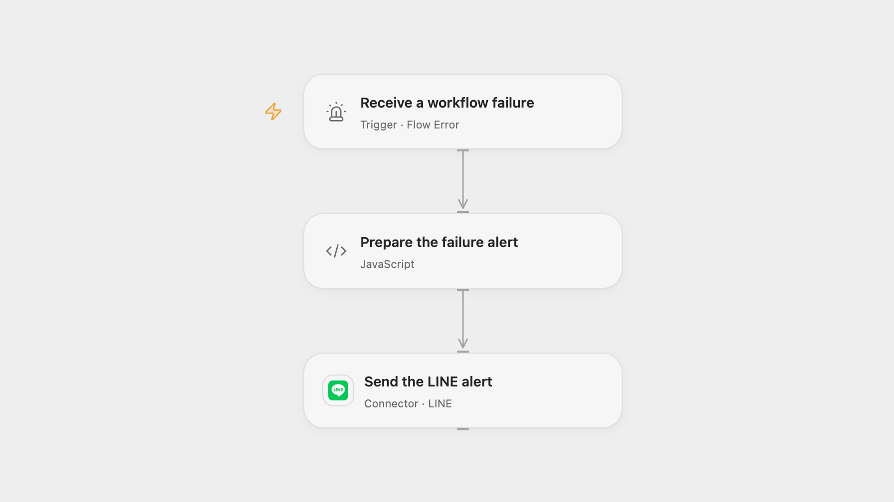

# Send Workflow Failure Alerts to LINE

Send a LINE message when a configured workflow fails.

<picture>
  <source media="(prefers-color-scheme: dark)" srcset="preview-dark.png">
  
</picture>

[Open Flow JSON](templates/send-workflow-failure-alerts-to-line.openflow.json) · [n8n JSON](templates/send-workflow-failure-alerts-to-line.n8n.json)

## Setup

Connect a LINE Messaging API channel with permission to send push messages and set the user, group or room ID in **Send the LINE alert**. The destination must be reachable by that LINE Official Account. In Open Flow, select the published source workflows in **Receive a workflow failure**, then publish and enable this workflow. In n8n configure a Header Auth credential with Authorization set to Bearer followed by the channel access token in **Send the LINE alert**, set the destination ID in **Prepare the failure alert**, enable this workflow, and select it as the error workflow in each source workflow's settings. Enable one format and avoid assigning the error workflow to itself.

## Behavior

An automatic workflow failure sends one LINE message with its workflow name. Open Flow also reports indeterminate runs and includes the run ID; its error event does not supply an execution URL. n8n includes the execution URL when available. An alert over 5,000 characters stops before sending. Restrict access to the LINE conversation and execution history. A successful API response confirms acceptance, not delivery to a recipient who has blocked the account. A failed or uncertain push may already have been accepted; check LINE before retrying.

Inspiration &amp; credits

## Changes to the source

- Replace the private LINE destination and token with setup; Open Flow uses the formal LINE push Action. n8n constructs the JSON object before sending so names and URLs containing quotes remain valid.
- Open Flow reports the run ID available in its error event instead of the n8n execution URL.

Adapted from [n8n Error Report to Line](https://github.com/Zie619/n8n-workflows/blob/ae8cf6dc5b873cbb4f74587aa9180ed3a9f70682/workflows/Error/1849_Error_Stickynote_Automation_Webhook.json) in [Zie619/n8n-workflows](https://github.com/Zie619/n8n-workflows). The matching [n8n community listing](https://n8n.io/workflows/3141-send-n8n-error-reports-to-line/) credits lin. The original template does not state a separate license.

The collection’s [MIT notice](https://github.com/Zie619/n8n-workflows/blob/94007c1445d9258a7da116646b79473e7c7c3282/LICENSE) is pinned at a later revision. This is the collection notice at that revision; it does not establish a separate original template author's license. Our changes are listed above; see [repository licensing](../../README.md#licensing).

> MIT License
>
> Copyright (c) 2025 Zie619
>
> Permission is hereby granted, free of charge, to any person obtaining a copy
> of this software and associated documentation files (the "Software"), to deal
> in the Software without restriction, including without limitation the rights
> to use, copy, modify, merge, publish, distribute, sublicense, and/or sell
> copies of the Software, and to permit persons to whom the Software is
> furnished to do so, subject to the following conditions:
>
> The above copyright notice and this permission notice shall be included in all
> copies or substantial portions of the Software.
>
> THE SOFTWARE IS PROVIDED "AS IS", WITHOUT WARRANTY OF ANY KIND, EXPRESS OR
> IMPLIED, INCLUDING BUT NOT LIMITED TO THE WARRANTIES OF MERCHANTABILITY,
> FITNESS FOR A PARTICULAR PURPOSE AND NONINFRINGEMENT. IN NO EVENT SHALL THE
> AUTHORS OR COPYRIGHT HOLDERS BE LIABLE FOR ANY CLAIM, DAMAGES OR OTHER
> LIABILITY, WHETHER IN AN ACTION OF CONTRACT, TORT OR OTHERWISE, ARISING FROM,
> OUT OF OR IN CONNECTION WITH THE SOFTWARE OR THE USE OR OTHER DEALINGS IN THE
> SOFTWARE.

