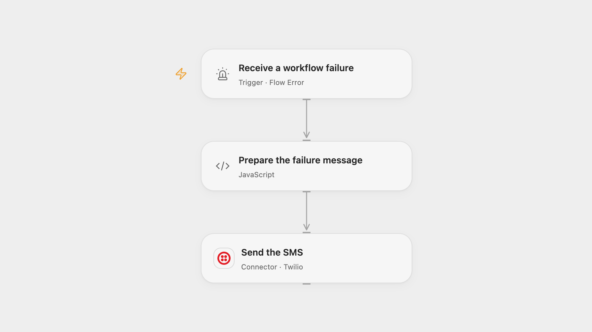

# Send Workflow Failure SMS with Twilio

Send a Twilio SMS identifying a workflow that failed.

<picture>
  <source media="(prefers-color-scheme: dark)" srcset="preview-dark.png">
  
</picture>

[Open Flow JSON](templates/send-workflow-failure-sms-with-twilio.openflow.json) · [n8n JSON](templates/send-workflow-failure-sms-with-twilio.n8n.json)

## Setup

In Open Flow, select the published source workflows in **Receive a workflow failure**, then publish and enable the error workflow. Connect Twilio in **Send the SMS** and set an SMS-capable sender and recipient in E.164 format.

In n8n, connect Twilio, configure the sender and recipient, assign this workflow as the error workflow in each source workflow’s settings, and activate it. Avoid assigning it to itself.

## Behavior

An automatic failure in a configured source workflow sends an SMS containing that workflow’s ID and name. Manual test runs do not represent automatic error dispatch. If a send fails or its outcome is uncertain, check the recipient before retrying; the SMS may already have been delivered.

Inspiration &amp; credits

## Changes to the source

- Configure the empty Twilio sender and recipient and bind the error workflow to its source workflows.

Adapted from [Send an SMS when a workflow fails](https://github.com/Zie619/n8n-workflows/blob/ae8cf6dc5b873cbb4f74587aa9180ed3a9f70682/workflows/Error/1036_Error_Twilio_Send_Triggered.json) in [Zie619/n8n-workflows](https://github.com/Zie619/n8n-workflows). The source export does not identify a separate template author or license.

The collection’s [MIT notice](https://github.com/Zie619/n8n-workflows/blob/94007c1445d9258a7da116646b79473e7c7c3282/LICENSE) is pinned at a later revision. This is the collection notice at that revision; it does not establish a separate original template author's license. Our changes are listed above; see [repository licensing](../../README.md#licensing).

> MIT License
>
> Copyright (c) 2025 Zie619
>
> Permission is hereby granted, free of charge, to any person obtaining a copy
> of this software and associated documentation files (the "Software"), to deal
> in the Software without restriction, including without limitation the rights
> to use, copy, modify, merge, publish, distribute, sublicense, and/or sell
> copies of the Software, and to permit persons to whom the Software is
> furnished to do so, subject to the following conditions:
>
> The above copyright notice and this permission notice shall be included in all
> copies or substantial portions of the Software.
>
> THE SOFTWARE IS PROVIDED "AS IS", WITHOUT WARRANTY OF ANY KIND, EXPRESS OR
> IMPLIED, INCLUDING BUT NOT LIMITED TO THE WARRANTIES OF MERCHANTABILITY,
> FITNESS FOR A PARTICULAR PURPOSE AND NONINFRINGEMENT. IN NO EVENT SHALL THE
> AUTHORS OR COPYRIGHT HOLDERS BE LIABLE FOR ANY CLAIM, DAMAGES OR OTHER
> LIABILITY, WHETHER IN AN ACTION OF CONTRACT, TORT OR OTHERWISE, ARISING FROM,
> OUT OF OR IN CONNECTION WITH THE SOFTWARE OR THE USE OR OTHER DEALINGS IN THE
> SOFTWARE.

