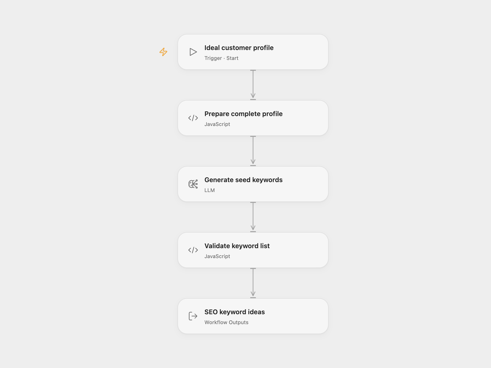

# SEO Seed Keywords

Generate 15–20 seed keywords for a B2B software product using its ideal customer profile. The result is a list of lowercase keyword ideas for SEO planning.

<picture>
  <source media="(prefers-color-scheme: dark)" srcset="preview-dark.png">
  
</picture>

[Open Flow JSON](templates/seo-seed-keywords.openflow.json) · [n8n JSON](templates/seo-seed-keywords.n8n.json)

## Setup and use

For Open Flow, select a configured `claude-sonnet-4-6` model in **Generate seed keywords**. Use Run and supply the five profile fields:

```json
{
  "product": "Workflow automation software for small service teams",
  "pain_points": "Manual handoffs and repeated data entry",
  "goals": "Reduce admin work and improve response times",
  "current_solutions": "Spreadsheets and email",
  "expertise_level": "Business users with limited coding experience"
}
```

For n8n, edit those fields in **Set Ideal Customer Profile (ICP)** and connect the attached **Anthropic Chat Model**. The template selects `claude-sonnet-4-6` with a 4,096-token generation budget. Another available model can be selected in both formats; the keyword ideas may differ.

Each successful run has one generation step and returns `keywords`. n8n’s model adapter can retry transient request failures with backoff; it does not repeat the whole workflow. Invalid JSON, a list outside 15–20 items, or empty keywords stops the run. The workflow trims and lowercases each keyword. It does not browse, fetch search volume or competition data, write to a database, or publish content. Keyword intent and relevance are model judgments; review them and use your SEO data before prioritizing.

## Changes to the source

- Give the model all five customer-profile fields; the source prompt included only the product.
- Replace the tool-less Agent with a Basic LLM Chain and parse its actual text output before reading keyword items.
- Return a validated keyword list instead of relying on a missing object field and a placeholder database node.
- Use an available model instead of the source node’s retired default, and remove historical per-run price estimates.

## Source and license

Adapted from [Generate SEO Seed Keywords Using AI](https://github.com/enescingoz/awesome-n8n-templates/blob/827110332c21cbe000ab13f6d292d5adb1f1f8db/AI_Research_RAG_and_Data_Analysis/Generate%20SEO%20Seed%20Keywords%20Using%20AI.json) in [enescingoz/awesome-n8n-templates](https://github.com/enescingoz/awesome-n8n-templates).

Source collection notice: © 2024–2026 Enes Cingoz, [CC BY 4.0](https://github.com/enescingoz/awesome-n8n-templates/blob/827110332c21cbe000ab13f6d292d5adb1f1f8db/LICENSE). The source export does not identify a separate template author or license. See [repository licensing](../../README.md#licensing) for the scope of OOMOL contributions and third-party material.
