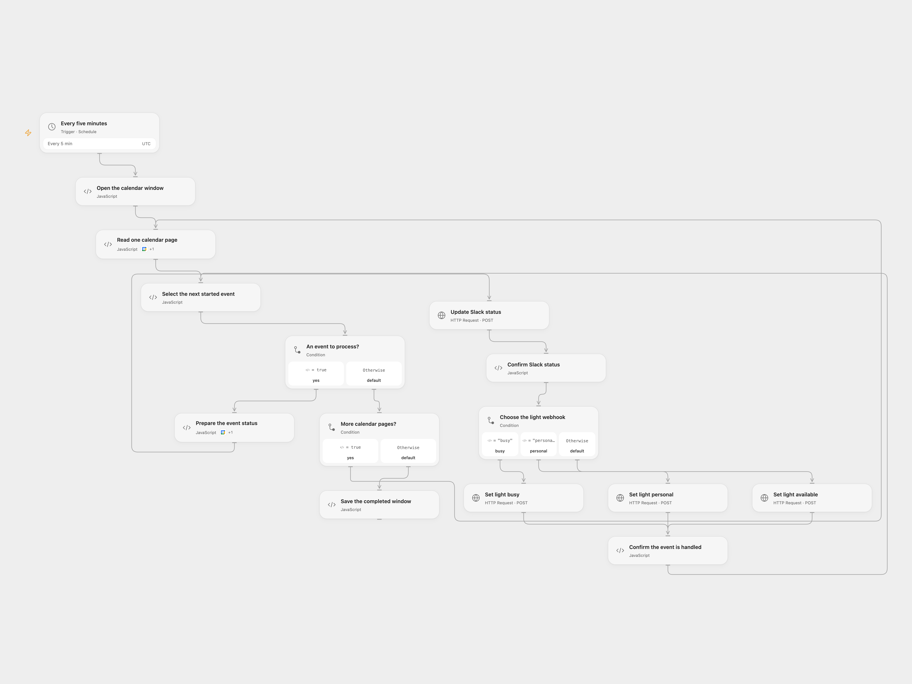

# Set Slack Status and Light from Calendar Starts

Update Slack status and a light webhook when a Google Calendar event starts.

<picture>
  <source media="(prefers-color-scheme: dark)" srcset="preview-dark.png">
  
</picture>

[Open Flow JSON](templates/set-slack-status-and-light-from-calendar-starts.openflow.json) · [n8n JSON](templates/set-slack-status-and-light-from-calendar-starts.n8n.json)

## Setup

Connect Google Calendar and set its calendar ID in **Open the calendar window**. Bind a Slack user token with users.profile:write as a secret Variable to **Update Slack status**. Configure the three light webhook URLs in their HTTP nodes. In n8n connect Google Calendar and Slack, set the calendar and all three light webhook URLs. Activate one format and prevent overlapping Open Flow runs.

## Behavior

Every five minutes, check for events that started since the previous poll. The event title becomes the Slack status and its calendar color selects the busy, personal or available light. Open Flow processes events sequentially, updates Slack before calling the light, and saves the window after all events succeed. The first Open Flow poll initializes its checkpoint when that poll runs; events that started between activation and that first poll are not backfilled.

If an event fails or a write outcome is unknown, Open Flow stops future processing with that event pending. Inspect Slack and the light, finish any missing change manually, then set **Open the calendar window → acknowledgeEventId** to that event's ID to continue. No uncertain write is automatically replayed.

Inspiration &amp; credits

## Changes to the source

- Open Flow uses a scheduled Calendar scan and a separately supplied Slack user token because the managed trigger reports changes rather than starts and the managed Slack authorization lacks profile-write scope. The source's n8n Calendar and Slack nodes remain. Open Flow uses a completion checkpoint and requires acknowledgement after an uncertain event.

Adapted from [Set Slack status and a light from calendar events](https://github.com/Zie619/n8n-workflows/blob/ae8cf6dc5b873cbb4f74587aa9180ed3a9f70682/workflows/Manual/0078_Manual_Slack_Monitor_Webhook.json) in [Zie619/n8n-workflows](https://github.com/Zie619/n8n-workflows). The source export does not identify a separate template author or license.

The collection’s [MIT notice](https://github.com/Zie619/n8n-workflows/blob/94007c1445d9258a7da116646b79473e7c7c3282/LICENSE) is pinned at a later revision. This is the collection notice at that revision; it does not establish a separate original template author's license. Our changes are listed above; see [repository licensing](../../README.md#licensing).

> MIT License
>
> Copyright (c) 2025 Zie619
>
> Permission is hereby granted, free of charge, to any person obtaining a copy
> of this software and associated documentation files (the "Software"), to deal
> in the Software without restriction, including without limitation the rights
> to use, copy, modify, merge, publish, distribute, sublicense, and/or sell
> copies of the Software, and to permit persons to whom the Software is
> furnished to do so, subject to the following conditions:
>
> The above copyright notice and this permission notice shall be included in all
> copies or substantial portions of the Software.
>
> THE SOFTWARE IS PROVIDED "AS IS", WITHOUT WARRANTY OF ANY KIND, EXPRESS OR
> IMPLIED, INCLUDING BUT NOT LIMITED TO THE WARRANTIES OF MERCHANTABILITY,
> FITNESS FOR A PARTICULAR PURPOSE AND NONINFRINGEMENT. IN NO EVENT SHALL THE
> AUTHORS OR COPYRIGHT HOLDERS BE LIABLE FOR ANY CLAIM, DAMAGES OR OTHER
> LIABILITY, WHETHER IN AN ACTION OF CONTRACT, TORT OR OTHERWISE, ARISING FROM,
> OUT OF OR IN CONNECTION WITH THE SOFTWARE OR THE USE OR OTHER DEALINGS IN THE
> SOFTWARE.

