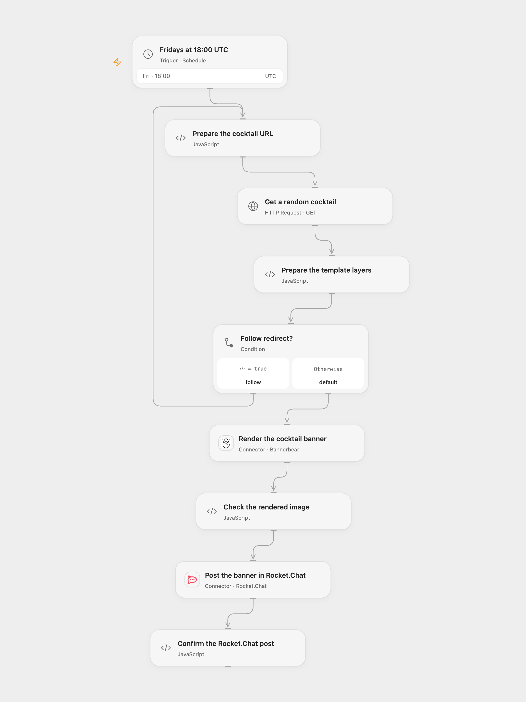

# Share a Cocktail Banner in Rocket.Chat

Render a random cocktail recipe as an image and share it in Rocket.Chat every Friday.

<picture>
  <source media="(prefers-color-scheme: dark)" srcset="preview-dark.png">
  
</picture>

[Open Flow JSON](templates/share-cocktail-banner-in-rocket-chat.openflow.json) · [n8n JSON](templates/share-cocktail-banner-in-rocket-chat.n8n.json)

## Setup

Connect Bannerbear in **Render the cocktail banner** and select your template ID. The template needs an image layer named `cocktail-image` and text layers named `title` and `recipe`. Connect Rocket.Chat in **Post the banner in Rocket.Chat** and enter a room ID, `#channel` or `@username` that the connected user can post to.

The CocktailDB URL uses public test key `1`, intended for development and education. Review [CocktailDB API access](https://www.thecocktaildb.com/api.php) for your use and change the key in **Prepare the cocktail URL** or the n8n **HTTP Request** node if needed. In n8n, configure Bannerbear and Rocket.Chat credentials, template ID and channel, then activate one format.

## Behavior

At 18:00 each Friday, the workflow requests one random cocktail, fills its image, name and instructions into the template, and posts the rendered image as a Rocket.Chat attachment. The schedule starts in UTC; change the timezone for your local Friday evening. The source used the n8n instance timezone. n8n Cron V1 chooses a fixed randomized second within the minute; Open Flow uses the minute boundary.

Missing recipe fields, an invalid image URL, request failure or incomplete image stops the run before posting. Open Flow uses Bannerbear's synchronous endpoint, which can time out after 10 seconds; n8n creates asynchronously and checks up to three times. A timed-out or uncertain image request may already have created an image. A failed or uncertain Rocket.Chat post may already have arrived. Check the services before replaying; no automatic retry or rollback is configured. The HTTP step follows up to 21 redirects with a 30-second timeout per request; Open Flow limits each response to 4 MiB.

Inspiration &amp; credits

## Changes to the source

- Configure the template and room without private credentials; validate cocktail fields and the completed image before posting, then check the post result.
- Use a UTC starting schedule and Bannerbear's synchronous Action in Open Flow.

Adapted from [Cocktail Recipe Sharing](https://github.com/Zie619/n8n-workflows/blob/ae8cf6dc5b873cbb4f74587aa9180ed3a9f70682/workflows/Http/0964_HTTP_Bannerbear_Automation_Scheduled.json) in [Zie619/n8n-workflows](https://github.com/Zie619/n8n-workflows). The matching [n8n community listing](https://n8n.io/workflows/365-render-custom-text-over-images/) credits tanaypant. The original template does not state a separate license.

The collection’s [MIT notice](https://github.com/Zie619/n8n-workflows/blob/94007c1445d9258a7da116646b79473e7c7c3282/LICENSE) is pinned at a later revision. This is the collection notice at that revision; it does not establish a separate original template author's license. Our changes are listed above; see [repository licensing](../../README.md#licensing).

> MIT License
>
> Copyright (c) 2025 Zie619
>
> Permission is hereby granted, free of charge, to any person obtaining a copy
> of this software and associated documentation files (the "Software"), to deal
> in the Software without restriction, including without limitation the rights
> to use, copy, modify, merge, publish, distribute, sublicense, and/or sell
> copies of the Software, and to permit persons to whom the Software is
> furnished to do so, subject to the following conditions:
>
> The above copyright notice and this permission notice shall be included in all
> copies or substantial portions of the Software.
>
> THE SOFTWARE IS PROVIDED "AS IS", WITHOUT WARRANTY OF ANY KIND, EXPRESS OR
> IMPLIED, INCLUDING BUT NOT LIMITED TO THE WARRANTIES OF MERCHANTABILITY,
> FITNESS FOR A PARTICULAR PURPOSE AND NONINFRINGEMENT. IN NO EVENT SHALL THE
> AUTHORS OR COPYRIGHT HOLDERS BE LIABLE FOR ANY CLAIM, DAMAGES OR OTHER
> LIABILITY, WHETHER IN AN ACTION OF CONTRACT, TORT OR OTHERWISE, ARISING FROM,
> OUT OF OR IN CONNECTION WITH THE SOFTWARE OR THE USE OR OTHER DEALINGS IN THE
> SOFTWARE.

