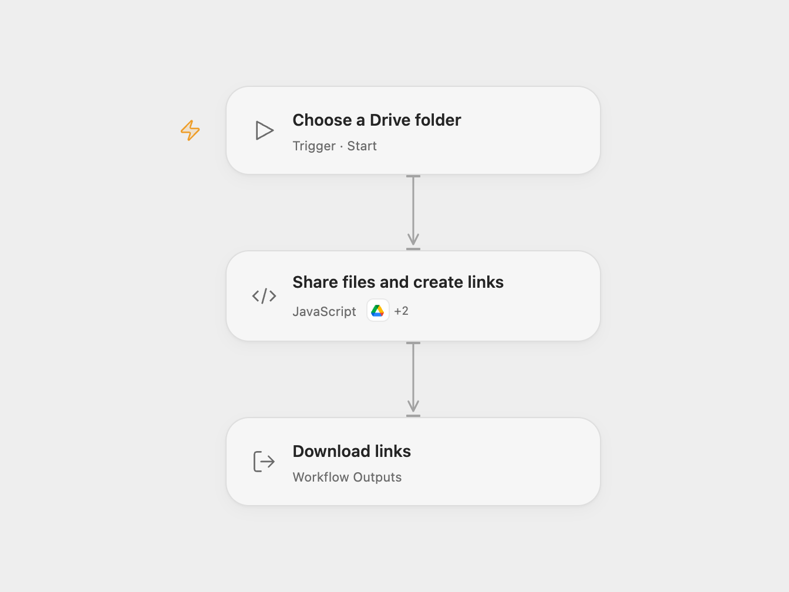

# Share Drive Folder Files and Create Download Links

Grant public reader access to files in a Google Drive folder and create download links.

<picture>
  <source media="(prefers-color-scheme: dark)" srcset="preview-dark.png">
  
</picture>

[Open Flow JSON](templates/share-drive-folder-files-and-create-download-links.openflow.json) · [n8n JSON](templates/share-drive-folder-files-and-create-download-links.n8n.json)

## Setup

Connect Google Drive with permission to list and share the files. In Open Flow allow both declared Drive actions and run with the folder ID. In n8n set the folder ID in **Set Folder ID**, select Google Drive credentials on both Drive nodes, and run manually.

## Behavior

The workflow lists up to 100 items directly in the folder, ordered by modification time, grants each anyone-with-the-link reader access, and returns its name and download link. This makes the items publicly accessible to anyone with the link. Check the contents and your sharing policy before running. Open Flow follows additional pages when a page contains fewer than 100 items; n8n uses the source’s single page. Google Drive and organization restrictions can prevent sharing or downloading; Google Workspace files and folders may not support direct download through these links.

If sharing fails or a response is unknown, earlier permissions remain. Inspect Drive permissions before rerunning. There is no automatic write retry.

Inspiration &amp; credits

## Changes to the source

- Require a folder ID and remove the original account-specific download URL parameters.
- Confirm each permission before including its download link.

Adapted from [Create download links for Drive folder files](https://github.com/Zie619/n8n-workflows/blob/ae8cf6dc5b873cbb4f74587aa9180ed3a9f70682/workflows/Code/0380_Code_Manual_Create_Triggered.json) in [Zie619/n8n-workflows](https://github.com/Zie619/n8n-workflows). The source export does not identify a separate template author or license.

The collection’s [MIT notice](https://github.com/Zie619/n8n-workflows/blob/94007c1445d9258a7da116646b79473e7c7c3282/LICENSE) is pinned at a later revision. This is the collection notice at that revision; it does not establish a separate original template author's license. Our changes are listed above; see [repository licensing](../../README.md#licensing).

> MIT License
>
> Copyright (c) 2025 Zie619
>
> Permission is hereby granted, free of charge, to any person obtaining a copy
> of this software and associated documentation files (the "Software"), to deal
> in the Software without restriction, including without limitation the rights
> to use, copy, modify, merge, publish, distribute, sublicense, and/or sell
> copies of the Software, and to permit persons to whom the Software is
> furnished to do so, subject to the following conditions:
>
> The above copyright notice and this permission notice shall be included in all
> copies or substantial portions of the Software.
>
> THE SOFTWARE IS PROVIDED "AS IS", WITHOUT WARRANTY OF ANY KIND, EXPRESS OR
> IMPLIED, INCLUDING BUT NOT LIMITED TO THE WARRANTIES OF MERCHANTABILITY,
> FITNESS FOR A PARTICULAR PURPOSE AND NONINFRINGEMENT. IN NO EVENT SHALL THE
> AUTHORS OR COPYRIGHT HOLDERS BE LIABLE FOR ANY CLAIM, DAMAGES OR OTHER
> LIABILITY, WHETHER IN AN ACTION OF CONTRACT, TORT OR OTHERWISE, ARISING FROM,
> OUT OF OR IN CONNECTION WITH THE SOFTWARE OR THE USE OR OTHER DEALINGS IN THE
> SOFTWARE.

