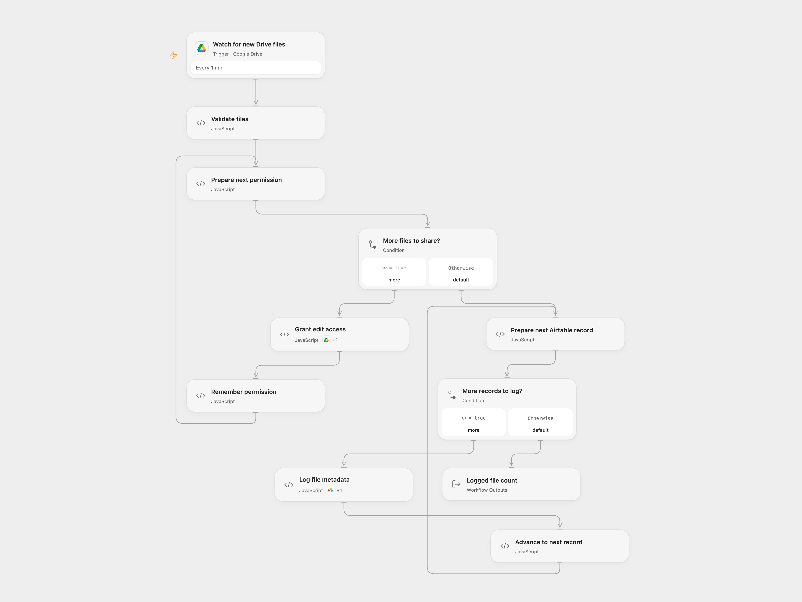

# Share New Drive Files and Log to Airtable

Grant a recipient edit access to new files in a Drive folder and log each permission in Airtable.

<picture>
  <source media="(prefers-color-scheme: dark)" srcset="preview-dark.png">
  
</picture>

[Open Flow JSON](templates/share-new-drive-files-and-log-to-airtable.openflow.json) · [n8n JSON](templates/share-new-drive-files-and-log-to-airtable.n8n.json)

## Setup

Select a Google Drive connection with access to the folder in **Watch for new Drive files** and a connection with permission to share its files in **Grant edit access**. Set the folder ID in **Watch for new Drive files**. Set the recipient email, Airtable base ID and table name in **Validate files**. Allow the declared Drive Action in **Grant edit access**. Connect Airtable in **Log file metadata** and allow its declared Action; The table needs fields named `FileId`, `sentId`, `FileName`, `CreatedTime` and `ModifiedTime`; the last two hold date-time values. In n8n, set the folder in **Google Drive**, recipient and Airtable base and table IDs in **Validate files**, and select Google Drive and Airtable credentials.

## Behavior

Every minute the workflow checks for files created directly in the selected folder. For each event batch it grants the configured user writer access to every file in the batch, then creates one Airtable record per file with its ID, name, creation and modification times, and `sentId`, which is the Drive permission ID. Google Drive normally sends the recipient a sharing notification. This changes file access and can notify the recipient; confirm the recipient and sharing policy before enabling.

Open Flow processes up to 50 file candidates per page and uses a continuation checkpoint; n8n collects all native result pages in a poll. With more than 50 files, Open Flow can log one page before sharing the next, while n8n processes its collected batch together. On first activation Open Flow starts from the current time rather than importing older files. Open Flow and n8n use different polling checkpoints and neither guarantees exactly-once handling. Events whose run fails may not automatically replay. Inspect Drive permissions and Airtable before retrying; repeated runs can create duplicate records. Earlier permission changes and records are not rolled back if a later operation fails. A lost response can leave a permission or record created even if the run reports failure. No automatic write retry is configured. Avoid concurrent permission changes on the same file.

## Changes to the source

- Replace the empty folder, Airtable identifiers and example recipient with configuration. Validate files and confirm write IDs.

Source and license

Adapted from [Sync new files from Google Drive with Airtable](https://github.com/Zie619/n8n-workflows/blob/ae8cf6dc5b873cbb4f74587aa9180ed3a9f70682/workflows/Stickynote/1987_Stickynote_Airtable_Create_Triggered.json) in [Zie619/n8n-workflows](https://github.com/Zie619/n8n-workflows). The matching [n8n community listing](https://n8n.io/workflows/2776-sync-new-files-from-google-drive-with-airtable/) credits WeblineIndia. The original template does not state a separate license.

The collection’s [MIT notice](https://github.com/Zie619/n8n-workflows/blob/94007c1445d9258a7da116646b79473e7c7c3282/LICENSE) is pinned at a later revision. This is the collection notice at that revision; it does not establish a separate original template author's license. Our changes are listed above; see [repository licensing](../../README.md#licensing).

> MIT License
>
> Copyright (c) 2025 Zie619
>
> Permission is hereby granted, free of charge, to any person obtaining a copy
> of this software and associated documentation files (the "Software"), to deal
> in the Software without restriction, including without limitation the rights
> to use, copy, modify, merge, publish, distribute, sublicense, and/or sell
> copies of the Software, and to permit persons to whom the Software is
> furnished to do so, subject to the following conditions:
>
> The above copyright notice and this permission notice shall be included in all
> copies or substantial portions of the Software.
>
> THE SOFTWARE IS PROVIDED "AS IS", WITHOUT WARRANTY OF ANY KIND, EXPRESS OR
> IMPLIED, INCLUDING BUT NOT LIMITED TO THE WARRANTIES OF MERCHANTABILITY,
> FITNESS FOR A PARTICULAR PURPOSE AND NONINFRINGEMENT. IN NO EVENT SHALL THE
> AUTHORS OR COPYRIGHT HOLDERS BE LIABLE FOR ANY CLAIM, DAMAGES OR OTHER
> LIABILITY, WHETHER IN AN ACTION OF CONTRACT, TORT OR OTHERWISE, ARISING FROM,
> OUT OF OR IN CONNECTION WITH THE SOFTWARE OR THE USE OR OTHER DEALINGS IN THE
> SOFTWARE.

