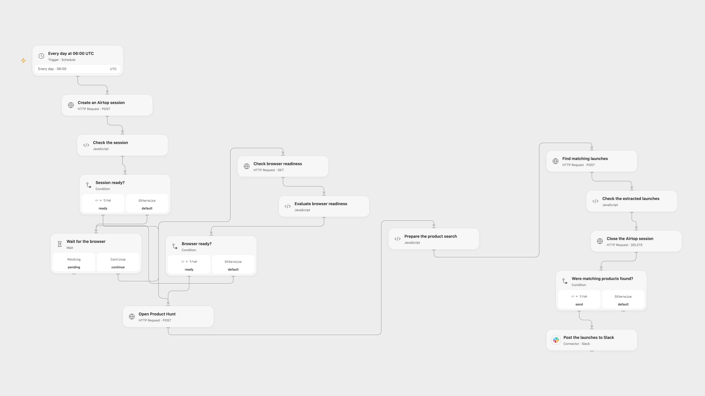

# Share Product Hunt Matches to Slack

Find Product Hunt launches relevant to a topic and share the results with a Slack channel.

<picture>
  <source media="(prefers-color-scheme: dark)" srcset="preview-dark.png">
  
</picture>

[Open Flow JSON](templates/share-product-hunt-matches-to-slack.openflow.json) · [n8n JSON](templates/share-product-hunt-matches-to-slack.n8n.json)

## Setup

Create an Airtop API key and connect Slack. In Open Flow, create a secret Variable named AIRTOP_API_KEY with the key, set the topic in **Prepare the product search**, and select a Slack channel in **Post the launches to Slack**. In n8n, connect Airtop and Slack, set the topic in **Define relevant products**, and select a Slack channel. Activate one format.

## Behavior

Every day at 06:00 UTC, Airtop opens Product Hunt and extracts up to five launches matching the topic. A result containing [NA] produces no Slack message; otherwise the returned text is posted. Open Flow runs on the minute boundary; n8n uses a fixed second within that minute. Results are AI-generated and should be checked before use.

Open Flow checks readiness up to 60 times, five seconds apart, then closes its session after a successful query before posting. If an earlier request fails, the session can remain until Airtop's idle timeout. An unknown request outcome may have created a session or sent a message; inspect the service before retrying. There is no automatic deduplication or replay.

## Changes to the source

- Replace the private Slack channel and use UTC instead of the source instance timezone. Open Flow uses the published Airtop session, window and page-query HTTP APIs because no Airtop Provider or Action was available in the checked catalog.
- Open Flow closes a completed session before posting; the original n8n node relies on its session setting.

Source and license

Adapted from [Automate product Hunt discovery with Airtop and Slack](https://github.com/Zie619/n8n-workflows/blob/ae8cf6dc5b873cbb4f74587aa9180ed3a9f70682/workflows/Schedule/1859_Schedule_Slack_Monitor_Scheduled.json) in [Zie619/n8n-workflows](https://github.com/Zie619/n8n-workflows). The matching [n8n listing](https://n8n.io/workflows/3481-automate-product-hunt-discovery-with-airtop-and-slack/) credits Airtop. No separate original template license was found.

The collection’s [MIT notice](https://github.com/Zie619/n8n-workflows/blob/94007c1445d9258a7da116646b79473e7c7c3282/LICENSE) is pinned at a later revision. This is the collection notice at that revision; it does not establish a separate original template author's license. Our changes are listed above; see [repository licensing](../../README.md#licensing).

> MIT License
>
> Copyright (c) 2025 Zie619
>
> Permission is hereby granted, free of charge, to any person obtaining a copy
> of this software and associated documentation files (the "Software"), to deal
> in the Software without restriction, including without limitation the rights
> to use, copy, modify, merge, publish, distribute, sublicense, and/or sell
> copies of the Software, and to permit persons to whom the Software is
> furnished to do so, subject to the following conditions:
>
> The above copyright notice and this permission notice shall be included in all
> copies or substantial portions of the Software.
>
> THE SOFTWARE IS PROVIDED "AS IS", WITHOUT WARRANTY OF ANY KIND, EXPRESS OR
> IMPLIED, INCLUDING BUT NOT LIMITED TO THE WARRANTIES OF MERCHANTABILITY,
> FITNESS FOR A PARTICULAR PURPOSE AND NONINFRINGEMENT. IN NO EVENT SHALL THE
> AUTHORS OR COPYRIGHT HOLDERS BE LIABLE FOR ANY CLAIM, DAMAGES OR OTHER
> LIABILITY, WHETHER IN AN ACTION OF CONTRACT, TORT OR OTHERWISE, ARISING FROM,
> OUT OF OR IN CONNECTION WITH THE SOFTWARE OR THE USE OR OTHER DEALINGS IN THE
> SOFTWARE.

