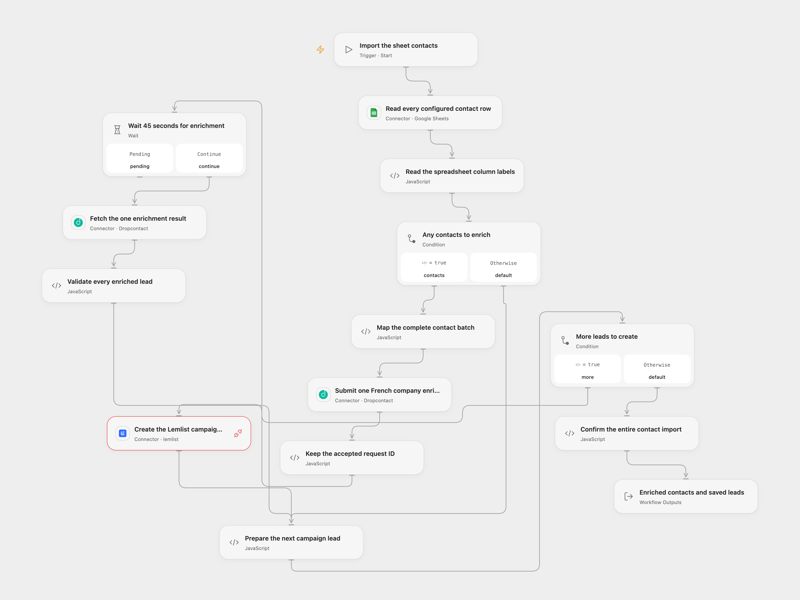

# Sheet Contacts through Dropcontact to Lemlist

Read a contact range, enrich its complete batch with Dropcontact, then create the resulting leads in one Lemlist campaign.

<picture>
  <source media="(prefers-color-scheme: dark)" srcset="preview-dark.png">
  
</picture>

[Open Flow JSON](templates/sheet-contacts-dropcontact-lemlist.openflow.json) · [n8n JSON](templates/sheet-contacts-dropcontact-lemlist.n8n.json)

## Setup

Connect Google Sheets in **Read every configured contact row**, set the spreadsheet ID and range. The source uses `A:K`; the first row contains column labels and data starts on the next row. Use the exact labels `email`, `firstName`, `lastName`, `fullName`, `companyName`, `website` and `LinkedIn` for the fields you supply. Only those seven fields are submitted for enrichment. A contact needs an email, a LinkedIn identifier, or a name plus company/website. Other sheet columns are not sent. The complete range must contain at most 250 contact rows, the current API’s single-batch limit; oversized ranges fail before submission without truncation.

Connect Dropcontact in both enrichment nodes. **SIREN** remains enabled, requesting French company information. Leave **Language** unset in Open Flow: its current Action accepts only explicit English, while the vendor’s [documented API default](https://developer.dropcontact.com/en/reference/enrich-a-batch-of-records/) for an omitted language is French, matching this source. The actual workflow uses that standard omitted-field path and sends no `language` value. In n8n, keep the explicit **French** option.

Connect Lemlist in **Create the Lemlist campaign lead**, with permission for **Provider API Request**. Set the campaign ID in **Validate every enriched lead**. The API key’s user needs permission to create leads and, when necessary, contacts and companies. This workflow does not create a campaign. Check its settings before importing; an active outreach campaign may act on enrolled leads.

In n8n, select **Google Sheets OAuth2 API**, **Dropcontact API** and **Lemlist API** credentials. Set the spreadsheet ID/range in its read node and the campaign ID at the end of **Validate every enriched lead**. Keep Dropcontact contact/enrich, non-simplified output, French company enrich, French language and a 45-second wait. The Lemlist node’s campaign/email expressions consume the validated plan; do not replace them with a separate list or lookup operation. Activate one format for this import.

## Behavior

Run the manual entry once. An empty range or header-only table completes without enrichment or lead creation. Each populated contact row is retained; invalid rows stop before submission. Open Flow’s Dropcontact Action trims contact-field whitespace according to its contract. It submits the entire batch once with French company enrichment, waits 45 seconds, and fetches the same request ID once. It does not poll indefinitely or resubmit a pending request. If processing is still pending or failed, no leads are created. Check that request in Dropcontact before starting another import.

The complete result must contain one usable enriched record per submitted row. Each record uses its first `email[0].email`, as the source does, with no additional qualification/confidence filter. Missing first emails or incomplete/malformed batches fail before any lead is created. The first name, last name and company returned by Dropcontact are sent to Lemlist; all enriched fields remain available in the result.

Leads are created sequentially through Lemlist’s [create endpoint](https://developer.lemlist.com/api-reference/endpoints/leads/create-lead-in-campaign), preserving the complete API receipts. A successful run returns all **Leads**, **Enriched** records, the original **Submission** response and **Count**. n8n keeps its full native lead responses and enriched records in the preceding node. Re-importing an existing campaign lead is a create error, not an update operation. The API can update the underlying matching contact/company with submitted values even though the campaign lead itself is new.

A read/enrichment failure stops before lead creation. A failed or uncertain creation stops later leads; earlier contacts/companies/leads may already have changed. No rollback, workflow retry or cross-run import history is added. Check the campaign and enrichment request before replaying. The complete table, enrichment records, plans and accumulated receipts must fit the inspected Open Flow Code host’s 1 MiB input/result budgets; oversized data fails without truncation. Wait storage and automatic continuation must remain available across the 45-second pause.

## Changes to the source

- Restore the complete sheet → French company enrichment → Lemlist campaign-lead import and replace private account settings with setup.
- Make the original read, raw field mapping, single 45-second wait and one result fetch explicit.
- Use current formal Google/Dropcontact Actions and a managed Lemlist Provider API request, preserving French through the documented API default.
- Validate the complete batch before creating leads, encode campaign/email path segments and confirm every created lead without retrying uncertain writes.

Source and license

Adapted from [Spreadsheet contact enrichment and Lemlist campaign import](https://github.com/Zie619/n8n-workflows/blob/ae8cf6dc5b873cbb4f74587aa9180ed3a9f70682/workflows/Manual/0120_Manual_GoogleSheets_Automate_Triggered.json) in [Zie619/n8n-workflows](https://github.com/Zie619/n8n-workflows). The source export does not identify a separate template author or license.

The collection’s [MIT notice](https://github.com/Zie619/n8n-workflows/blob/94007c1445d9258a7da116646b79473e7c7c3282/LICENSE) is pinned at a later revision. This is the collection notice at that revision; it does not establish a separate original template author's license. Our changes are listed above; see [repository licensing](../../README.md#licensing).

> MIT License
>
> Copyright (c) 2025 Zie619
>
> Permission is hereby granted, free of charge, to any person obtaining a copy
> of this software and associated documentation files (the "Software"), to deal
> in the Software without restriction, including without limitation the rights
> to use, copy, modify, merge, publish, distribute, sublicense, and/or sell
> copies of the Software, and to permit persons to whom the Software is
> furnished to do so, subject to the following conditions:
>
> The above copyright notice and this permission notice shall be included in all
> copies or substantial portions of the Software.
>
> THE SOFTWARE IS PROVIDED "AS IS", WITHOUT WARRANTY OF ANY KIND, EXPRESS OR
> IMPLIED, INCLUDING BUT NOT LIMITED TO THE WARRANTIES OF MERCHANTABILITY,
> FITNESS FOR A PARTICULAR PURPOSE AND NONINFRINGEMENT. IN NO EVENT SHALL THE
> AUTHORS OR COPYRIGHT HOLDERS BE LIABLE FOR ANY CLAIM, DAMAGES OR OTHER
> LIABILITY, WHETHER IN AN ACTION OF CONTRACT, TORT OR OTHERWISE, ARISING FROM,
> OUT OF OR IN CONNECTION WITH THE SOFTWARE OR THE USE OR OTHER DEALINGS IN THE
> SOFTWARE.

