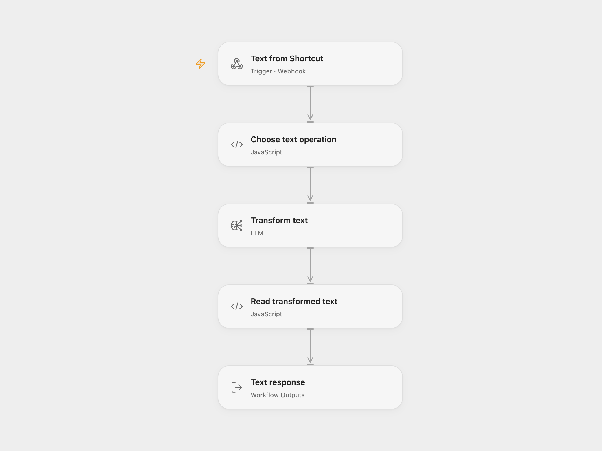

# Shortcut Text Transformer

Send selected text from an Apple Shortcut to translate it into English or Spanish, correct its grammar, or ask for a slightly shorter or longer version. The webhook returns the transformed text.

<picture>
  <source media="(prefers-color-scheme: dark)" srcset="preview-dark.png">
  
</picture>

[Open Flow JSON](templates/shortcut-text-transformer.openflow.json) · [n8n JSON](templates/shortcut-text-transformer.n8n.json)

## Setup

Import the JSON. In Open Flow, select a configured `gpt-4o-mini` model in **Transform text**. In n8n, select your OpenAI credential on each of the five OpenAI nodes. Publish and enable the configured workflow and copy its production webhook URL.

Create an Apple Shortcut that receives text from the share sheet or clipboard. Add **Get Contents of URL**, set the URL to the webhook, choose **POST**, and set its request body to JSON with `type` and `content`. Pass the selected text as `content`. Show or copy the response using the Shortcut's normal text actions.

| `type` | Requested edit |
| --- | --- |
| `spanish` | Translate into Spanish. |
| `english` | Translate into English. |
| `grammar` | Correct grammar while retaining the content. |
| `shorter` | Make the text about 5% shorter. |
| `longer` | Make the text about 5% longer. |

Any JSON HTTP client can make the same request:

```json
{
  "type": "grammar",
  "content": "We was ready for the meeting."
}
```

Each valid request makes one model call. A successful response is HTTP 200 with a plain-text body. Letter case matters for `type`; missing or empty text and unknown operations fail before the model runs. An empty or incorrectly shaped model result also fails. Error status and body follow the hosting platform's error handling. No automatic retry is configured.

The length requests are prompts, so the result may differ from 5%. Review wording before replacing your original text. Open Flow waits up to 60 seconds for the response; an HTTP timeout does not cancel an already running model call. Submitted text is sent to your configured model provider.

## Changes to the source

- Validate requests before routing so unknown operations do not disappear into an unconnected switch branch.
- Check that the model returns a nonempty `output` string.
- Return plain text and retain its line breaks without inserting HTML.
- In Open Flow, select a prompt before one shared model node. n8n retains the five prompt branches. Both use the source prompts and `gpt-4o-mini`.
- Describe the Shortcut setup directly rather than depending on a third-party Shortcut download.

## Source and license

Adapted from [Text automations using Apple Shortcuts](https://github.com/enescingoz/awesome-n8n-templates/blob/827110332c21cbe000ab13f6d292d5adb1f1f8db/Other_Integrations_and_Use_Cases/Text%20automations%20using%20Apple%20Shortcuts.json) in [enescingoz/awesome-n8n-templates](https://github.com/enescingoz/awesome-n8n-templates).

Source collection notice: © 2024–2026 Enes Cingoz, [CC BY 4.0](https://github.com/enescingoz/awesome-n8n-templates/blob/827110332c21cbe000ab13f6d292d5adb1f1f8db/LICENSE). The source export does not identify a separate template author or license. This adaptation includes the changes listed above; see [repository licensing](../../README.md#licensing) for the scope of OOMOL contributions and third-party material.
