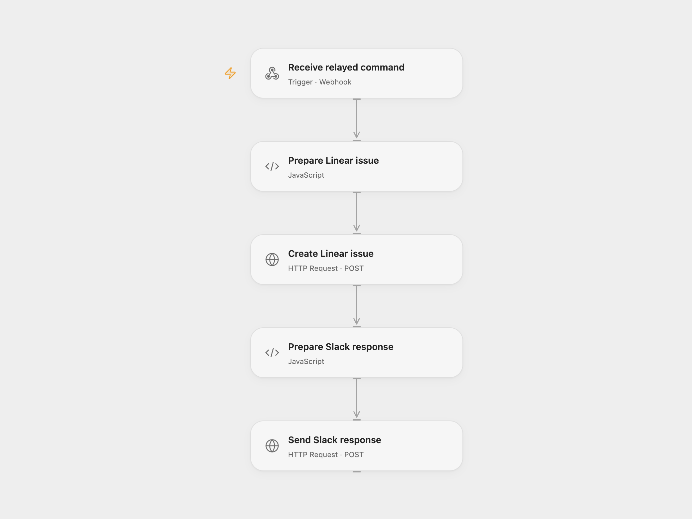

# Create Linear Bugs from Slack Commands

Create a Linear bug from a Slack slash command and reply with its issue link.

<picture>
  <source media="(prefers-color-scheme: dark)" srcset="preview-dark.png">
  
</picture>

[Open Flow JSON](templates/slack-bug-command-to-linear.openflow.json) · [n8n JSON](templates/slack-bug-command-to-linear.n8n.json)

## Setup and use

Create a Slack slash command and point it to the n8n webhook URL. Import the n8n workflow and set teamId and labelIds in **Set me up**. Set executionMode to n8n to process there, or openflow to forward the complete Slack form payload to Open Flow. In n8n connect Linear OAuth. In Open Flow set the relay URL in **Forward to Open Flow**, set the Linear team and label IDs in **Prepare Linear issue**, and bind the Linear Authorization header value as the secret Variable LINEAR_AUTHORIZATION. For an OAuth token include the Bearer prefix; for a personal API key use the key as the header value. Activate the n8n webhook and choose one mode.

## Behavior

n8n accepts the slash command and acknowledges it before executing the selected branch. The Open Flow mode relays the entire form payload as JSON inside event. The selected workflow creates a Linear issue with the submitted title, configured team and labels, a bug-report description and creator name, then sends the created issue URL to the original Slack response URL. The n8n webhook and Open Flow relay do not verify the sender; restrict access to both endpoints. Slack response URLs and event data may appear in execution history. Slack has deprecated user_name; the creator text depends on that field. An uncertain issue creation or Slack response requires checking Linear and the conversation before retrying; another run can create a duplicate issue. Slack acknowledgment must arrive within three seconds; network and server latency affect this.

Inspiration &amp; credits

## Changes to the source

- Add an n8n mode selector and complete-event relay for Open Flow. Replace fixed Linear team and label IDs with configuration, and pass the title safely as a GraphQL variable, and stop if Linear returns an error or no issue URL.

Adapted from [Create a Linear bug from Slack](https://github.com/Zie619/n8n-workflows/blob/ae8cf6dc5b873cbb4f74587aa9180ed3a9f70682/workflows/Http/0450_HTTP_Stickynote_Create_Webhook.json) in [Zie619/n8n-workflows](https://github.com/Zie619/n8n-workflows). The source export does not identify a separate template author or license.

The collection’s [MIT notice](https://github.com/Zie619/n8n-workflows/blob/94007c1445d9258a7da116646b79473e7c7c3282/LICENSE) is pinned at a later revision. This is the collection notice at that revision; it does not establish a separate original template author's license. Our changes are listed above; see [repository licensing](../../README.md#licensing).

> MIT License
>
> Copyright (c) 2025 Zie619
>
> Permission is hereby granted, free of charge, to any person obtaining a copy
> of this software and associated documentation files (the "Software"), to deal
> in the Software without restriction, including without limitation the rights
> to use, copy, modify, merge, publish, distribute, sublicense, and/or sell
> copies of the Software, and to permit persons to whom the Software is
> furnished to do so, subject to the following conditions:
>
> The above copyright notice and this permission notice shall be included in all
> copies or substantial portions of the Software.
>
> THE SOFTWARE IS PROVIDED "AS IS", WITHOUT WARRANTY OF ANY KIND, EXPRESS OR
> IMPLIED, INCLUDING BUT NOT LIMITED TO THE WARRANTIES OF MERCHANTABILITY,
> FITNESS FOR A PARTICULAR PURPOSE AND NONINFRINGEMENT. IN NO EVENT SHALL THE
> AUTHORS OR COPYRIGHT HOLDERS BE LIABLE FOR ANY CLAIM, DAMAGES OR OTHER
> LIABILITY, WHETHER IN AN ACTION OF CONTRACT, TORT OR OTHERWISE, ARISING FROM,
> OUT OF OR IN CONNECTION WITH THE SOFTWARE OR THE USE OR OTHER DEALINGS IN THE
> SOFTWARE.

