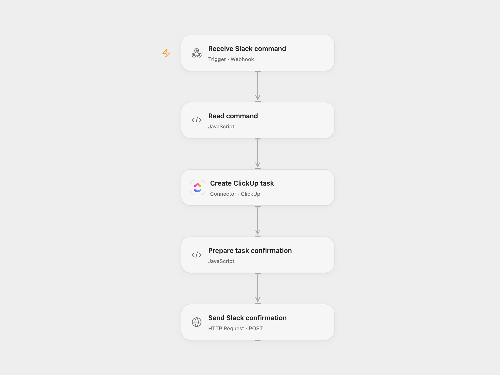

# Create ClickUp Tasks from Slack Commands

Create a ClickUp task from a Slack slash command and reply with its task ID.

<picture>
  <source media="(prefers-color-scheme: dark)" srcset="preview-dark.png">
  
</picture>

[Open Flow JSON](templates/slack-command-to-clickup-task.openflow.json) · [n8n JSON](templates/slack-command-to-clickup-task.n8n.json)

## Setup and use

Create a Slack slash command pointing to the n8n webhook. Configure the ClickUp workspace, list and credentials in n8n. Set **Execution mode** to n8n or openflow. For Open Flow mode configure the relay URL, deploy the workflow, and connect ClickUp with a list ID. Use one mode. The n8n and Open Flow endpoints do not verify the sender; restrict access.

## Behavior

n8n acknowledges the Slack request immediately, then the selected workflow creates a task whose title and description are the command text and posts the task ID to Slack's response URL. Slack requires acknowledgment within three seconds; server latency affects this. The full command, including response URL, may appear in execution history. A lost response from ClickUp may mean the task was created; inspect ClickUp before retrying. A failed Slack confirmation does not undo task creation.

Inspiration &amp; credits

## Changes to the source

- Replace sample ClickUp identifiers with configuration, add an Open Flow relay and send the task confirmation through Slack's response URL after an immediate acknowledgment.

Adapted from [Slack command to ClickUp](https://github.com/Zie619/n8n-workflows/blob/ae8cf6dc5b873cbb4f74587aa9180ed3a9f70682/workflows/Clickup/0469_Clickup_Respondtowebhook_Create_Webhook.json) in [Zie619/n8n-workflows](https://github.com/Zie619/n8n-workflows). The source export does not identify a separate template author or license.

The collection’s [MIT notice](https://github.com/Zie619/n8n-workflows/blob/94007c1445d9258a7da116646b79473e7c7c3282/LICENSE) is pinned at a later revision. This is the collection notice at that revision; it does not establish a separate original template author's license. Our changes are listed above; see [repository licensing](../../README.md#licensing).

> MIT License
>
> Copyright (c) 2025 Zie619
>
> Permission is hereby granted, free of charge, to any person obtaining a copy
> of this software and associated documentation files (the "Software"), to deal
> in the Software without restriction, including without limitation the rights
> to use, copy, modify, merge, publish, distribute, sublicense, and/or sell
> copies of the Software, and to permit persons to whom the Software is
> furnished to do so, subject to the following conditions:
>
> The above copyright notice and this permission notice shall be included in all
> copies or substantial portions of the Software.
>
> THE SOFTWARE IS PROVIDED "AS IS", WITHOUT WARRANTY OF ANY KIND, EXPRESS OR
> IMPLIED, INCLUDING BUT NOT LIMITED TO THE WARRANTIES OF MERCHANTABILITY,
> FITNESS FOR A PARTICULAR PURPOSE AND NONINFRINGEMENT. IN NO EVENT SHALL THE
> AUTHORS OR COPYRIGHT HOLDERS BE LIABLE FOR ANY CLAIM, DAMAGES OR OTHER
> LIABILITY, WHETHER IN AN ACTION OF CONTRACT, TORT OR OTHERWISE, ARISING FROM,
> OUT OF OR IN CONNECTION WITH THE SOFTWARE OR THE USE OR OTHER DEALINGS IN THE
> SOFTWARE.

