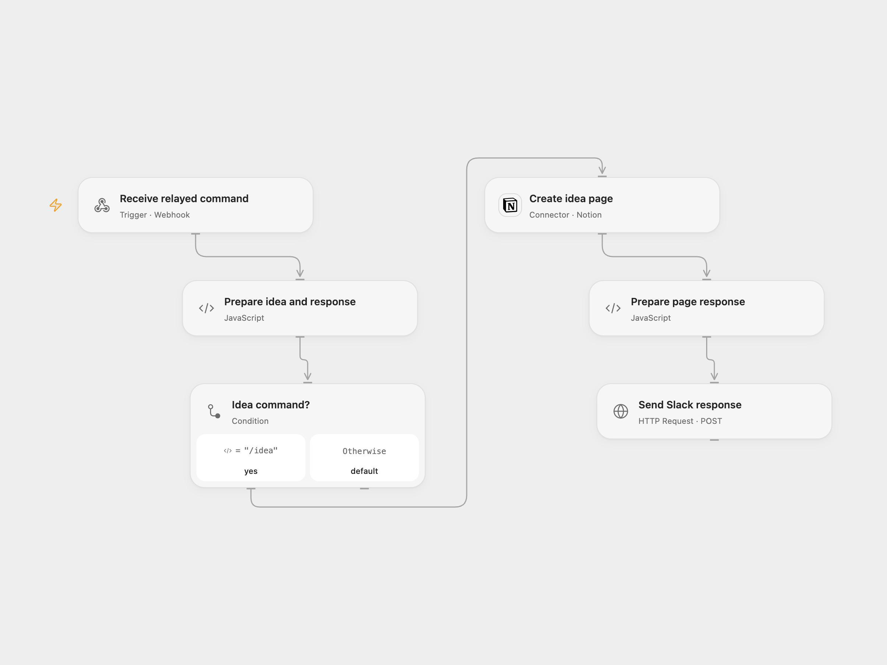

# Save Slack Ideas to Notion

Create a Notion idea page from a Slack slash command and reply with a details link.

<picture>
  <source media="(prefers-color-scheme: dark)" srcset="preview-dark.png">
  
</picture>

[Open Flow JSON](templates/slack-ideas-to-notion.openflow.json) · [n8n JSON](templates/slack-ideas-to-notion.n8n.json)

## Setup and use

Create a Slack slash command named /idea pointing to the n8n webhook URL. Import the n8n workflow and configure its Notion database URL and credentials. Set executionMode in **Set me up** to n8n to process there, or openflow to forward the complete Slack form payload to Open Flow. For Open Flow, set the relay URL in **Forward to Open Flow**, connect Notion, and set the data source ID and title property name in **Prepare idea and response**. The data source needs a title property and a rich text property named Creator. Share it with the Notion integration. Activate the n8n webhook and choose one mode.

## Behavior

n8n accepts the slash command and acknowledges it before executing the selected branch. The Open Flow mode relays the entire form payload as JSON inside event. The selected workflow creates a page with the idea title and Creator, then posts a private response with the created page link to Slack’s response URL. The n8n webhook and Open Flow relay do not verify the sender; restrict access to both endpoints. Slack response URLs and event data may appear in execution history. Slack has deprecated user_name; Creator depends on that field being present. If page creation or Slack response is uncertain, inspect Notion and the conversation before retrying; another run can create a duplicate page. Slack acknowledgment must arrive within three seconds; network and server latency affect this.

Inspiration &amp; credits

## Changes to the source

- Add an n8n mode selector and full-event relay for Open Flow, replace the sample Notion URL, and configure the data source ID and title property.

Adapted from [Slack ideas to Notion](https://github.com/Zie619/n8n-workflows/blob/ae8cf6dc5b873cbb4f74587aa9180ed3a9f70682/workflows/Http/0440_HTTP_Stickynote_Create_Webhook.json) in [Zie619/n8n-workflows](https://github.com/Zie619/n8n-workflows). The source export does not identify a separate template author or license.

The collection’s [MIT notice](https://github.com/Zie619/n8n-workflows/blob/94007c1445d9258a7da116646b79473e7c7c3282/LICENSE) is pinned at a later revision. This is the collection notice at that revision; it does not establish a separate original template author's license. Our changes are listed above; see [repository licensing](../../README.md#licensing).

> MIT License
>
> Copyright (c) 2025 Zie619
>
> Permission is hereby granted, free of charge, to any person obtaining a copy
> of this software and associated documentation files (the "Software"), to deal
> in the Software without restriction, including without limitation the rights
> to use, copy, modify, merge, publish, distribute, sublicense, and/or sell
> copies of the Software, and to permit persons to whom the Software is
> furnished to do so, subject to the following conditions:
>
> The above copyright notice and this permission notice shall be included in all
> copies or substantial portions of the Software.
>
> THE SOFTWARE IS PROVIDED "AS IS", WITHOUT WARRANTY OF ANY KIND, EXPRESS OR
> IMPLIED, INCLUDING BUT NOT LIMITED TO THE WARRANTIES OF MERCHANTABILITY,
> FITNESS FOR A PARTICULAR PURPOSE AND NONINFRINGEMENT. IN NO EVENT SHALL THE
> AUTHORS OR COPYRIGHT HOLDERS BE LIABLE FOR ANY CLAIM, DAMAGES OR OTHER
> LIABILITY, WHETHER IN AN ACTION OF CONTRACT, TORT OR OTHERWISE, ARISING FROM,
> OUT OF OR IN CONNECTION WITH THE SOFTWARE OR THE USE OR OTHER DEALINGS IN THE
> SOFTWARE.

