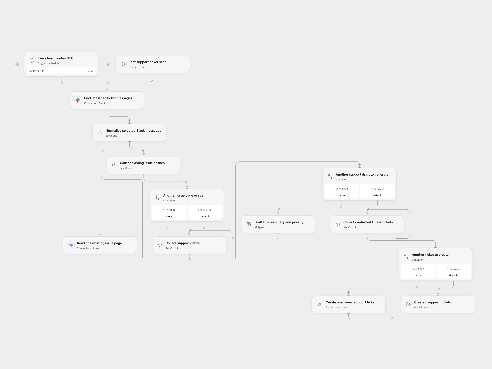

# Slack Support Tickets to Linear

Turn ticket-tagged Slack messages into structured Linear support tickets, retaining the original message and a hash for the next scan.

<picture>
  <source media="(prefers-color-scheme: dark)" srcset="preview-dark.png">
  
</picture>

[Open Flow JSON](templates/slack-support-tickets-to-linear.openflow.json) · [n8n JSON](templates/slack-support-tickets-to-linear.n8n.json)

## Configure

Connect Slack using a user token with `search:read` and access to your support channel. Set the query on the Slack search node; the starter query selects messages carrying the ticket emoji. Connect Linear and replace the team and state IDs on the create node. Configure the `gpt-5-mini` model connection. Test before enabling the five-minute schedule. Both templates start with UTC; the original schedule inherited the n8n instance timezone.

## Behavior

Each run searches the latest ten matching messages, ordered by timestamp descending. It does not traverse additional Slack search pages. For each selected message it repeats the source's existing-issue scan: pages of up to 50, stopping when the accumulated count reaches 50 or the server has no next page. A short earlier page can make the last page bring the total above 50. The scans finish before generation, and all generated drafts are validated before creating tickets sequentially.

The description retains the summary, up to three suggestions, original author/message, channel, timestamp, permalink and `hash: #p…` marker. Priorities map to Linear urgent 1/high 2/medium 3/low 4. Null descriptions and descriptions without a hash are ignored safely. Quoted, multiline messages are passed as data rather than interpolated JSON. Invalid message metadata or draft fields stop before ticket creation.

Deduplication covers only hashes in these bounded issue scans. Older issues outside the window, concurrent runs and an uncertain creation response can still produce duplicates. Avoid overlapping runs and inspect Linear before repeating a failed run. No write is automatically retried. A failure creating or confirming a later ticket leaves earlier tickets created; the run does not return a success report for the incomplete batch. The Open Flow Action also reads the newly created issue to confirm it; a lost confirmation can follow a successful creation.

The source leaves its OpenAI model unspecified. The pinned current n8n model node defaults to `gpt-5-mini`, now made explicit in both files. Open Flow uses one native Agent round with structured output and no tools, memory or code. It uses the deployment's Agent generation settings. The n8n ChatOpenAI adapter permits two transient transport retries; the Open Flow Agent executor does not retry that transport failure. Neither format adds a workflow retry. Check the [model documentation](https://developers.openai.com/api/docs/models/gpt-5-mini) and your configured route before enabling the schedule. The source's optional RAG/tools suggestion is not implemented in its graph. Model quality, account permissions and live API access require your own testing.

Inspiration &amp; credits

Adapted from [Customer Support Channel and Ticketing System with Slack and Linear](https://github.com/enescingoz/awesome-n8n-templates/blob/827110332c21cbe000ab13f6d292d5adb1f1f8db/Slack/Customer%20Support%20Channel%20and%20Ticketing%20System%20with%20Slack%20and%20Linear.json) in [enescingoz/awesome-n8n-templates](https://github.com/enescingoz/awesome-n8n-templates).

Source collection notice: © 2024–2026 Enes Cingoz, [CC BY 4.0](https://github.com/enescingoz/awesome-n8n-templates/blob/827110332c21cbe000ab13f6d292d5adb1f1f8db/LICENSE). The matching [n8n community listing](https://n8n.io/workflows/2323-customer-support-channel-and-ticketing-system-with-slack-and-linear/) credits Jimleuk. The source export does not state a separate template license. See [repository licensing](../../README.md#licensing) for the scope of OOMOL contributions and third-party material.

