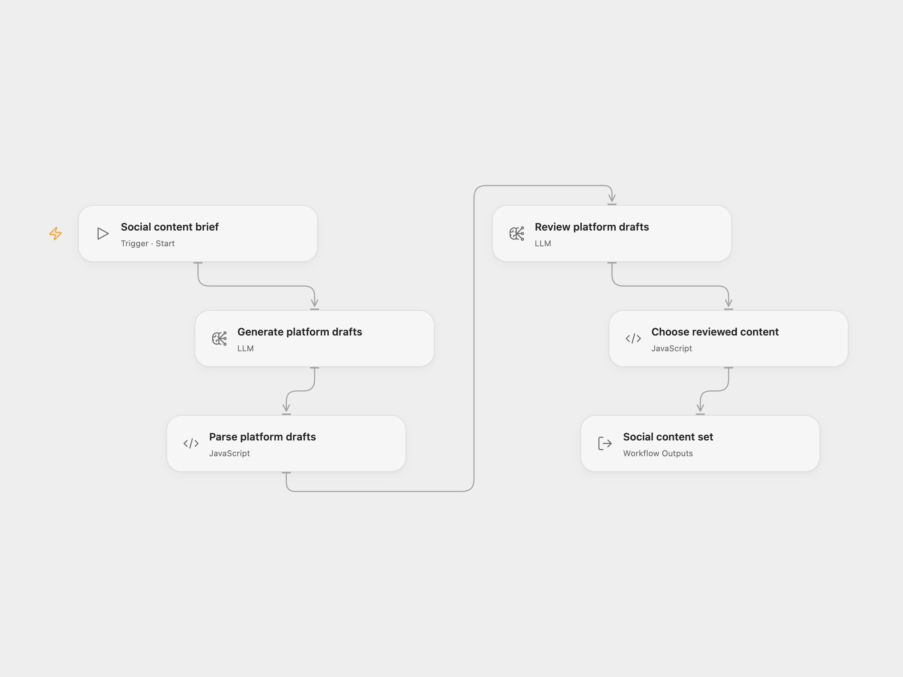

# Social Content Review

Generate a set of social content, then review grammar, tone, formatting, and hashtags with a second model call. The result includes an X draft, LinkedIn post, Reddit title and body, and Instagram caption.

<picture>
  <source media="(prefers-color-scheme: dark)" srcset="preview-dark.png">
  
</picture>

[Open Flow JSON](templates/social-content-review.openflow.json) · [n8n JSON](templates/social-content-review.n8n.json)

## Setup

For Open Flow, select a configured `llama3:8b` model in every model step. For n8n, connect each attached **Ollama Model** to an Ollama credential with the base URL of a service reachable from n8n. Confirm that it serves `llama3:8b`. The native Ollama models send each step's generation budget as `num_predict`. You can choose another available model in both formats; its wording and quality may differ.

In Open Flow, use Run and supply `topic`, `brand_voice`, and `target_audience`. In n8n, edit those three values in **Content Parameters** and use Execute Workflow.

The first model must return all five content fields as nonempty strings. An invalid first response stops the workflow. An invalid review response returns the original content with `reviewed: false`; a valid review sets `reviewed: true`. A failed model request stops the workflow. The result also includes `topic` and a UTC generation timestamp.

The workflow does not publish posts. Review claims, tone, and platform limits before posting; requested character counts and hashtag counts are prompt guidance.

## Changes to the source

- Use configured model accounts, correct the omitted POST behavior, and remove assumptions about a string-valued HTTP `data` field.
- Preserve the source fallback to original content when the review cannot be parsed.
- Validate all five generated fields and keep incomplete review results from overwriting a complete draft.
- Give the review step the configured brand voice and use real line breaks in both prompts.

## Source and license

Adapted from [AI Social Media Content Generator with Ollama](https://github.com/enescingoz/awesome-n8n-templates/blob/827110332c21cbe000ab13f6d292d5adb1f1f8db/Instagram_Twitter_Social_Media/AI%20Social%20Media%20Content%20Generator%20with%20Ollama.json) in [enescingoz/awesome-n8n-templates](https://github.com/enescingoz/awesome-n8n-templates).

Source collection notice: © 2024–2026 Enes Cingoz, [CC BY 4.0](https://github.com/enescingoz/awesome-n8n-templates/blob/827110332c21cbe000ab13f6d292d5adb1f1f8db/LICENSE). The source export does not identify a separate template author or license. See [repository licensing](../../README.md#licensing) for the scope of OOMOL contributions and third-party material.
