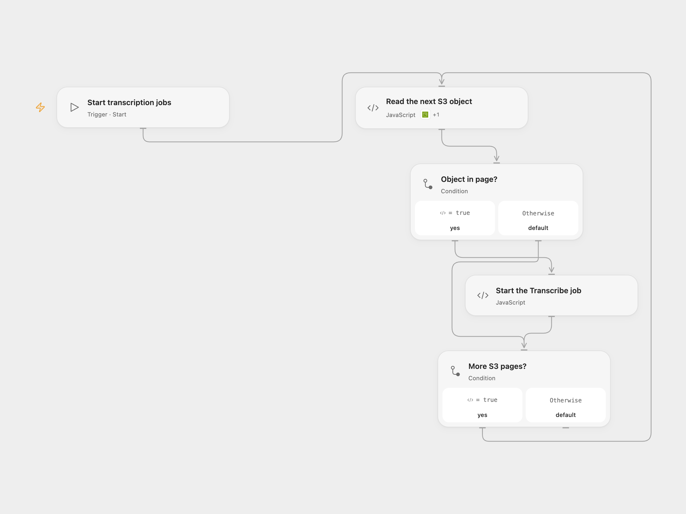

# Start Transcription Jobs for S3 Objects

Start an automatic-language Amazon Transcribe job for each nonempty object in an S3 bucket.

<picture>
  <source media="(prefers-color-scheme: dark)" srcset="preview-dark.png">
  
</picture>

[Open Flow JSON](templates/start-transcription-jobs-for-s3-objects.openflow.json) · [n8n JSON](templates/start-transcription-jobs-for-s3-objects.n8n.json)

## Setup

Connect AWS S3 and configure the bucket and AWS region in **Read the next S3 object**. Bind secret Variables for AWS access key ID and secret access key in **Start the Transcribe job**; bind a session token too when using temporary credentials. The credentials need s3:ListBucket, s3:GetObject and transcribe:StartTranscriptionJob permissions; the bucket must be in the Transcribe region. For another region, change the allowed HTTP host to that region's Transcribe endpoint. In n8n configure the same bucket in **AWS S3** and AWS credentials on both AWS nodes. Enable one format.

## Behavior

A manual run lists the whole bucket, including nested prefixes, and submits one Transcribe job per nonempty object, with automatic language identification. The bucket should contain supported audio or video media; objects are not filtered by extension; zero-byte objects and folder markers are skipped as in the source. Submission only starts jobs; it does not wait for or download completed transcripts. When no output bucket is specified, Amazon Transcribe supplies a service-managed transcript location.

Each job name is a deterministic hash of the bucket and object key. Re-running for the same object can conflict with an existing job; inspect AWS before retrying or delete/rename the earlier job if appropriate. A failed or uncertain submission may already have succeeded, and earlier jobs remain if a later object fails. No automatic submission retry is added. Large buckets are handled page by page within platform execution limits.

Inspiration &amp; credits

## Changes to the source

- Replace the private bucket and credentials with configuration. Open Flow uses the formal S3 Action and signs the Transcribe API request with AWS secret Variables; n8n retains its native AWS nodes.
- List nested objects that the original S3 node's root-only delimiter omitted. Use a stable hash of bucket and key for job names; the source's whitespace-only replacement fails for keys containing characters AWS does not allow in job names.

Adapted from [Create transcription jobs using AWS Transcribe](https://github.com/Zie619/n8n-workflows/blob/ae8cf6dc5b873cbb4f74587aa9180ed3a9f70682/workflows/Manual/0049_Manual_Awss3_Automate_Triggered.json) in [Zie619/n8n-workflows](https://github.com/Zie619/n8n-workflows). The matching [n8n listing](https://n8n.io/workflows/1111-create-transcription-jobs-using-aws-transcribe/) credits Harshil Agrawal. The original template does not state a separate license.

The collection’s [MIT notice](https://github.com/Zie619/n8n-workflows/blob/94007c1445d9258a7da116646b79473e7c7c3282/LICENSE) is pinned at a later revision. This is the collection notice at that revision; it does not establish a separate original template author's license. Our changes are listed above; see [repository licensing](../../README.md#licensing).

> MIT License
>
> Copyright (c) 2025 Zie619
>
> Permission is hereby granted, free of charge, to any person obtaining a copy
> of this software and associated documentation files (the "Software"), to deal
> in the Software without restriction, including without limitation the rights
> to use, copy, modify, merge, publish, distribute, sublicense, and/or sell
> copies of the Software, and to permit persons to whom the Software is
> furnished to do so, subject to the following conditions:
>
> The above copyright notice and this permission notice shall be included in all
> copies or substantial portions of the Software.
>
> THE SOFTWARE IS PROVIDED "AS IS", WITHOUT WARRANTY OF ANY KIND, EXPRESS OR
> IMPLIED, INCLUDING BUT NOT LIMITED TO THE WARRANTIES OF MERCHANTABILITY,
> FITNESS FOR A PARTICULAR PURPOSE AND NONINFRINGEMENT. IN NO EVENT SHALL THE
> AUTHORS OR COPYRIGHT HOLDERS BE LIABLE FOR ANY CLAIM, DAMAGES OR OTHER
> LIABILITY, WHETHER IN AN ACTION OF CONTRACT, TORT OR OTHERWISE, ARISING FROM,
> OUT OF OR IN CONNECTION WITH THE SOFTWARE OR THE USE OR OTHER DEALINGS IN THE
> SOFTWARE.

