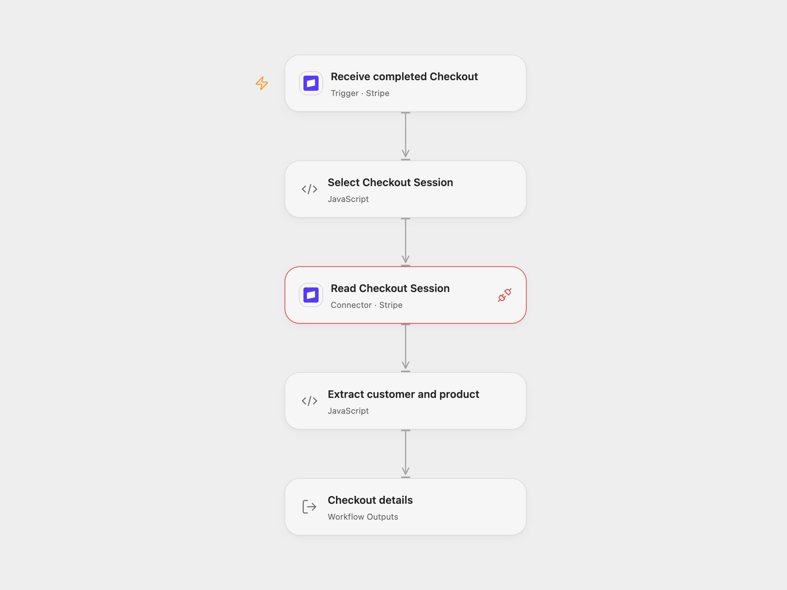

# Stripe Checkout Customer and Product

Retrieve customer details and the first line-item description when a Stripe Checkout Session completes.

<picture>
  <source media="(prefers-color-scheme: dark)" srcset="preview-dark.png">
  
</picture>

[Open Flow JSON](templates/stripe-checkout-customer-and-product.openflow.json) · [n8n JSON](templates/stripe-checkout-customer-and-product.n8n.json)

## Setup

Connect Stripe in **Receive completed Checkout** and **Read Checkout Session** using the same account. The connection needs permission to manage webhook endpoints and read Checkout Sessions; allow Provider API access for the read. In n8n, connect the same Stripe account to the trigger and HTTP request. Ensure the trigger has a signing secret in its credential or registered webhook; without either, n8n may accept unsigned requests. Enable only one format.

## Behavior

For each `checkout.session.completed` event, the workflow reads that Session with expanded line items and returns the customer name, email and description of the first line item. Missing customer details, an empty line-item list or a missing description are returned as null. It does not summarize additional items. A completed Checkout Session is not proof that an asynchronous payment has settled; check payment status and relevant later events before using the output for fulfillment.

An invalid event, failed read, unexpected response or mismatched Session ID stops the run. No external record is created or updated. Stripe events can be delivered more than once; downstream consumers should handle duplicates. Open Flow's Stripe Provider requests API version 2024-06-20; n8n uses the account's configured API version. Customer information appears in execution data; restrict access.

Inspiration &amp; credits

## Changes to the source

- Validate the event and match the returned Session to the event before producing output.
- Return null for optional customer or first-item fields instead of relying on missing values, and expose the result as workflow output.

Adapted from [Stripe Payment Order Sync – Auto Retrieve Customer & Product Purchased](https://github.com/Zie619/n8n-workflows/blob/ae8cf6dc5b873cbb4f74587aa9180ed3a9f70682/workflows/Http/1773_HTTP_Stripe_Sync_Webhook.json) in [Zie619/n8n-workflows](https://github.com/Zie619/n8n-workflows). The matching [n8n community listing](https://n8n.io/workflows/3391-stripe-payment-order-sync-auto-retrieve-customer-and-product-purchased/) credits Matt F. The original template does not state a separate license.

The collection’s [MIT notice](https://github.com/Zie619/n8n-workflows/blob/94007c1445d9258a7da116646b79473e7c7c3282/LICENSE) is pinned at a later revision. This is the collection notice at that revision; it does not establish a separate original template author's license. Our changes are listed above; see [repository licensing](../../README.md#licensing).

> MIT License
>
> Copyright (c) 2025 Zie619
>
> Permission is hereby granted, free of charge, to any person obtaining a copy
> of this software and associated documentation files (the "Software"), to deal
> in the Software without restriction, including without limitation the rights
> to use, copy, modify, merge, publish, distribute, sublicense, and/or sell
> copies of the Software, and to permit persons to whom the Software is
> furnished to do so, subject to the following conditions:
>
> The above copyright notice and this permission notice shall be included in all
> copies or substantial portions of the Software.
>
> THE SOFTWARE IS PROVIDED "AS IS", WITHOUT WARRANTY OF ANY KIND, EXPRESS OR
> IMPLIED, INCLUDING BUT NOT LIMITED TO THE WARRANTIES OF MERCHANTABILITY,
> FITNESS FOR A PARTICULAR PURPOSE AND NONINFRINGEMENT. IN NO EVENT SHALL THE
> AUTHORS OR COPYRIGHT HOLDERS BE LIABLE FOR ANY CLAIM, DAMAGES OR OTHER
> LIABILITY, WHETHER IN AN ACTION OF CONTRACT, TORT OR OTHERWISE, ARISING FROM,
> OUT OF OR IN CONNECTION WITH THE SOFTWARE OR THE USE OR OTHER DEALINGS IN THE
> SOFTWARE.

