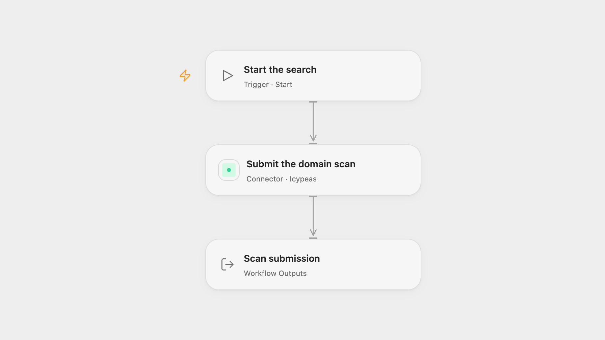

# Submit a Domain Scan with Icypeas

Submit a company or domain to Icypeas to find role-based email addresses.

<picture>
  <source media="(prefers-color-scheme: dark)" srcset="preview-dark.png">
  
</picture>

[Open Flow JSON](templates/submit-a-domain-scan-with-icypeas.openflow.json) · [n8n JSON](templates/submit-a-domain-scan-with-icypeas.n8n.json)

## Setup

In Open Flow, connect Icypeas in **Submit the domain scan** and replace the company domain or name. In n8n, configure an HTTP Header Auth credential named Authorization with your Icypeas API key, and replace the company field in **Submit the domain scan**. Run one format.

## Behavior

A manual run submits one domain scan for role-based email addresses. The response includes the search item ID and its current status when the service provides them. Icypeas processes searches asynchronously; inspect the item in Icypeas to see the result. If a submission fails or its outcome is uncertain, check Icypeas before retrying.

Inspiration &amp; credits

## Changes to the source

- Use the current API-key authorization instead of the source’s older signing method.
- Replace the sample company with an editable placeholder.

Adapted from [Perform a domain search (single) with Icypeas](https://github.com/Zie619/n8n-workflows/blob/ae8cf6dc5b873cbb4f74587aa9180ed3a9f70682/workflows/Manual/1517_Manual_Code_Automation_Webhook.json) in [Zie619/n8n-workflows](https://github.com/Zie619/n8n-workflows). The matching [n8n community listing](https://n8n.io/workflows/2012-perform-a-domain-search-with-icypeas-single/) credits Corentin Ribeyre. The original template does not state a separate license.

The collection’s [MIT notice](https://github.com/Zie619/n8n-workflows/blob/94007c1445d9258a7da116646b79473e7c7c3282/LICENSE) is pinned at a later revision. This is the collection notice at that revision; it does not establish a separate original template author's license. Our changes are listed above; see [repository licensing](../../README.md#licensing).

> MIT License
>
> Copyright (c) 2025 Zie619
>
> Permission is hereby granted, free of charge, to any person obtaining a copy
> of this software and associated documentation files (the "Software"), to deal
> in the Software without restriction, including without limitation the rights
> to use, copy, modify, merge, publish, distribute, sublicense, and/or sell
> copies of the Software, and to permit persons to whom the Software is
> furnished to do so, subject to the following conditions:
>
> The above copyright notice and this permission notice shall be included in all
> copies or substantial portions of the Software.
>
> THE SOFTWARE IS PROVIDED "AS IS", WITHOUT WARRANTY OF ANY KIND, EXPRESS OR
> IMPLIED, INCLUDING BUT NOT LIMITED TO THE WARRANTIES OF MERCHANTABILITY,
> FITNESS FOR A PARTICULAR PURPOSE AND NONINFRINGEMENT. IN NO EVENT SHALL THE
> AUTHORS OR COPYRIGHT HOLDERS BE LIABLE FOR ANY CLAIM, DAMAGES OR OTHER
> LIABILITY, WHETHER IN AN ACTION OF CONTRACT, TORT OR OTHERWISE, ARISING FROM,
> OUT OF OR IN CONNECTION WITH THE SOFTWARE OR THE USE OR OTHER DEALINGS IN THE
> SOFTWARE.

