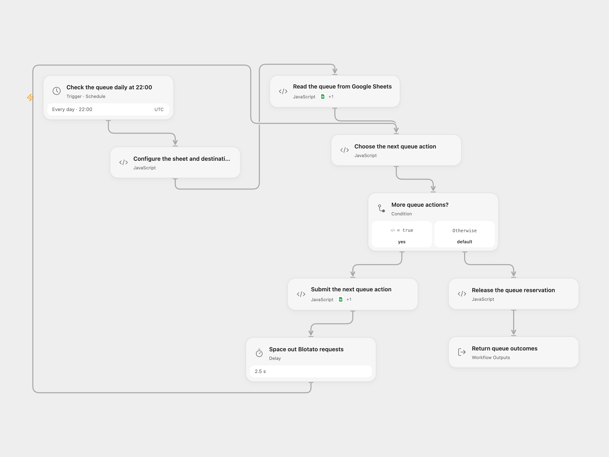

# Submit Social Videos with Blotato

Submit queued Google Sheets videos to connected social accounts with Blotato, and record the submissions on the original rows.

<!-- template-actions:start -->
 
<!-- template-actions:end -->

<picture>
  <source media="(prefers-color-scheme: dark)" srcset="preview-dark.png">
  
</picture>

## Setup

1. In your worksheet, put `URL VIDEO`, `DESCRIPTION`, `Titre`, `STATUS`, and `SUBMISSION IDS` in the header row. If you enable Bluesky or Pinterest, add `IMAGE URL` and supply a still image for each video. Use public HTTPS links to video and image files you are authorized to publish.
2. In **Configure the sheet and destinations**, set the spreadsheet ID and worksheet name. Enter the connected Blotato account ID for each platform you want to use. Facebook also needs a Page ID, and Pinterest needs a board ID. Leave unused account IDs blank. The `twitter` key is for X. Set the TikTok AI-generated label to match your clips. [Blotato accounts and destinations](https://help.blotato.com/rest-api-reference/accounts)
3. Select a Google Sheets connection with edit access in **Read the queue from Google Sheets** and **Submit the next queue action**. Bind `BLOTATO_API_KEY` as a secret variable in **Submit the next queue action**. Enable one workflow per worksheet. Keep rows and headers in place during a run.

## Behavior

The queue runs daily at 22:00 UTC. It processes rows with a video URL, a blank or `READY` status, and no existing submission IDs. It reserves each row, uploads the video, and sends the row's description and media to the enabled destinations. YouTube uses `Titre`, unlisted visibility, and subscriber notifications off. Bluesky and Pinterest use the row's still image. Change the schedule time zone to use a different local time.

When Blotato accepts every submission, the workflow writes `SUBMITTED` and the destination submission IDs to the same row. Blotato handles publication after acceptance. Use its dashboard or status API to check whether a post went live. [Blotato post status](https://help.blotato.com/rest-api-reference/publish-post/get-post)

An unconfirmed upload or post leaves `CHECK BLOTATO` and any known submission IDs. An interrupted run may leave `SUBMITTING`. Review the related posts in Blotato before recovering that row. Only return the whole row to `READY` after confirming none of its intended posts was accepted, or reconcile the missing destinations separately. If an interruption also leaves a workflow State reservation, clear it only after checking the queue and confirming the earlier run has stopped.

In n8n

Enter the same worksheet and destination settings in **Configure the sheet and destinations**. Bind Google Sheets OAuth2 to **Read the queue from Google Sheets**, **Reserve the original row**, and **Write the status and submission IDs**. Bind a Header Auth credential named `blotato-api-key` to **Upload the video to Blotato** and **Submit the posts to Blotato**, using your Blotato API key as its value.

Use one production execution slot for this queue and avoid overlapping manual executions. Blotato submission receipts are saved on the original row. Review any `SUBMITTING` or `CHECK BLOTATO` row before retrying, and start the next run from the schedule entry so it checks the row's status.

Inspiration &amp; credits

Adapted from [Auto-Publish to 9 Social Platforms](https://github.com/Zie619/n8n-workflows/blob/ae8cf6dc5b873cbb4f74587aa9180ed3a9f70682/workflows/Http/1367_HTTP_Schedule_Automate_Webhook.json) in [Zie619/n8n-workflows](https://github.com/Zie619/n8n-workflows). Attribution: Zie619 / n8n-workflows.

The collection’s [MIT notice](https://github.com/Zie619/n8n-workflows/blob/94007c1445d9258a7da116646b79473e7c7c3282/LICENSE) is pinned at a later revision. This is the collection notice at that revision; it does not establish a separate original template author's license. Our changes are listed above; see [repository licensing](../../README.md#licensing).

> MIT License
>
> Copyright (c) 2025 Zie619
>
> Permission is hereby granted, free of charge, to any person obtaining a copy
> of this software and associated documentation files (the "Software"), to deal
> in the Software without restriction, including without limitation the rights
> to use, copy, modify, merge, publish, distribute, sublicense, and/or sell
> copies of the Software, and to permit persons to whom the Software is
> furnished to do so, subject to the following conditions:
>
> The above copyright notice and this permission notice shall be included in all
> copies or substantial portions of the Software.
>
> THE SOFTWARE IS PROVIDED "AS IS", WITHOUT WARRANTY OF ANY KIND, EXPRESS OR
> IMPLIED, INCLUDING BUT NOT LIMITED TO THE WARRANTIES OF MERCHANTABILITY,
> FITNESS FOR A PARTICULAR PURPOSE AND NONINFRINGEMENT. IN NO EVENT SHALL THE
> AUTHORS OR COPYRIGHT HOLDERS BE LIABLE FOR ANY CLAIM, DAMAGES OR OTHER
> LIABILITY, WHETHER IN AN ACTION OF CONTRACT, TORT OR OTHERWISE, ARISING FROM,
> OUT OF OR IN CONNECTION WITH THE SOFTWARE OR THE USE OR OTHER DEALINGS IN THE
> SOFTWARE.

