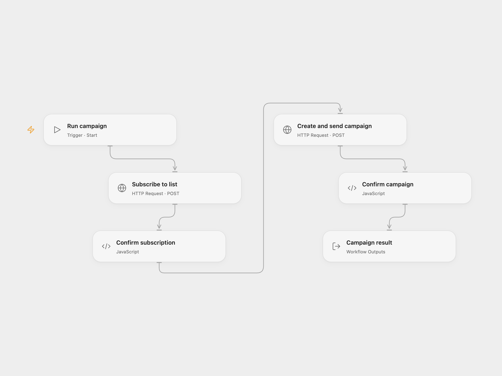

# Subscribe and Send a Sendy Campaign

Add a subscriber to a Sendy list, then create and send a campaign to the list.

<picture>
  <source media="(prefers-color-scheme: dark)" srcset="preview-dark.png">
  
</picture>

[Open Flow JSON](templates/subscribe-and-send-sendy-campaign.openflow.json) · [n8n JSON](templates/subscribe-and-send-sendy-campaign.n8n.json)

## Setup

Use a trusted HTTPS Sendy installation with its sending cron configured. The campaign is sent to the entire selected list, not only the subscriber added by this run. Use a list whose members agreed to receive the campaign and check its content and recipients before running. Sendy list settings control whether a new subscriber needs double opt-in confirmation.

In Open Flow, replace the host in **Subscribe to list** and **Create and send campaign**. Create two secret Variables containing URL-encoded form bodies, then bind each variable to the corresponding node's **Body** input. Use the same list ID in both bodies. Encode every value as form data, including the API key and HTML:

- Subscription body: `api_key=KEY&name=NAME&email=EMAIL&list=LIST_ID&boolean=true`.
- Campaign body: `api_key=KEY&from_name=NAME&from_email=EMAIL&reply_to=EMAIL&title=TITLE&subject=SUBJECT&html_text=HTML&list_ids=LIST_ID&send_campaign=1&boolean=true`.

The examples show field names, not ready-to-send values. Encode special characters in each value before joining the fields, keep both bodies secret, and use an endpoint that does not redirect. In n8n, configure **Subscribe to list** with a Custom Auth credential containing JSON with `headers` set to `{ "Content-Type": "application/x-www-form-urlencoded" }` and `body` containing `api_key`, `name`, `email`, `list`, and `boolean` set to `"true"`. For example, the credential JSON is:

```json
{ "headers": { "Content-Type": "application/x-www-form-urlencoded" }, "body": { "api_key": "YOUR_KEY", "name": "YOUR_NAME", "email": "YOUR_EMAIL", "list": "YOUR_LIST_ID", "boolean": "true" } }
```

Configure the Sendy credential and sender, campaign and list fields in **Sendy1**. Use the same list in both nodes.

## Behavior

A successful subscription request is followed by campaign creation with immediate sending enabled. Sendy may return that the campaign was created or is now sending; this is not proof of delivery. Failure stops later steps. No automatic retry or rollback is configured. A lost response may mean the subscription or campaign succeeded, so inspect Sendy before retrying.

## Changes to the source

- Replace the original personal details and list with configuration. Open Flow sends the documented form requests using secret body Variables; n8n uses Custom Auth for subscription and its native Sendy credential for the campaign, accepting subscription success responses `true` and `1`.

<details>
<summary>Source and license</summary>

Adapted from [Add a subscriber to a list and create and send a campaign](https://github.com/Zie619/n8n-workflows/blob/ae8cf6dc5b873cbb4f74587aa9180ed3a9f70682/workflows/Manual/0175_Manual_Sendy_Create_Triggered.json) in [Zie619/n8n-workflows](https://github.com/Zie619/n8n-workflows). The source export does not identify a separate template author or license.

The collection’s [MIT notice](https://github.com/Zie619/n8n-workflows/blob/94007c1445d9258a7da116646b79473e7c7c3282/LICENSE) is pinned at a later revision. This is the collection notice at that revision; it does not establish a separate original template author's license. Our changes are listed above; see [repository licensing](../../README.md#licensing).

> MIT License
>
> Copyright (c) 2025 Zie619
>
> Permission is hereby granted, free of charge, to any person obtaining a copy
> of this software and associated documentation files (the "Software"), to deal
> in the Software without restriction, including without limitation the rights
> to use, copy, modify, merge, publish, distribute, sublicense, and/or sell
> copies of the Software, and to permit persons to whom the Software is
> furnished to do so, subject to the following conditions:
>
> The above copyright notice and this permission notice shall be included in all
> copies or substantial portions of the Software.
>
> THE SOFTWARE IS PROVIDED "AS IS", WITHOUT WARRANTY OF ANY KIND, EXPRESS OR
> IMPLIED, INCLUDING BUT NOT LIMITED TO THE WARRANTIES OF MERCHANTABILITY,
> FITNESS FOR A PARTICULAR PURPOSE AND NONINFRINGEMENT. IN NO EVENT SHALL THE
> AUTHORS OR COPYRIGHT HOLDERS BE LIABLE FOR ANY CLAIM, DAMAGES OR OTHER
> LIABILITY, WHETHER IN AN ACTION OF CONTRACT, TORT OR OTHERWISE, ARISING FROM,
> OUT OF OR IN CONNECTION WITH THE SOFTWARE OR THE USE OR OTHER DEALINGS IN THE
> SOFTWARE.

</details>
