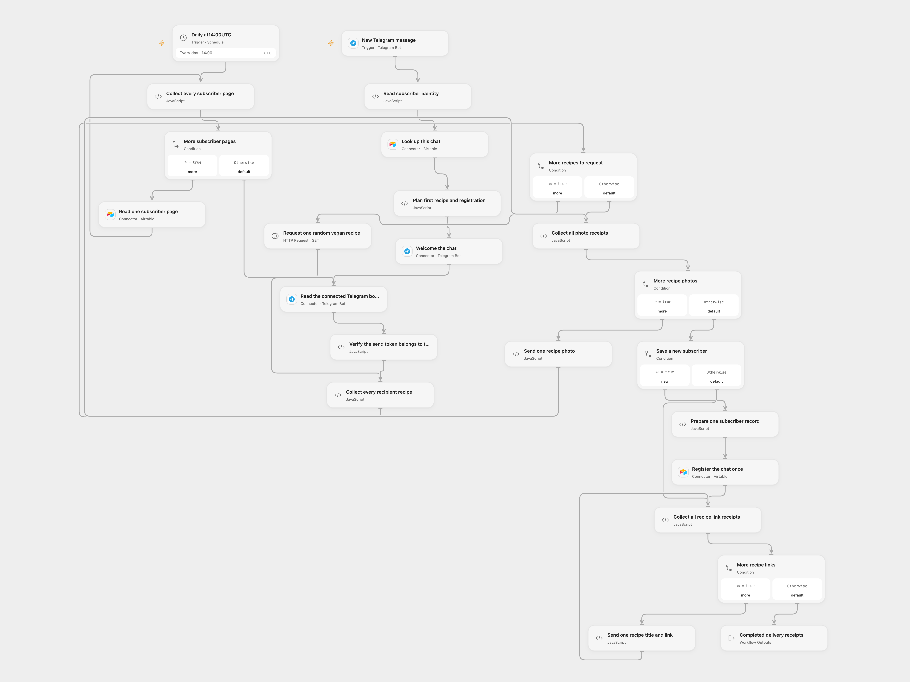

# Send Daily Vegan Recipes to Telegram Subscribers

Welcome Telegram subscribers with a vegan recipe and send each saved chat a random recipe every day.

<!-- template-actions:start -->
 
<!-- template-actions:end -->

<picture>
  <source media="(prefers-color-scheme: dark)" srcset="preview-dark.png">
  
</picture>

## Setup

1. Connect the same Telegram bot to **New Telegram message**, **Welcome the chat**, and **Read the connected Telegram bot identity**. Bind the exact token for this bot as a secret variable to **Verify the send token belongs to this bot**, **Send one recipe photo**, and **Send one recipe title and link**. Telegram permits one active update webhook per bot. [Telegram Bot API](https://core.telegram.org/bots/api)
2. Use one Airtable base and table for the lookup, registration, and daily subscriber list. Add a numeric `chatid` field and a text `Name` field. Keep one row per chat and restrict access to the subscriber table.
3. Bind your Spoonacular key as a secret variable in **Request one random vegan recipe**. Confirm your account may share the returned recipe images. The schedule starts at 14:00 UTC daily. Adjust it in the daily trigger. [Spoonacular random recipe API](https://spoonacular.com/food-api/docs#Get-Random-Recipes)

## Behavior

When a chat sends a message to the bot, it receives a welcome, a vegan recipe photo, and a recipe title and source link. The workflow registers a previously unlisted chat in Airtable using its chat ID and the sender’s first name. Existing subscribers continue to receive a recipe when they message the bot. Remove a chat’s Airtable row to stop its daily delivery.

The daily run reads all subscriber pages and requests one random recipe for each distinct chat. It attempts all photos before sending the links. A rejected or unconfirmed send is recorded against that chat and message type, and other deliveries continue. Each send is attempted once per run, including when a timeout leaves the result unknown. Check the individual receipts after a run and avoid replaying the full broadcast to recover a single send.

In n8n

Connect the same Telegram bot credential to the trigger and all Telegram nodes. Connect the same Airtable personal access token, base and table at every Airtable node. Select a Query Auth credential named `apiKey` for both Spoonacular requests. Edit the Cron schedule or workflow time zone if needed. Daily photo and link receipts mark any send without a matching result as unconfirmed. Compare receipts before considering a manual resend for an individual chat.

Inspiration &amp; credits

Adapted from [Send a random recipe once a day to Telegram](https://github.com/enescingoz/awesome-n8n-templates/blob/827110332c21cbe000ab13f6d292d5adb1f1f8db/Telegram/Send%20a%20random%20recipe%20once%20a%20day%20to%20Telegram.json) in [enescingoz/awesome-n8n-templates](https://github.com/enescingoz/awesome-n8n-templates).

Source collection notice: © 2024–2026 Enes Cingoz, [CC BY 4.0](https://github.com/enescingoz/awesome-n8n-templates/blob/827110332c21cbe000ab13f6d292d5adb1f1f8db/LICENSE). The [original n8n gallery template](https://n8n.io/workflows/1425-send-a-random-recipe-once-a-day-to-telegram/) credits Hilary Torn. See [repository licensing](../../README.md#licensing) for the scope of OOMOL contributions and third-party material.

## Changes to the source

The workflow checks Airtable for the exact chat ID and registers a new subscriber even when the table is empty. The daily path reports individual Telegram outcomes and keeps the source’s photo-first, link-second order.

