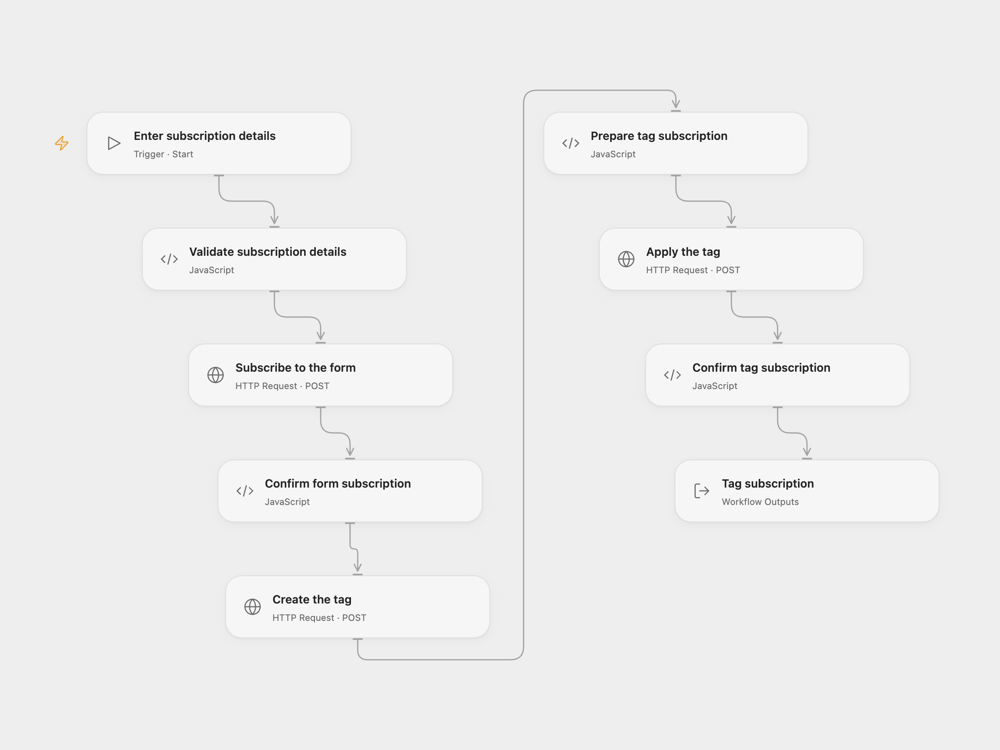

# Subscribe to a Kit Form and Tag

Add a subscriber to a Kit form, create a tag and apply it to the subscriber.

<picture>
  <source media="(prefers-color-scheme: dark)" srcset="preview-dark.png">
  
</picture>

[Open Flow JSON](templates/subscribe-to-kit-form-and-tag.openflow.json) · [n8n JSON](templates/subscribe-to-kit-form-and-tag.n8n.json)

## Setup

Use a Kit form that accepts subscribers and a V3 API secret. In Open Flow, create a secret Variable containing the V3 secret and bind **Auth Token** on **Subscribe to the form**, **Create the tag** and **Apply the tag**. Run with the subscriber email, numeric form ID and one tag name. In n8n, connect a ConvertKit API credential on all three ConvertKit nodes and edit **Set subscription details**.

Only subscribe people who have agreed to receive your messages. Kit's form settings control any confirmation email and subscription status.

## Behavior

Each run submits the email to the form, creates the named tag and applies the returned tag to the same subscriber. It does not wait for a confirmation email to be accepted. Existing form settings and Kit automations can send messages or take other actions. This uses Kit's deprecated V3 API, which Kit says remains available but is no longer actively developed; review your integration if Kit retires it. V3 credentials are distinct from V4 credentials.

A failure stops later steps. Earlier writes can already have succeeded, and an uncertain response may mean a write succeeded. Inspect the subscriber, form and tags before retrying. The V3 secret is sent in the request URL, as in the original n8n credential; URLs may appear in service or proxy logs.

## Changes to the source

- Replace the personal form and tag IDs and blank values with configuration. Apply the newly created tag instead of a fixed unrelated tag ID.
- Use the configured email rather than assuming it appears in the form response; verify returned subscription and tag IDs.

Source and license

Adapted from [Add subscriber to form, create tag and subscriber to the tag](https://github.com/Zie619/n8n-workflows/blob/ae8cf6dc5b873cbb4f74587aa9180ed3a9f70682/workflows/Manual/0653_Manual_Convertkit_Create_Triggered.json) in [Zie619/n8n-workflows](https://github.com/Zie619/n8n-workflows). The matching [n8n community listing](https://n8n.io/workflows/642-manage-subscribers-in-convertkit/) credits Harshil Agrawal. The original template does not state a separate license.

The collection’s [MIT notice](https://github.com/Zie619/n8n-workflows/blob/94007c1445d9258a7da116646b79473e7c7c3282/LICENSE) is pinned at a later revision. This is the collection notice at that revision; it does not establish a separate original template author's license. Our changes are listed above; see [repository licensing](../../README.md#licensing).

> MIT License
>
> Copyright (c) 2025 Zie619
>
> Permission is hereby granted, free of charge, to any person obtaining a copy
> of this software and associated documentation files (the "Software"), to deal
> in the Software without restriction, including without limitation the rights
> to use, copy, modify, merge, publish, distribute, sublicense, and/or sell
> copies of the Software, and to permit persons to whom the Software is
> furnished to do so, subject to the following conditions:
>
> The above copyright notice and this permission notice shall be included in all
> copies or substantial portions of the Software.
>
> THE SOFTWARE IS PROVIDED "AS IS", WITHOUT WARRANTY OF ANY KIND, EXPRESS OR
> IMPLIED, INCLUDING BUT NOT LIMITED TO THE WARRANTIES OF MERCHANTABILITY,
> FITNESS FOR A PARTICULAR PURPOSE AND NONINFRINGEMENT. IN NO EVENT SHALL THE
> AUTHORS OR COPYRIGHT HOLDERS BE LIABLE FOR ANY CLAIM, DAMAGES OR OTHER
> LIABILITY, WHETHER IN AN ACTION OF CONTRACT, TORT OR OTHERWISE, ARISING FROM,
> OUT OF OR IN CONNECTION WITH THE SOFTWARE OR THE USE OR OTHER DEALINGS IN THE
> SOFTWARE.

