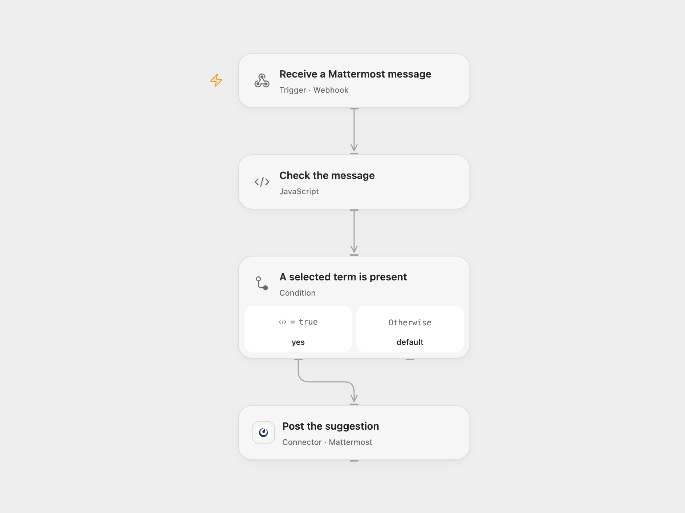

# Suggest Inclusive Language in Mattermost

Suggest inclusive alternatives in a Mattermost channel when a message contains selected terms.

<picture>
  <source media="(prefers-color-scheme: dark)" srcset="preview-dark.png">
  
</picture>

[Open Flow JSON](templates/suggest-inclusive-language-in-mattermost.openflow.json) · [n8n JSON](templates/suggest-inclusive-language-in-mattermost.n8n.json)

## Setup

Create a Mattermost outgoing webhook for one specified public channel. Set its content type to application/json, leave trigger words empty so it receives all messages in that channel, and use this workflow's webhook URL as its callback. Copy the webhook token. This workflow accepts one token, so use a separate webhook and workflow instance for each additional public channel. Bind each Open Flow instance to its own webhook token; create distinct Variables if the instances share a Variable scope. Connect Mattermost in **Post the suggestion** with permission to post in the selected channel.

Create an Open Flow secret Variable named MATTERMOST_OUTGOING_TOKEN containing that token and bind it to the token input of **Check the message**. In n8n, configure Mattermost credentials and set the same token in the MATTERMOST_OUTGOING_TOKEN environment variable accessible to Code nodes. Self-hosted n8n may require enabling environment access. For multiple n8n workflows in one instance, give each hook token a distinct environment variable and edit that workflow’s **Check the message** code to read its corresponding variable name. Alternatively, use separate n8n environments with the same variable name and different values. Enable one format only. Restrict access to the webhook URL, token, sender and execution history; webhook payloads contain message text and the bearer token.

## Behavior

For each outgoing webhook message, the workflow validates the token and looks for any of these case-sensitive substrings: guys, Guys, bros, Bros, dudes, Dudes, gals or Gals. A match posts one suggestion in the originating channel. Other capitalization does not match; substrings inside longer words also match. It does not reply in a thread. The fixed suggestion contains none of these substrings, so a delivery of that suggestion does not produce another suggestion. The immediate HTTP response is an empty JSON receipt and does not confirm that the suggestion was posted.

A failed or uncertain post may still have taken effect. Check the channel before rerunning; repeated deliveries are not deduplicated.

Inspiration &amp; credits

## Changes to the source

- Require and validate the Mattermost outgoing webhook token before posting, and return an empty JSON receipt.

Adapted from [Gender inclusive language bot for Mattermost](https://github.com/Zie619/n8n-workflows/blob/ae8cf6dc5b873cbb4f74587aa9180ed3a9f70682/workflows/Mattermost/0301_Mattermost_Noop_Automation_Webhook.json) in [Zie619/n8n-workflows](https://github.com/Zie619/n8n-workflows). The matching [n8n listing](https://n8n.io/workflows/982-gender-inclusive-language-bot-for-mattermost/) credits Lorena. No separate original template license was found.

The collection’s [MIT notice](https://github.com/Zie619/n8n-workflows/blob/94007c1445d9258a7da116646b79473e7c7c3282/LICENSE) is pinned at a later revision. This is the collection notice at that revision; it does not establish a separate original template author's license. Our changes are listed above; see [repository licensing](../../README.md#licensing).

> MIT License
>
> Copyright (c) 2025 Zie619
>
> Permission is hereby granted, free of charge, to any person obtaining a copy
> of this software and associated documentation files (the "Software"), to deal
> in the Software without restriction, including without limitation the rights
> to use, copy, modify, merge, publish, distribute, sublicense, and/or sell
> copies of the Software, and to permit persons to whom the Software is
> furnished to do so, subject to the following conditions:
>
> The above copyright notice and this permission notice shall be included in all
> copies or substantial portions of the Software.
>
> THE SOFTWARE IS PROVIDED "AS IS", WITHOUT WARRANTY OF ANY KIND, EXPRESS OR
> IMPLIED, INCLUDING BUT NOT LIMITED TO THE WARRANTIES OF MERCHANTABILITY,
> FITNESS FOR A PARTICULAR PURPOSE AND NONINFRINGEMENT. IN NO EVENT SHALL THE
> AUTHORS OR COPYRIGHT HOLDERS BE LIABLE FOR ANY CLAIM, DAMAGES OR OTHER
> LIABILITY, WHETHER IN AN ACTION OF CONTRACT, TORT OR OTHERWISE, ARISING FROM,
> OUT OF OR IN CONNECTION WITH THE SOFTWARE OR THE USE OR OTHER DEALINGS IN THE
> SOFTWARE.

