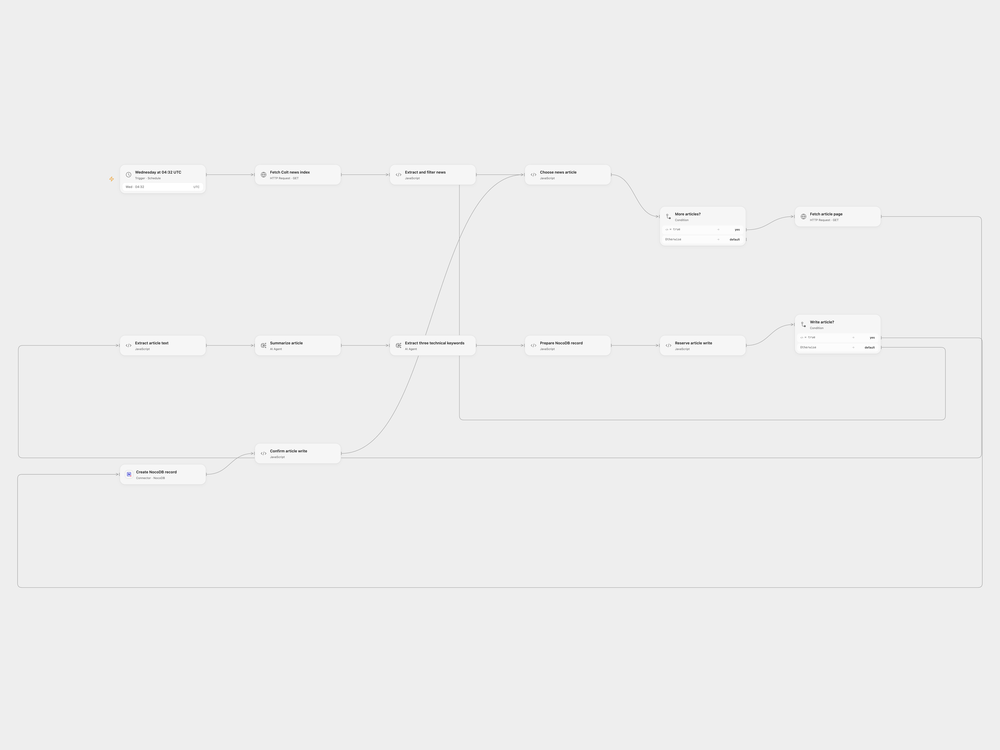

# Summarize Colt News in NocoDB

Summarize recent Colt news and save summaries and keywords to NocoDB.

<!-- template-actions:start -->
 
<!-- template-actions:end -->

<picture>
  <source media="(prefers-color-scheme: dark)" srcset="preview-dark.png">
  
</picture>

## Setup

Connect an AI model and NocoDB v3, enter the base and table IDs in **Create NocoDB record**, and enable persistent State. Create the fields `News_Source`, `Title`, `Date`, `Link`, `Summary` and `Keywords`. Prevent overlapping runs.

## Behavior

Each Wednesday at 04:32 UTC, the workflow fetches the Colt news index, extracts links and dates, selects posts dated within the preceding 70 days, fetches each article, produces a summary under 70 words and three technical keywords, and creates a NocoDB record. Site markup changes may require updating the extraction patterns in **Extract and filter news** and **Extract article text**. Article text is sent to the model.

If a database create has an unknown result, inspect NocoDB and resolve the pending State key before retrying.

In n8n

Import the n8n workflow, configure the model, NocoDB credentials, base, table, and a Data Table with `item_key` and `status` text columns.

Inspiration &amp; credits

Adapted from [Scrape and summarize posts of a news site without RSS feed](https://github.com/enescingoz/awesome-n8n-templates/blob/827110332c21cbe000ab13f6d292d5adb1f1f8db/AI_Research_RAG_and_Data_Analysis/Scrape%20and%20summarize%20posts%20of%20a%20news%20site%20without%20RSS%20feed%20using%20AI%20and%20save%20them%20to%20a%20NocoDB.json) in [enescingoz/awesome-n8n-templates](https://github.com/enescingoz/awesome-n8n-templates).

Source collection notice: © 2024–2026 Enes Cingoz, [CC BY 4.0](https://github.com/enescingoz/awesome-n8n-templates/blob/827110332c21cbe000ab13f6d292d5adb1f1f8db/LICENSE). The source export does not identify a separate template author or license. See [repository licensing](../../README.md#licensing) for the scope of OOMOL contributions and third-party material.

