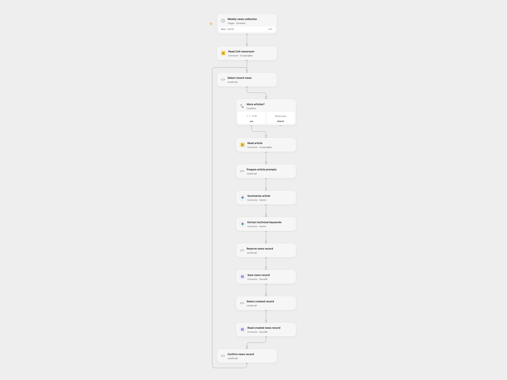

# Summarize Colt News to NocoDB

Summarize recent Colt news and save each article with technical keywords.

<!-- template-actions:start -->
 
<!-- template-actions:end -->

<picture>
  <source media="(prefers-color-scheme: dark)" srcset="preview-dark.png">
  
</picture>

## Setup

Connect ScrapingBee, Gemini and NocoDB. Create a NocoDB table with the fields `News_Source`, `Title`, `Date`, `Link`, `Summary` and `Keywords`, plus the default `Id` primary key. Enter the same table ID in **Save news record** and **Read created news record**. Enable persistent State.

In n8n, configure an HTTP Query Auth credential with parameter name `api_key` for both ScrapingBee nodes, connect both Gemini model nodes, and configure HTTP Header Auth with name `xc-token` for the two NocoDB nodes. Set your NocoDB host and the same table ID in both URLs. Select one Data Table with text columns `item_key` and `status` in all checkpoint nodes. Activate only one format.

## Behavior

Every Wednesday at 04:32 UTC, the workflow reads the current Colt Newsroom list and selects articles from the preceding 70 days. It fetches each article, produces a short summary and three technical keywords, and saves one row per URL. The list and article selectors depend on Colt's site structure. The workflow stops if the list is empty, dates are unordered, its oldest listed item does not cover the full 70-day window, or an article title does not match its card. Summaries and keywords may be inaccurate. ScrapingBee receives the public page URLs and extracted article text is sent to Gemini.

A pending NocoDB write may already have succeeded. Inspect the table before retrying. In Open Flow enter the pending key `colt-news:<article URL>` and `confirmed` or `absent` in **Select recent news**, rerun, then clear those fields. In n8n, set the matching Data Table row to `done` if confirmed or delete it if absent, then rerun. Avoid overlapping runs; checkpoints are not atomic locks.

Inspiration &amp; credits

The source identifies [askans](https://bonn.social/@askans) as its contact. Use the current Colt Newsroom, preserve each card’s date and URL, read back created NocoDB records, and stop on uncertain writes.

Adapted from [News Extraction](https://github.com/Zie619/n8n-workflows/blob/ae8cf6dc5b873cbb4f74587aa9180ed3a9f70682/workflows/Code/1646_Code_Schedule_Create_Scheduled.json) in [Zie619/n8n-workflows](https://github.com/Zie619/n8n-workflows). Attribution: askans (source contact) / Zie619.

The collection’s [MIT notice](https://github.com/Zie619/n8n-workflows/blob/94007c1445d9258a7da116646b79473e7c7c3282/LICENSE) is pinned at a later revision. This is the collection notice at that revision; it does not establish a separate original template author's license. Our changes are listed above; see [repository licensing](../../README.md#licensing).

> MIT License
>
> Copyright (c) 2025 Zie619
>
> Permission is hereby granted, free of charge, to any person obtaining a copy
> of this software and associated documentation files (the "Software"), to deal
> in the Software without restriction, including without limitation the rights
> to use, copy, modify, merge, publish, distribute, sublicense, and/or sell
> copies of the Software, and to permit persons to whom the Software is
> furnished to do so, subject to the following conditions:
>
> The above copyright notice and this permission notice shall be included in all
> copies or substantial portions of the Software.
>
> THE SOFTWARE IS PROVIDED "AS IS", WITHOUT WARRANTY OF ANY KIND, EXPRESS OR
> IMPLIED, INCLUDING BUT NOT LIMITED TO THE WARRANTIES OF MERCHANTABILITY,
> FITNESS FOR A PARTICULAR PURPOSE AND NONINFRINGEMENT. IN NO EVENT SHALL THE
> AUTHORS OR COPYRIGHT HOLDERS BE LIABLE FOR ANY CLAIM, DAMAGES OR OTHER
> LIABILITY, WHETHER IN AN ACTION OF CONTRACT, TORT OR OTHERWISE, ARISING FROM,
> OUT OF OR IN CONNECTION WITH THE SOFTWARE OR THE USE OR OTHER DEALINGS IN THE
> SOFTWARE.

