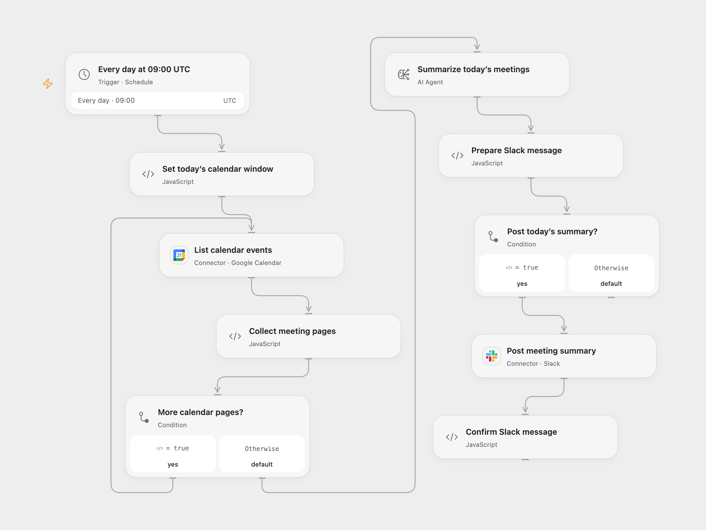

# Summarize Daily Calendar Meetings in Slack

Summarize today’s calendar meetings and attendees with AI, then post the summary in Slack.

<!-- template-actions:start -->
 
<!-- template-actions:end -->

<picture>
  <source media="(prefers-color-scheme: dark)" srcset="preview-dark.png">
  
</picture>

## Setup

Connect Google Calendar and Slack, configure an AI model, and enter the calendar ID in **Set today’s calendar window** and channel ID in **Prepare Slack message**. The default schedule and calendar-day boundaries use UTC; adjust the schedule and date handling together for another timezone.

In n8n connect the calendar, Gemini model and Slack credentials, select a current Gemini model, configure the calendar and channel IDs, and choose a Data Table with item_key and status text columns for the checkpoint nodes. Activate only one format and prevent overlapping runs.

## Behavior

At 09:00 UTC the workflow retrieves all pages of today’s events and sends their titles, times and attendees to the AI model. It posts the generated summary to Slack, including a message when there are no events. Event details and attendee information are shared with the model provider and Slack. Open Flow stops if the day has more than 5,000 events.

If Slack’s outcome is unknown, inspect the channel before retrying. In **Prepare Slack message**, set acknowledge to the pending key and resolution to confirmed if posted, or absent if not, then rerun and clear both fields. In n8n inspect the pending Data Table row and mark it done if posted or delete it to retry.

Inspiration &amp; credits

Read Calendar pages before summarization, replace private destinations and add a Slack checkpoint.

Adapted from [Daily meetings summarization with Gemini AI](https://github.com/Zie619/n8n-workflows/blob/ae8cf6dc5b873cbb4f74587aa9180ed3a9f70682/workflows/Schedule/1891_Schedule_Slack_Automation_Scheduled.json) in [Zie619/n8n-workflows](https://github.com/Zie619/n8n-workflows). The source export does not identify a separate template author or license.

The collection’s [MIT notice](https://github.com/Zie619/n8n-workflows/blob/94007c1445d9258a7da116646b79473e7c7c3282/LICENSE) is pinned at a later revision. This is the collection notice at that revision; it does not establish a separate original template author's license. Our changes are listed above; see [repository licensing](../../README.md#licensing).

> MIT License
>
> Copyright (c) 2025 Zie619
>
> Permission is hereby granted, free of charge, to any person obtaining a copy
> of this software and associated documentation files (the "Software"), to deal
> in the Software without restriction, including without limitation the rights
> to use, copy, modify, merge, publish, distribute, sublicense, and/or sell
> copies of the Software, and to permit persons to whom the Software is
> furnished to do so, subject to the following conditions:
>
> The above copyright notice and this permission notice shall be included in all
> copies or substantial portions of the Software.
>
> THE SOFTWARE IS PROVIDED "AS IS", WITHOUT WARRANTY OF ANY KIND, EXPRESS OR
> IMPLIED, INCLUDING BUT NOT LIMITED TO THE WARRANTIES OF MERCHANTABILITY,
> FITNESS FOR A PARTICULAR PURPOSE AND NONINFRINGEMENT. IN NO EVENT SHALL THE
> AUTHORS OR COPYRIGHT HOLDERS BE LIABLE FOR ANY CLAIM, DAMAGES OR OTHER
> LIABILITY, WHETHER IN AN ACTION OF CONTRACT, TORT OR OTHERWISE, ARISING FROM,
> OUT OF OR IN CONNECTION WITH THE SOFTWARE OR THE USE OR OTHER DEALINGS IN THE
> SOFTWARE.

