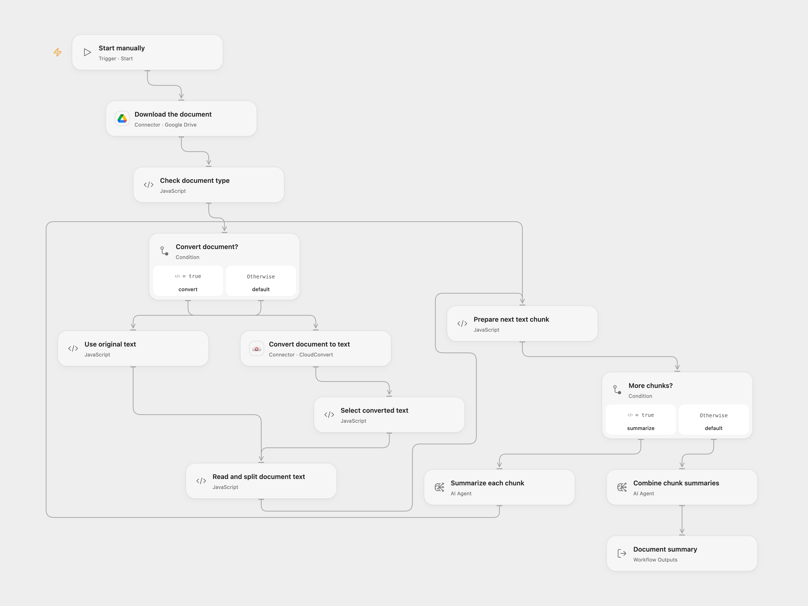

# Summarize Drive Documents

Summarize a supported document stored in Google Drive.

<picture>
  <source media="(prefers-color-scheme: dark)" srcset="preview-dark.png">
  
</picture>

[Open Flow JSON](templates/summarize-drive-documents.openflow.json) · [n8n JSON](templates/summarize-drive-documents.n8n.json)

## Setup

Connect Google Drive in **Download the document**, and set the same file ID there and in **Check document type**. Enable Drive file transit and set the transit and CloudConvert download HTTPS hostnames in the **Read and split document text** HTTP allowlist. Connect CloudConvert in **Convert document to text** and select available models for **Summarize each chunk** and **Combine chunk summaries**. In n8n set the file ID in **Google Drive** and connect Google Drive and OpenAI. Run either format manually.

## Behavior

The workflow reads one Drive document and returns a summary. Open Flow handles PDF, DOCX and EPUB via CloudConvert text conversion and reads TXT, Markdown, CSV and JSON as text. It accepts source files up to 10 MB and extracted text up to 500,000 UTF-8 bytes. A blank or oversized document fails. It divides text into sequential chunks of at most 3,000 UTF-8 bytes, summarizes every chunk and combines the summaries. Long documents can take many model calls; service and execution limits can stop a run.

The original n8n chain uses its own binary document loader, 3,000-token splitter and map-reduce. Byte boundaries, parsing and generated summaries can differ across formats. CSV and JSON are summarized as raw text in Open Flow. Review the result. The document may be sent to CloudConvert and its text to the selected model. Restrict access to execution data and temporary transit URLs. Conversion, download and model failures stop the run.

Inspiration &amp; credits

## Changes to the source

- Replace the original file ID with user configuration. Open Flow converts PDF, DOCX and EPUB to text using CloudConvert, then performs bounded per-chunk and combined summaries with AI Agents. n8n retains its original loader, token splitter and chain.
- Open Flow splits on UTF-8 byte boundaries rather than cl100k token boundaries, and has explicit file, text and chunk limits. Parsing and model results can differ.

Adapted from [Load and summarize Google Drive files with AI](https://github.com/Zie619/n8n-workflows/blob/ae8cf6dc5b873cbb4f74587aa9180ed3a9f70682/workflows/Manual/0328_Manual_GoogleDrive_Automate_Triggered.json) in [Zie619/n8n-workflows](https://github.com/Zie619/n8n-workflows). The matching [n8n listing](https://n8n.io/workflows/1962-load-and-summarize-google-drive-files-with-ai/) credits n8n Team. The source does not state a separate template license.

The collection’s [MIT notice](https://github.com/Zie619/n8n-workflows/blob/94007c1445d9258a7da116646b79473e7c7c3282/LICENSE) is pinned at a later revision. This is the collection notice at that revision; it does not establish a separate original template author's license. Our changes are listed above; see [repository licensing](../../README.md#licensing).

> MIT License
>
> Copyright (c) 2025 Zie619
>
> Permission is hereby granted, free of charge, to any person obtaining a copy
> of this software and associated documentation files (the "Software"), to deal
> in the Software without restriction, including without limitation the rights
> to use, copy, modify, merge, publish, distribute, sublicense, and/or sell
> copies of the Software, and to permit persons to whom the Software is
> furnished to do so, subject to the following conditions:
>
> The above copyright notice and this permission notice shall be included in all
> copies or substantial portions of the Software.
>
> THE SOFTWARE IS PROVIDED "AS IS", WITHOUT WARRANTY OF ANY KIND, EXPRESS OR
> IMPLIED, INCLUDING BUT NOT LIMITED TO THE WARRANTIES OF MERCHANTABILITY,
> FITNESS FOR A PARTICULAR PURPOSE AND NONINFRINGEMENT. IN NO EVENT SHALL THE
> AUTHORS OR COPYRIGHT HOLDERS BE LIABLE FOR ANY CLAIM, DAMAGES OR OTHER
> LIABILITY, WHETHER IN AN ACTION OF CONTRACT, TORT OR OTHERWISE, ARISING FROM,
> OUT OF OR IN CONNECTION WITH THE SOFTWARE OR THE USE OR OTHER DEALINGS IN THE
> SOFTWARE.

