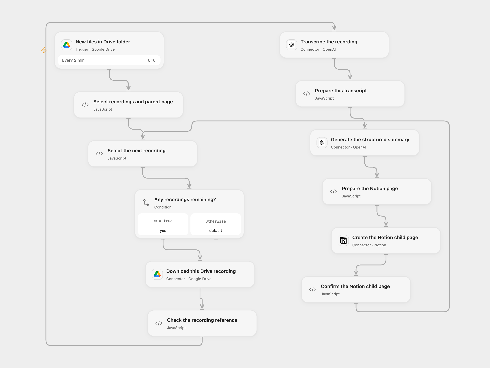

# Summarize Drive Recordings in Notion

Transcribe new recordings in a Google Drive folder and create a Notion child page with each recording’s title and summary.

<!-- template-actions:start -->
 
<!-- template-actions:end -->

<picture>
  <source media="(prefers-color-scheme: dark)" srcset="preview-dark.png">
  
</picture>

## Setup

1. Connect Google Drive in **New files in Drive folder** and **Download this Drive recording**. Use the same account for both steps. Select the folder ID in the trigger. The download requires Connector file transit.
2. Connect OpenAI for transcription and the summary. Connect Notion in **Create the Notion child page** and grant that connection access to the parent page.
3. Enter the parent page ID in **Select recordings and parent page**, then publish the trigger. Upload or create a new recording directly in the selected folder after the first poll.

## Behavior

The folder is checked every two minutes. The workflow processes newly created recordings in supported audio formats, up to 25,000,000 bytes per file. It uses OpenAI’s automatic language detection and requests a summary in the recording’s language. Relative action item dates use the processing date in UTC. The structured response includes the original analysis fields. Only its title and summary are written to Notion, under a **Summary** heading.

Each recording has its own download, transcription and Notion page. Non-recording files are skipped. A download, transcription or summary failure stops the run before page creation for that recording. Pages already confirmed remain in Notion. If page creation returns an uncertain result, check the parent page before retrying the recording.

In n8n

Set the folder ID in **New files in Drive folder** and use the same Google Drive credential in the trigger and download node. Set the parent page ID in **Select recordings and parent page**. Select the same OpenAI credential in **Transcribe the recording** and **Generate the structured summary**.

Add a **Header Auth** credential on **Create the Notion child page**. Use `Authorization` as the name and `Bearer YOUR_NOTION_INTEGRATION_SECRET` as the value. Share the parent page with that integration and grant Insert content. The native Drive trigger checks the folder every minute. Keep each poll within one Drive result page (100 new files). If Drive returns another page, the native trigger can stall before the run begins. Test the trigger with a dedicated folder because manual mode can pick an existing file.

Inspiration &amp; credits

Adapted from [Whisper Transkription copy](https://github.com/Zie619/n8n-workflows/blob/ae8cf6dc5b873cbb4f74587aa9180ed3a9f70682/workflows/Stickynote/1682_Stickynote_Notion_Automation_Triggered.json) in [Zie619/n8n-workflows](https://github.com/Zie619/n8n-workflows). Attribution: Pat (checkso, original workflow) / Zie619 (collection). See the [original n8n gallery template](https://n8n.io/workflows/2178-transcribe-audio-files-summarize-with-gpt-4-and-store-in-notion/).

## Changes to the source

The workflow uses `gpt-transcribe` for transcription in the recording’s original language. OpenAI lists Whisper as deprecated. [OpenAI file transcription](https://developers.openai.com/api/docs/guides/speech-to-text)

The collection’s [MIT notice](https://github.com/Zie619/n8n-workflows/blob/94007c1445d9258a7da116646b79473e7c7c3282/LICENSE) is pinned at a later revision. This is the collection notice at that revision; it does not establish a separate original template author's license. Our changes are listed above; see [repository licensing](../../README.md#licensing).

> MIT License
>
> Copyright (c) 2025 Zie619
>
> Permission is hereby granted, free of charge, to any person obtaining a copy
> of this software and associated documentation files (the "Software"), to deal
> in the Software without restriction, including without limitation the rights
> to use, copy, modify, merge, publish, distribute, sublicense, and/or sell
> copies of the Software, and to permit persons to whom the Software is
> furnished to do so, subject to the following conditions:
>
> The above copyright notice and this permission notice shall be included in all
> copies or substantial portions of the Software.
>
> THE SOFTWARE IS PROVIDED "AS IS", WITHOUT WARRANTY OF ANY KIND, EXPRESS OR
> IMPLIED, INCLUDING BUT NOT LIMITED TO THE WARRANTIES OF MERCHANTABILITY,
> FITNESS FOR A PARTICULAR PURPOSE AND NONINFRINGEMENT. IN NO EVENT SHALL THE
> AUTHORS OR COPYRIGHT HOLDERS BE LIABLE FOR ANY CLAIM, DAMAGES OR OTHER
> LIABILITY, WHETHER IN AN ACTION OF CONTRACT, TORT OR OTHERWISE, ARISING FROM,
> OUT OF OR IN CONNECTION WITH THE SOFTWARE OR THE USE OR OTHER DEALINGS IN THE
> SOFTWARE.

