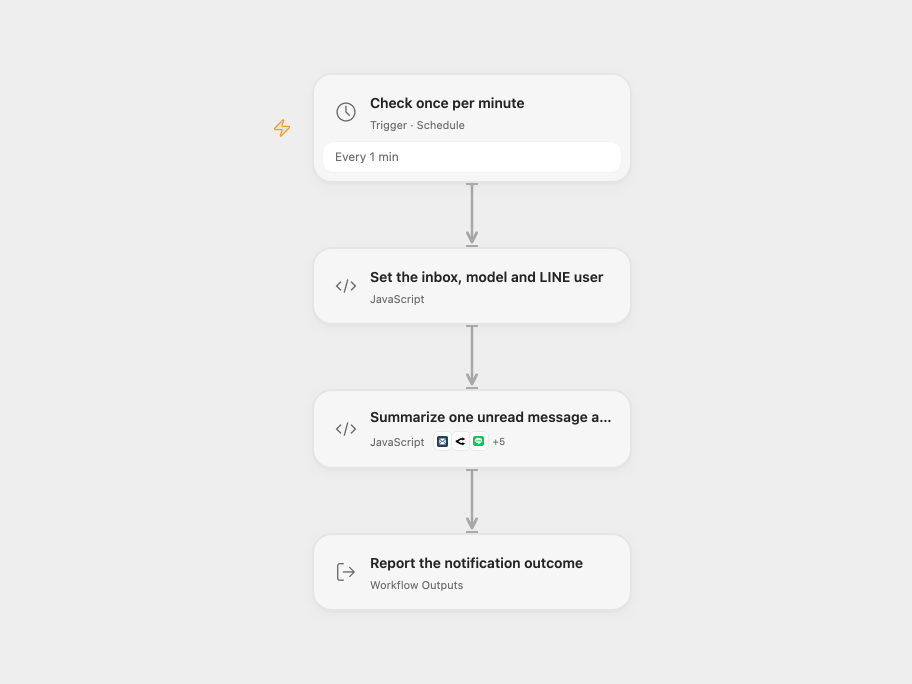

# Summarize IMAP Emails and Send Them to LINE

Summarize each unread IMAP email with OpenRouter and send its actions and deadlines to one configured LINE user.

<!-- template-actions:start -->
 
<!-- template-actions:end -->

<picture>
  <source media="(prefers-color-scheme: dark)" srcset="preview-dark.png">
  
</picture>

## Setup

1. In **Set the inbox, model and LINE user**, set the IMAP folder, OpenRouter model ID and one private LINE user ID beginning with `U`. Use a mailbox and LINE recipient authorized to handle this email content. Consider a dedicated folder with a mail rule for the messages you want summarized. [OpenRouter model directory](https://openrouter.ai/models) and [LINE push eligibility](https://developers.line.biz/en/reference/messaging-api/#send-push-message).
2. In **Summarize one unread message and push to LINE**, bind your IMAP Mailbox, OpenRouter and LINE connections. The IMAP Mailbox connection uses a publicly reachable TLS IMAP server on port 993. In OpenRouter, choose routing and privacy settings suitable for your email data. The default Llama 3.3 70B model uses a paid endpoint. Requests deny data-collecting inference providers. [OpenRouter provider routing](https://openrouter.ai/docs/guides/routing/provider-selection)
3. Start with a folder containing only test mail. Publish and enable the workflow. The first poll can process mail that was already unread.

## Behavior

The workflow looks for the oldest unprocessed unread message once per minute and leaves it unread. It sends the sender address, subject and text body to OpenRouter. HTML-only mail is converted to plain text without fetching embedded content. Attachments, other recipients and mail headers are excluded. Empty, truncated and over-limit bodies are skipped. The text body limit is 24,000 characters. Messages read elsewhere before polling are outside the unread search.

Routine mail receives a short summary. Important messages can include urgency, actions and a deadline on the first line. LINE sends plain text, so bold-style markers remain visible as characters. Incomplete model replies and summaries over LINE's 5,000-character limit produce no push.

The run reports the IMAP UID, notification status and, when LINE accepted the request, a LINE message ID. A pending or indeterminate outcome can already have reached LINE. Check the recipient or LINE logs before recovery. Each IMAP UID is reserved once for its folder and UIDVALIDITY, and a completed reservation is not replayed. The workflow stops if its mailbox identity changes or it cannot establish the next unread UID after scanning 1,000 results. When changing the linked mailbox, use separate workflow state. Restrict run access to mailbox operators.

In n8n

Bind the mailbox and set the folder in **Watch the IMAP inbox**. In **Prepare unread messages**, set a unique scope for this mailbox and folder, one LINE user ID and the model. Bind separate Bearer Auth credentials in **Summarize this email with OpenRouter** and **Send the summary to the configured LINE user**. Use a dedicated Data Table with text columns `request_key`, `mail_uid`, `status`, and `receipt` in **Check for a previous attempt**, **Reserve this mail notification** and **Record the notification outcome**. Run one active copy in regular mode with `N8N_CONCURRENCY_PRODUCTION_LIMIT=1`. Keep production and manual execution data saving off to limit email retention.

The IMAP trigger can pick up previously unread mail at startup or reconnect. Its original no-action setting leaves mail unread. A scope and message fingerprint prevent repeat pushes even if the trigger sees the same unread message again. If you replace or recreate the mailbox, set a new scope and check the unread backlog before activating it. Use the Data Table to check outcomes. A pending or indeterminate result requires verification before recovery. [LINE retry key behavior](https://developers.line.biz/en/docs/messaging-api/retrying-api-request/)

Inspiration &amp; credits

Adapted from [Summarize your emails with A.I. (via Openrouter) and send to Line messenger](https://github.com/enescingoz/awesome-n8n-templates/blob/827110332c21cbe000ab13f6d292d5adb1f1f8db/Gmail_and_Email_Automation/Summarize%20your%20emails%20with%20A.I.%20(via%20Openrouter)%20and%20send%20to%20Line%20messenger.json) in [enescingoz/awesome-n8n-templates](https://github.com/enescingoz/awesome-n8n-templates).

Source collection notice: © 2024–2026 Enes Cingoz, [CC BY 4.0](https://github.com/enescingoz/awesome-n8n-templates/blob/827110332c21cbe000ab13f6d292d5adb1f1f8db/LICENSE). The original workflow is credited to Keith Rumjahn. The collection notice does not establish a separate license for the original workflow. See [repository licensing](../../README.md#licensing) for the scope of OOMOL contributions and third-party material.

[Original n8n workflow by Keith Rumjahn](https://n8n.io/workflows/2515-summarize-your-emails-with-ai-via-openrouter-and-send-to-line-messenger/).

## Changes to the source

Keep mail unread and separate each notification by IMAP message identity. Send the plain-text body to the model without attachments or other recipients. Use a configurable current model and reserve each LINE push before sending.

