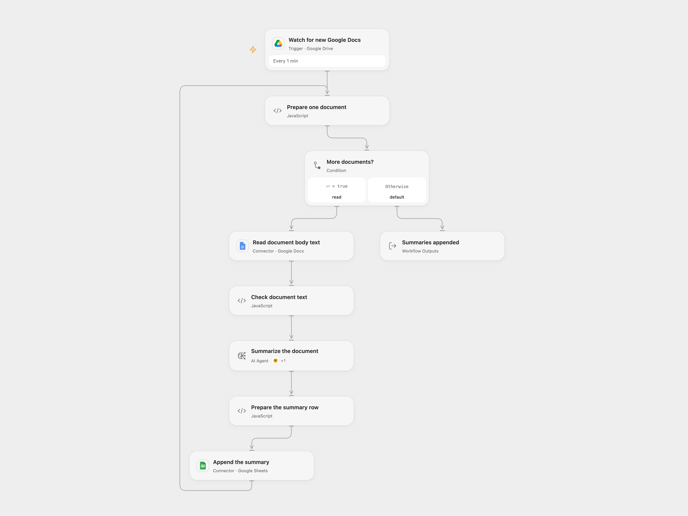

# Summarize New Google Docs to Sheets

Summarize new Google Docs and append each summary with its last editor to Google Sheets.

<picture>
  <source media="(prefers-color-scheme: dark)" srcset="preview-dark.png">
  
</picture>

[Open Flow JSON](templates/summarize-new-drive-documents-to-sheets.openflow.json) · [n8n JSON](templates/summarize-new-drive-documents-to-sheets.n8n.json)

## Setup

Connect Google Drive, Google Docs and Google Sheets. Set the watched folder ID, spreadsheet ID and range. Use columns A–C in the order Email, Name and Summary. Configure a tool-capable model and bind a Perigon connection to the Wikipedia tool in **Summarize the document**. In n8n, connect Google Drive, Google Docs, Google Sheets and OpenAI credentials, then set the same folder, spreadsheet and sheet with matching headers. Enable only one format to avoid duplicate rows.

## Behavior

Every minute, process newly created Google Docs directly in the chosen folder. Read body text including tabs and tables, summarize it and append the last modifying user’s email and name with the summary. Missing editor details become empty cells. Headers, footnotes, images and other non-text content are not summarized. Empty or inaccessible documents stop the affected run. Non-Google-Docs files are filtered out.

Open Flow uses optional Perigon Wikipedia search and JavaScript computation; n8n retains Wikipedia and Calculator tools, so results can differ. Open Flow allows up to four model rounds; n8n uses its configured tool-iteration limit. Document contents are sent to the selected model and may be used in optional tool requests. Documents may contain instructions that the model cannot be guaranteed to ignore. Review summaries for accuracy and limit access to the sheet and execution history. Large documents can exceed model or execution limits; the workflow does not intentionally truncate them.

Open Flow handles up to 50 candidate files per page with a continuation checkpoint; n8n collects native polling pages. Open Flow starts from the current time on first activation. An n8n manual test requests one matching existing file, while scheduled polls use their creation-time checkpoint. The formats use different checkpoints and do not guarantee exactly-once delivery. A failed run may not replay automatically, and an uncertain append may already have added a row. Inspect the sheet before retrying.

Inspiration &amp; credits

## Changes to the source

- Filter for Google Docs instead of trying to read every file as a document; read body text from all tabs and tables rather than only top-level paragraphs.
- Replace private configuration, validate document identity and nonempty text, and append raw cells to avoid spreadsheet formula interpretation.

Adapted from [Summarize the New Documents from Google Drive and Save Summary in Google Sheet](https://github.com/enescingoz/awesome-n8n-templates/blob/827110332c21cbe000ab13f6d292d5adb1f1f8db/Google_Drive_and_Google_Sheets/Summarize%20the%20New%20Documents%20from%20Google%20Drive%20and%20Save%20Summary%20in%20Google%20Sheet.json) in [enescingoz/awesome-n8n-templates](https://github.com/enescingoz/awesome-n8n-templates).

Source collection notice: © 2024–2026 Enes Cingoz, [CC BY 4.0](https://github.com/enescingoz/awesome-n8n-templates/blob/827110332c21cbe000ab13f6d292d5adb1f1f8db/LICENSE). The original [WeblineIndia workflow](https://github.com/weblineindia/n8n-Summarize-New-Documents-from-Google-Drive-and-Save-Summary-in-Google-Sheet/blob/c0ea4dc318e77d9e9404db4b026d1b3d752fafdd/Fetch_the_Most_Recent_Document_from_Google_Drive.json) is licensed under MIT; its notice is reproduced below. See [repository licensing](../../README.md#licensing) for the scope of OOMOL contributions and third-party material.

Original workflow notice:

> MIT License
>
> Copyright (c) 2025 WeblineIndia
>
> Permission is hereby granted, free of charge, to any person obtaining a copy
> of this software and associated documentation files (the "Software"), to deal
> in the Software without restriction, including without limitation the rights
> to use, copy, modify, merge, publish, distribute, sublicense, and/or sell
> copies of the Software, and to permit persons to whom the Software is
> furnished to do so, subject to the following conditions:
>
> The above copyright notice and this permission notice shall be included in all
> copies or substantial portions of the Software.
>
> THE SOFTWARE IS PROVIDED "AS IS", WITHOUT WARRANTY OF ANY KIND, EXPRESS OR
> IMPLIED, INCLUDING BUT NOT LIMITED TO THE WARRANTIES OF MERCHANTABILITY,
> FITNESS FOR A PARTICULAR PURPOSE AND NONINFRINGEMENT. IN NO EVENT SHALL THE
> AUTHORS OR COPYRIGHT HOLDERS BE LIABLE FOR ANY CLAIM, DAMAGES OR OTHER
> LIABILITY, WHETHER IN AN ACTION OF CONTRACT, TORT OR OTHERWISE, ARISING FROM,
> OUT OF OR IN CONNECTION WITH THE SOFTWARE OR THE USE OR OTHER DEALINGS IN THE
> SOFTWARE.

