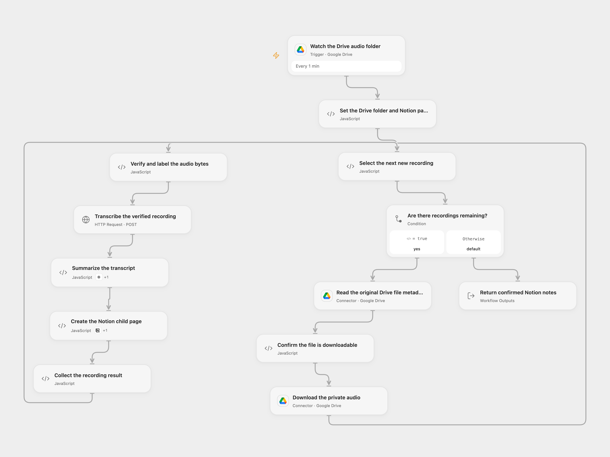

# Summarize New Drive Recordings in Notion

Watch a private Google Drive folder for new audio, transcribe it, and save a summary under a chosen Notion page.

<!-- template-actions:start -->
 
<!-- template-actions:end -->

<picture>
  <source media="(prefers-color-scheme: dark)" srcset="preview-dark.png">
  
</picture>

## Setup

1. Set the same My Drive folder ID in **Watch the Drive audio folder** and **Set the Drive folder and Notion parent**. Select the same Google Drive connection for the trigger, metadata and download. Enable Provider API access for the metadata and download nodes, and give the connection permission to download the files.
2. Bind an OpenAI API key with GPT Transcribe access in **Transcribe the verified recording**. Select an OpenAI connection with GPT-6 Luna access in **Summarize the transcript**.
3. Set the Notion parent page ID in **Set the Drive folder and Notion parent**. Share that page with the Notion integration and select its connection in **Create the Notion child page**. Publish and enable the workflow.

## Behavior

The workflow watches for new recordings in the selected folder every minute. It accepts up to 4 MiB per file in WAV, MP3, MPEG audio, M4A, audio MP4, FLAC, Ogg, or audio WebM. It checks the downloaded audio against its metadata and uses the Drive checksum when available. The page contains the generated title, a **Summary** section, and a link to the original private Drive file.

A recording is identified by its Drive file ID and the destination page. If Notion fails to confirm a write, the recording stays reserved. Check the Notion parent and the workflow run before attempting recovery. A failed recording can stop the current batch. Use folders and Notion pages appropriate for the people authorized to access the recording and notes.

In n8n

Set the source folder and destination page in **Set the Drive folder and Notion parent**. Bind the same Google Drive OAuth2 credential in **List all new recordings**, **Read the original Drive file metadata**, and **Download the private audio**. Select an OpenAI API credential in **Transcribe the verified recording** and **Summarize the transcript**, and a Notion API credential in **Create the Notion child page**.

Create a dedicated Data Table with text columns `request_key`, `status`, and `receipt`. Select it in **Check for an earlier Notion write**, **Reserve the Notion page**, and **Record the confirmed Notion page**. Use one production execution slot. The first scheduled run records the activation time. Subsequent runs read new Drive files in creation-time order, with a two-minute overlap. If a file blocks a batch, fix its access or move it out of the source folder so the next poll can continue.

Inspiration &amp; credits

## Changes to the source

Use current OpenAI models, verify audio before transcription, and hold unconfirmed Notion writes for inspection. [Original workflow by Pat](https://n8n.io/workflows/2178-transcribe-audio-files-summarize-with-gpt-4-and-store-in-notion/).

Adapted from [Transcribe audio files, summarize with GPT-4, and store in Notion](https://github.com/Zie619/n8n-workflows/blob/ae8cf6dc5b873cbb4f74587aa9180ed3a9f70682/workflows/Stickynote/1698_Stickynote_Notion_Automation_Triggered.json) in [Zie619/n8n-workflows](https://github.com/Zie619/n8n-workflows). Attribution: Pat (original workflow); Zie619 / n8n-workflows (collection).

The collection’s [MIT notice](https://github.com/Zie619/n8n-workflows/blob/94007c1445d9258a7da116646b79473e7c7c3282/LICENSE) is pinned at a later revision. This is the collection notice at that revision; it does not establish a separate original template author's license. Our changes are listed above; see [repository licensing](../../README.md#licensing).

> MIT License
>
> Copyright (c) 2025 Zie619
>
> Permission is hereby granted, free of charge, to any person obtaining a copy
> of this software and associated documentation files (the "Software"), to deal
> in the Software without restriction, including without limitation the rights
> to use, copy, modify, merge, publish, distribute, sublicense, and/or sell
> copies of the Software, and to permit persons to whom the Software is
> furnished to do so, subject to the following conditions:
>
> The above copyright notice and this permission notice shall be included in all
> copies or substantial portions of the Software.
>
> THE SOFTWARE IS PROVIDED "AS IS", WITHOUT WARRANTY OF ANY KIND, EXPRESS OR
> IMPLIED, INCLUDING BUT NOT LIMITED TO THE WARRANTIES OF MERCHANTABILITY,
> FITNESS FOR A PARTICULAR PURPOSE AND NONINFRINGEMENT. IN NO EVENT SHALL THE
> AUTHORS OR COPYRIGHT HOLDERS BE LIABLE FOR ANY CLAIM, DAMAGES OR OTHER
> LIABILITY, WHETHER IN AN ACTION OF CONTRACT, TORT OR OTHERWISE, ARISING FROM,
> OUT OF OR IN CONNECTION WITH THE SOFTWARE OR THE USE OR OTHER DEALINGS IN THE
> SOFTWARE.

