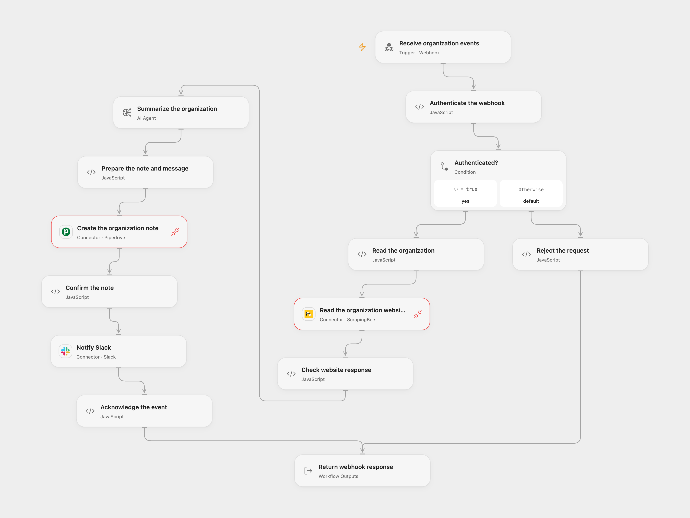

# Summarize New Pipedrive Organizations to Slack

Summarize a new organization’s website, save a CRM note and notify Slack.

<picture>
  <source media="(prefers-color-scheme: dark)" srcset="preview-dark.png">
  
</picture>

[Open Flow JSON](templates/summarize-pipedrive-organizations-to-slack.openflow.json) · [n8n JSON](templates/summarize-pipedrive-organizations-to-slack.n8n.json)

## Setup

Create an organization website custom field in Pipedrive. Deploy the workflow, then register a Pipedrive v2 organization-create webhook with HTTP Basic authentication pointing to its webhook URL. Set your numeric company ID and website custom-field key in **Read the organization**. In Open Flow create a secret Variable containing the word Basic, one space, and the Base64 encoding of username:password and bind it to **Authenticate the webhook**. Connect ScrapingBee in **Read the organization website**, Pipedrive in **Create the organization note**, an AI model in **Summarize the organization**, and Slack in **Notify Slack**; set the Slack channel ID. Grant Provider API Request permission for ScrapingBee and Pipedrive.

In n8n, configure the webhook Basic credential, company ID and custom-field key in **Read the organization**, ScrapingBee Query Auth with name api_key, Pipedrive and Slack credentials, and an OpenAI model. Register the n8n webhook separately and enable one format.

## Behavior

For each authenticated organization-create event, the workflow reads the website URL from the selected custom field, retrieves the page without JavaScript rendering, summarizes the content, creates a note on the same organization and posts the summary to Slack. Missing website data or a failed read/model/note stops before the Slack message. The site content is sent to ScrapingBee and the selected model; review summaries for accuracy and restrict access to execution data.

A note or Slack message may have been created when a response is lost. Check Pipedrive and Slack before replaying; redelivery or overlapping requests can create duplicates. Open Flow waits up to 60 seconds for the webhook response; n8n acknowledges on receipt. A later n8n failure appears in its execution history. Website query credentials may appear in service or network logs.

Inspiration &amp; credits

## Changes to the source

- Use an authenticated Pipedrive v2 organization-create webhook and configure the website field key. Fix the source's placeholder field and keep organization association through the note and Slack message.
- Reuse one plain-text summary for the note and message, escaping it for the CRM note. The source's note output was sent to a Markdown converter as if it still contained the model's HTML.

Adapted from [Enrich Pipedrive organization and notify Slack](https://github.com/enescingoz/awesome-n8n-templates/blob/827110332c21cbe000ab13f6d292d5adb1f1f8db/Slack/Enrich%20Pipedrive_s%20Organization%20Data%20with%20OpenAI%20GPT-4o%20%26%20Notify%20it%20in%20Slack.json) in [enescingoz/awesome-n8n-templates](https://github.com/enescingoz/awesome-n8n-templates).

Source collection notice: © 2024–2026 Enes Cingoz, [CC BY 4.0](https://github.com/enescingoz/awesome-n8n-templates/blob/827110332c21cbe000ab13f6d292d5adb1f1f8db/LICENSE). The source export does not identify a separate template author or license. See [repository licensing](../../README.md#licensing) for the scope of OOMOL contributions and third-party material.

