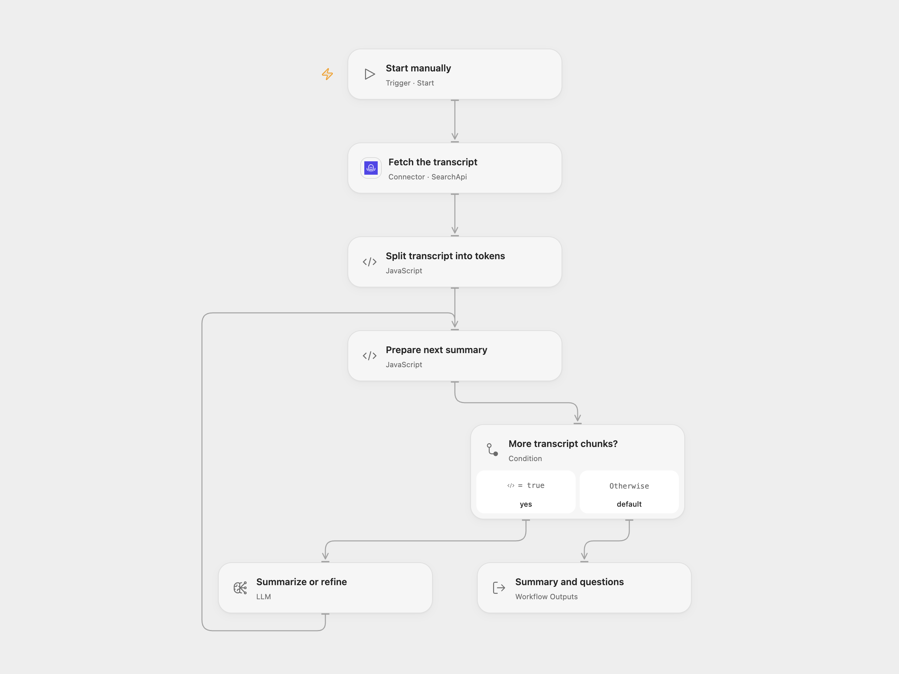

# Summarize Podcast Transcript with Refinement

Summarize a YouTube podcast transcript and generate specific example questions and answers.

<picture>
  <source media="(prefers-color-scheme: dark)" srcset="preview-dark.png">
  
</picture>

[Open Flow JSON](templates/summarize-podcast-transcript-with-refinement.openflow.json) · [n8n JSON](templates/summarize-podcast-transcript-with-refinement.n8n.json)

## Setup and use

Connect SearchApi in **Fetch the transcript** and set the video ID. Select an available model in **Summarize or refine**. In n8n, set the video ID, configure Query Auth with name `api_key` for **Fetch the transcript**, and connect an OpenAI model. Run manually. SearchApi defaults to English, and available transcripts depend on the video and service. Query credentials can appear in service or network logs.

## Behavior

The workflow joins transcript segments in order and splits them into GPT-2 tokens, with 10,000-token chunks and a 250-token overlap. The model summarizes the first chunk and successively refines its summary and specific example questions and answers using each remaining chunk. It makes one model call per chunk. Missing transcripts, API errors, or an empty model response stop the run. Input and intermediate data remain subject to execution and model context limits. Model output can be inaccurate; review it before use.

Inspiration &amp; credits

## Changes to the source

- Use a managed SearchApi connection or n8n Query Auth instead of embedding an API key in Code.
- Open Flow bundles the MIT-licensed js-tiktoken tokenizer to retain the source's GPT-2 chunk size and overlap. It makes the model choice and temperature 0 explicit; this can change wording.

Adapted from [Summarize a YouTube podcast transcript](https://github.com/Zie619/n8n-workflows/blob/ae8cf6dc5b873cbb4f74587aa9180ed3a9f70682/workflows/Manual/0399_Manual_Stickynote_Automate_Triggered.json) in [Zie619/n8n-workflows](https://github.com/Zie619/n8n-workflows). The source export does not identify a separate template author or license.

The collection’s [MIT notice](https://github.com/Zie619/n8n-workflows/blob/94007c1445d9258a7da116646b79473e7c7c3282/LICENSE) is pinned at a later revision. This is the collection notice at that revision; it does not establish a separate original template author's license. Our changes are listed above; see [repository licensing](../../README.md#licensing).

> MIT License
>
> Copyright (c) 2025 Zie619
>
> Permission is hereby granted, free of charge, to any person obtaining a copy
> of this software and associated documentation files (the "Software"), to deal
> in the Software without restriction, including without limitation the rights
> to use, copy, modify, merge, publish, distribute, sublicense, and/or sell
> copies of the Software, and to permit persons to whom the Software is
> furnished to do so, subject to the following conditions:
>
> The above copyright notice and this permission notice shall be included in all
> copies or substantial portions of the Software.
>
> THE SOFTWARE IS PROVIDED "AS IS", WITHOUT WARRANTY OF ANY KIND, EXPRESS OR
> IMPLIED, INCLUDING BUT NOT LIMITED TO THE WARRANTIES OF MERCHANTABILITY,
> FITNESS FOR A PARTICULAR PURPOSE AND NONINFRINGEMENT. IN NO EVENT SHALL THE
> AUTHORS OR COPYRIGHT HOLDERS BE LIABLE FOR ANY CLAIM, DAMAGES OR OTHER
> LIABILITY, WHETHER IN AN ACTION OF CONTRACT, TORT OR OTHERWISE, ARISING FROM,
> OUT OF OR IN CONNECTION WITH THE SOFTWARE OR THE USE OR OTHER DEALINGS IN THE
> SOFTWARE.

