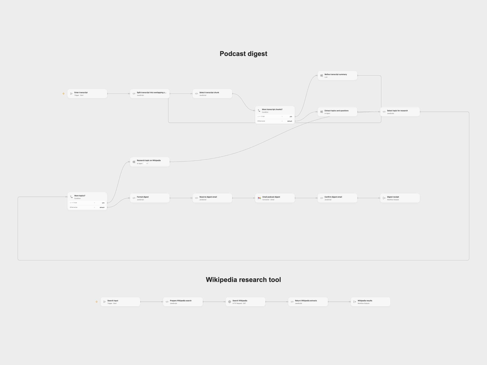

# Summarize a Podcast with Wikipedia Research

Summarize a transcript, research its topics using Wikipedia and email a digest.

<!-- template-actions:start -->
 
<!-- template-actions:end -->

<picture>
  <source media="(prefers-color-scheme: dark)" srcset="preview-dark.png">
  
</picture>

## Setup

Configure a current AI model and Gmail connection. Import the bundle, publish **Wikipedia research tool**, refresh its interface in **Podcast digest**, and configure its User-Agent with a contact. Supply a transcript, recipient and a unique request ID; enable persistent State. Use one format and avoid overlapping runs.

## Behavior

A manual run splits the transcript into 6000-character chunks with 1000-character overlap, refines a summary across all chunks, generates topics and questions, and asks an Agent to research each topic with Wikipedia. The email contains the summary, topic research and questions. Open Flow uses fixed character windows. Review model output and sources. Transcript data is sent to the model provider; topic queries are sent to Wikipedia. Workflow input and Code data size limits apply.

An unknown email outcome may already have sent. Use a new request ID only for a new intended digest.

In n8n

In n8n replace the sample transcript and recipient, configure OpenAI and Gmail credentials, and create a Data Table with item_key and status text columns. N8n uses its original recursive splitter. Inspect Gmail before clearing a pending request in persistent State or the n8n Data Table.

Inspiration &amp; credits

Adapted from [AI: Summarize podcast episode and enhance using Wikipedia](https://github.com/enescingoz/awesome-n8n-templates/blob/827110332c21cbe000ab13f6d292d5adb1f1f8db/OpenAI_and_LLMs/AI_%20Summarize%20podcast%20episode%20and%20enhance%20using%20Wikipedia.json) in [enescingoz/awesome-n8n-templates](https://github.com/enescingoz/awesome-n8n-templates).

Source collection notice: © 2024–2026 Enes Cingoz, [CC BY 4.0](https://github.com/enescingoz/awesome-n8n-templates/blob/827110332c21cbe000ab13f6d292d5adb1f1f8db/LICENSE). The source export does not identify a separate template author or license. See [repository licensing](../../README.md#licensing) for the scope of OOMOL contributions and third-party material.

