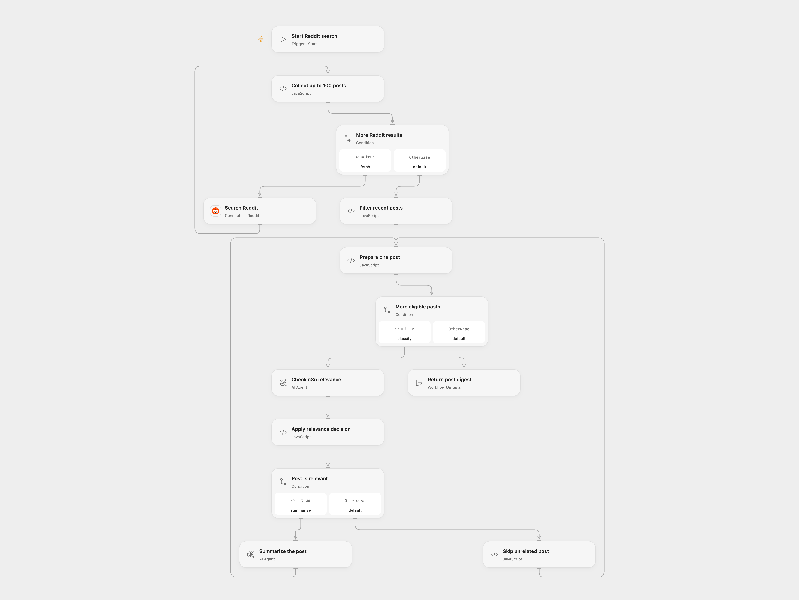

# Summarize Reddit n8n Discussions

Search recent Reddit posts and return one summary for each relevant n8n discussion.

<picture>
  <source media="(prefers-color-scheme: dark)" srcset="preview-dark.png">
  
</picture>

[Open Flow JSON](templates/summarize-reddit-n8n-discussions.openflow.json) · [n8n JSON](templates/summarize-reddit-n8n-discussions.n8n.json)

## Setup and use

Connect Reddit with read access and configure an available AI model in both Agent nodes. Run the workflow to search all Reddit for `n8n` sorted newest first. In Open Flow, edit the timezone input on **Filter recent posts** (default UTC); in n8n set the workflow timezone.

The workflow examines at most 100 search results, follows short pages, and keeps posts with at least 5 upvotes, nonempty text, and a creation time after midnight seven days before the run. It classifies only the first 500 characters. A classification containing the case-sensitive text `No` is excluded; each other post receives a one-sentence summary. Results include subreddit, subscriber count, upvotes, date and URL. Empty or entirely excluded results return no summaries. Model results are probabilistic and should be reviewed.

Open Flow returns an array and processes each post through classification and summary before the next. n8n returns individual items and executes nodes in its normal item batches. Open Flow uses the displayed timezone for dates; configure it to match n8n's workflow timezone. Open Flow fails on malformed Reddit data or a repeated pagination cursor; n8n follows its node behavior. Both formats make two model calls per included post, and a model failure stops the run.

Inspiration &amp; credits

## Changes to the source

- Replace retired OpenAI completion models with a configurable current model; n8n's response mapping preserves the source conditions and output fields. Open Flow uses Agent nodes and does not enforce the source model's 32/128-token limits.
- The source note says more than five upvotes; the actual condition is at least five. Its enabled summary prompt asks for one sentence.

Adapted from [Reddit n8n discussion digest](https://github.com/Zie619/n8n-workflows/blob/ae8cf6dc5b873cbb4f74587aa9180ed3a9f70682/workflows/Manual/0297_Manual_Openai_Export_Triggered.json) in [Zie619/n8n-workflows](https://github.com/Zie619/n8n-workflows). The source export does not identify a separate template author or license.

The collection’s [MIT notice](https://github.com/Zie619/n8n-workflows/blob/94007c1445d9258a7da116646b79473e7c7c3282/LICENSE) is pinned at a later revision. This is the collection notice at that revision; it does not establish a separate original template author's license. Our changes are listed above; see [repository licensing](../../README.md#licensing).

> MIT License
>
> Copyright (c) 2025 Zie619
>
> Permission is hereby granted, free of charge, to any person obtaining a copy
> of this software and associated documentation files (the "Software"), to deal
> in the Software without restriction, including without limitation the rights
> to use, copy, modify, merge, publish, distribute, sublicense, and/or sell
> copies of the Software, and to permit persons to whom the Software is
> furnished to do so, subject to the following conditions:
>
> The above copyright notice and this permission notice shall be included in all
> copies or substantial portions of the Software.
>
> THE SOFTWARE IS PROVIDED "AS IS", WITHOUT WARRANTY OF ANY KIND, EXPRESS OR
> IMPLIED, INCLUDING BUT NOT LIMITED TO THE WARRANTIES OF MERCHANTABILITY,
> FITNESS FOR A PARTICULAR PURPOSE AND NONINFRINGEMENT. IN NO EVENT SHALL THE
> AUTHORS OR COPYRIGHT HOLDERS BE LIABLE FOR ANY CLAIM, DAMAGES OR OTHER
> LIABILITY, WHETHER IN AN ACTION OF CONTRACT, TORT OR OTHERWISE, ARISING FROM,
> OUT OF OR IN CONNECTION WITH THE SOFTWARE OR THE USE OR OTHER DEALINGS IN THE
> SOFTWARE.

