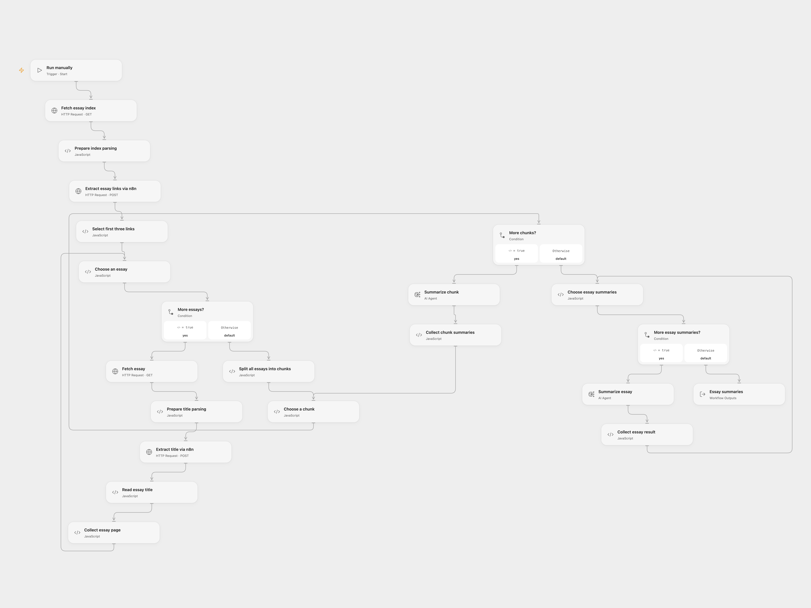

# Summarize Three Essays

Read the first three essay links from Paul Graham’s article index and summarize each page.

<!-- template-actions:start -->
 
<!-- template-actions:end -->

<picture>
  <source media="(prefers-color-scheme: dark)" srcset="preview-dark.png">
  
</picture>

## Setup

Configure an AI model. In Open Flow, import the n8n workflow, enable its **HTML parsing relay**, configure a Header Auth credential and bind the matching secret N8N_HTML_RELAY_TOKEN and relay URL in both parser nodes. Configure the model in n8n for direct use. Use one format and protect the relay.

## Behavior

Fetch the index, take its first three nested-table links, fetch each essay and return its title, URL and summary. The workflow sends page content to the model. Open Flow summarizes every 4,000-character chunk and combines those summaries; n8n uses its recursive document splitter and summarization chain. Summaries can differ and require review. Very large pages must fit workflow input and model limits.

Inspiration &amp; credits

## Changes to the source

Use HTTPS, process essays independently and preserve each title and URL with its summary.

Adapted from [Scrape and summarize webpages with AI](https://github.com/enescingoz/awesome-n8n-templates/blob/827110332c21cbe000ab13f6d292d5adb1f1f8db/AI_Research_RAG_and_Data_Analysis/Scrape%20and%20summarize%20webpages%20with%20AI.json) in [enescingoz/awesome-n8n-templates](https://github.com/enescingoz/awesome-n8n-templates).

Source collection notice: © 2024–2026 Enes Cingoz, [CC BY 4.0](https://github.com/enescingoz/awesome-n8n-templates/blob/827110332c21cbe000ab13f6d292d5adb1f1f8db/LICENSE). The source export does not identify a separate template author or license. See [repository licensing](../../README.md#licensing) for the scope of OOMOL contributions and third-party material.

