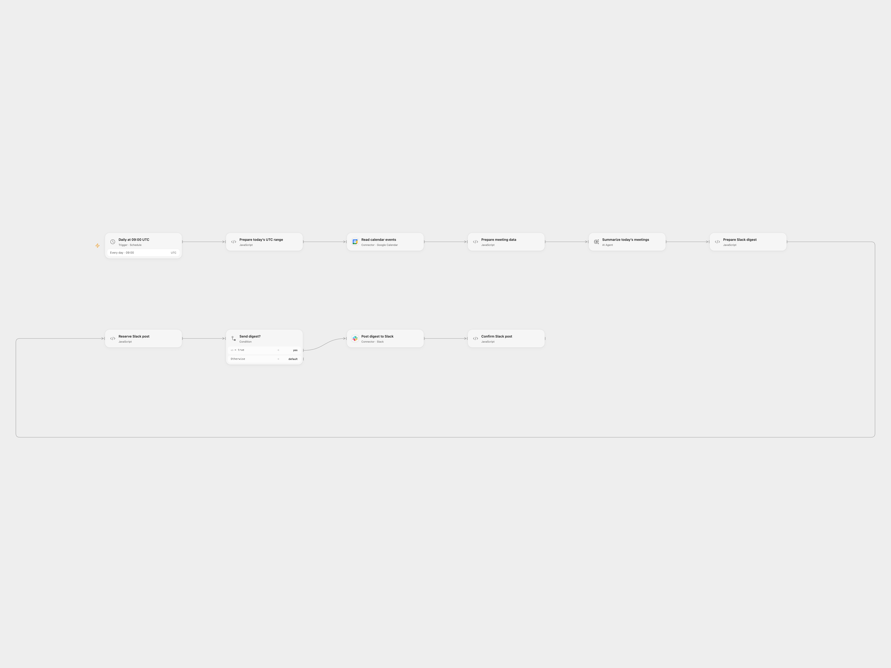

# Summarize Today’s Meetings in Slack

Summarize today’s calendar meetings and attendees in Slack.

<picture>
  <source media="(prefers-color-scheme: dark)" srcset="preview-dark.png">
  
</picture>

[Open Flow JSON](templates/summarize-todays-meetings-in-slack.openflow.json) · [n8n JSON](templates/summarize-todays-meetings-in-slack.n8n.json)

## Setup

Connect Google Calendar, Slack and the model in Open Flow, enter the calendar ID and Slack channel ID, and enable persistent State. In direct n8n mode configure the calendar, Gemini, Slack and a Data Table with item_key and status text columns. Use one mode and prevent overlapping runs.

## Behavior

At 09:00 UTC daily, read one page of up to 50 calendar events in the current UTC day, summarize meetings and all returned attendees, and post the digest in Slack. Events beyond the first page are not included. The calendar request retains the source node’s recurrence behavior. Calendar information is sent to the model; verify the digest. Open Flow uses a fixed calendar read followed by an Agent and labels the message Meeting digest; direct n8n retains the Calendar tool Agent and original Gemini label.

If Slack delivery is uncertain, inspect the channel and resolve the pending State or Data Table row before rerunning.

Inspiration &amp; credits

Adapted from [Daily meetings summarization with Gemini AI](https://github.com/enescingoz/awesome-n8n-templates/blob/827110332c21cbe000ab13f6d292d5adb1f1f8db/OpenAI_and_LLMs/Daily%20meetings%20summarization%20with%20Gemini%20AI.json) in [enescingoz/awesome-n8n-templates](https://github.com/enescingoz/awesome-n8n-templates).

Source collection notice: © 2024–2026 Enes Cingoz, [CC BY 4.0](https://github.com/enescingoz/awesome-n8n-templates/blob/827110332c21cbe000ab13f6d292d5adb1f1f8db/LICENSE). The source export does not identify a separate template author or license. See [repository licensing](../../README.md#licensing) for the scope of OOMOL contributions and third-party material.

