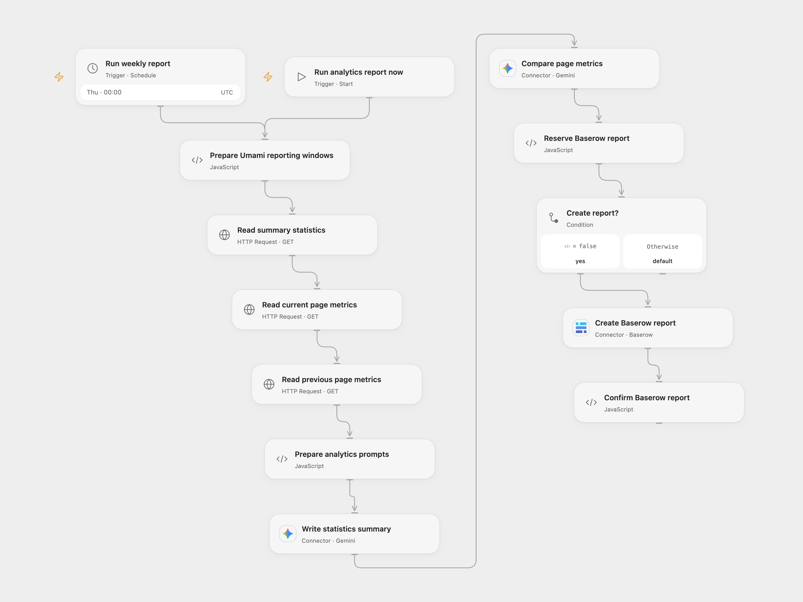

# Summarize Umami Analytics to Baserow

Compare weekly Umami page metrics and save two AI-written reports in Baserow.

<!-- template-actions:start -->
 
<!-- template-actions:end -->

<picture>
  <source media="(prefers-color-scheme: dark)" srcset="preview-dark.png">
  
</picture>

## Setup

In **Prepare Umami reporting windows**, configure the two HTTPS Umami base URLs and website IDs. They can refer to the same website or to separate summary and page-metric sources. Set the reporting timezone and use metrics type path for current Umami or url for compatible older installations. Bind UMAMI_STATS_TOKEN and UMAMI_METRICS_TOKEN as bearer tokens. Connect Gemini and Baserow Cloud, configure the Baserow table ID and site name, and enable persistent State. The Baserow table needs text fields report_key, site, summary and comparison, plus a date field named date.

## Behavior

Run manually or each Thursday at 00:00 UTC. The workflow reads the latest seven days of summary statistics and compares page metrics with the preceding seven days. Gemini produces a summary and a separate page comparison with five suggestions; one Baserow row stores both reports. Metrics are sent to Gemini, so review permissions and AI output. The two metric periods share the same boundary; each API request is limited to 500 ranked pages.

An uncertain Baserow creation leaves a pending checkpoint. Inspect the table for report_key, enter the key and confirmed or absent in **Reserve Baserow report**, rerun and clear the fields. Avoid overlapping reports for the same sites and date.

In n8n

In n8n configure the same hosts, IDs, tokens, Gemini and Baserow credentials and one Data Table with item_key and status text columns. In n8n inspect the corresponding Data Table checkpoint and Baserow row, and delete the checkpoint only after reconciliation.

Inspiration &amp; credits

Use the documented website statistics endpoint, keep separate configurable Umami sources, replace the old model, and add report checkpoints.

Adapted from [Umami analytics template](https://github.com/Zie619/n8n-workflows/blob/ae8cf6dc5b873cbb4f74587aa9180ed3a9f70682/workflows/Code/1850_Code_Schedule_Automation_Webhook.json) in [Zie619/n8n-workflows](https://github.com/Zie619/n8n-workflows). Attribution: Zie619 / n8n-workflows.

The collection’s [MIT notice](https://github.com/Zie619/n8n-workflows/blob/94007c1445d9258a7da116646b79473e7c7c3282/LICENSE) is pinned at a later revision. This is the collection notice at that revision; it does not establish a separate original template author's license. Our changes are listed above; see [repository licensing](../../README.md#licensing).

> MIT License
>
> Copyright (c) 2025 Zie619
>
> Permission is hereby granted, free of charge, to any person obtaining a copy
> of this software and associated documentation files (the "Software"), to deal
> in the Software without restriction, including without limitation the rights
> to use, copy, modify, merge, publish, distribute, sublicense, and/or sell
> copies of the Software, and to permit persons to whom the Software is
> furnished to do so, subject to the following conditions:
>
> The above copyright notice and this permission notice shall be included in all
> copies or substantial portions of the Software.
>
> THE SOFTWARE IS PROVIDED "AS IS", WITHOUT WARRANTY OF ANY KIND, EXPRESS OR
> IMPLIED, INCLUDING BUT NOT LIMITED TO THE WARRANTIES OF MERCHANTABILITY,
> FITNESS FOR A PARTICULAR PURPOSE AND NONINFRINGEMENT. IN NO EVENT SHALL THE
> AUTHORS OR COPYRIGHT HOLDERS BE LIABLE FOR ANY CLAIM, DAMAGES OR OTHER
> LIABILITY, WHETHER IN AN ACTION OF CONTRACT, TORT OR OTHERWISE, ARISING FROM,
> OUT OF OR IN CONNECTION WITH THE SOFTWARE OR THE USE OR OTHER DEALINGS IN THE
> SOFTWARE.

