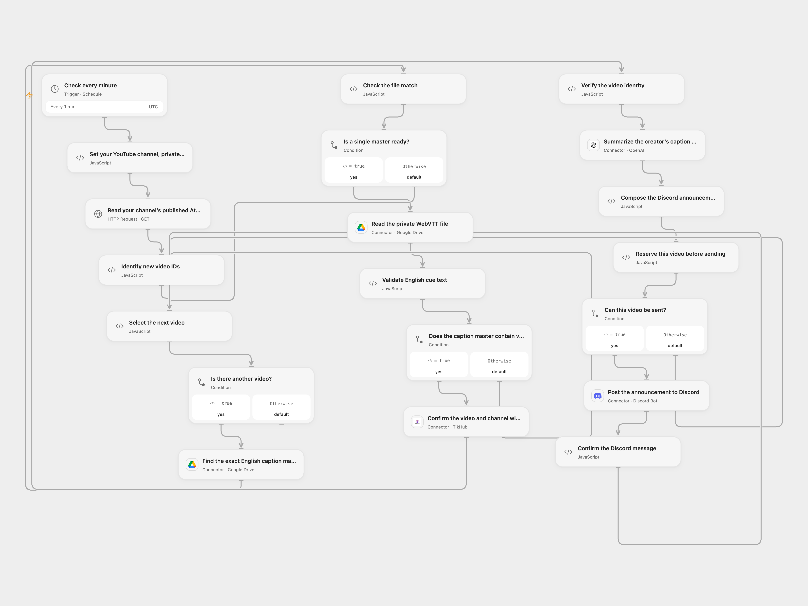

# Announce New YouTube Videos with Caption Summaries

Post the title, watch link, and three points from your English caption master when your YouTube channel publishes a new video.

<!-- template-actions:start -->
 
<!-- template-actions:end -->

<picture>
  <source media="(prefers-color-scheme: dark)" srcset="preview-dark.png">
  
</picture>

## Setup

1. Enter your authorized YouTube channel ID and Discord destination channel ID in **Set your YouTube channel, private Drive folder, and Discord channel**. The channel owner must authorize caption processing by OpenAI and the announcement in that Discord channel.
2. Put a single UTF-8 file named `VIDEO_ID.en.vtt` in a private My Drive folder. Use the same English WebVTT file you upload for that YouTube video. Copy the exact 11-character video ID from its watch URL, and verify the file belongs to that upload before the video goes live. Supply the folder ID in **Set your YouTube channel, private Drive folder, and Discord channel** and connect the same Google Drive account in **Find the exact English caption master** and **Read the private WebVTT file**. Allow Provider API access for the private download.
3. Connect TikHub in **Confirm the video and channel with TikHub**, OpenAI in **Summarize the creator’s caption master**, and Discord Bot in **Post the announcement to Discord**. The bot needs permission to send in the configured channel. Enable persistent State and publish.

## Behavior

The first successful minute check records the current feed as a baseline. On later checks, YouTube’s official Atom feed supplies new video IDs, including IDs from outside the regular Videos tab. TikHub confirms the video and channel before the workflow uses the video title and canonical link in the announcement. The OpenAI request contains only the authorized creator caption text. The model writes three short points. Discord receives the title, those points, and the watch link with mentions disabled. [YouTube Atom notifications](https://developers.google.com/youtube/data/guides/push_notifications) · [TikHub video details](https://docs.tikhub.io/461775522e0)

A missing, invalid, or duplicate master produces a status for that video without posting. Upload or correct the single file while the new video is still in the rolling Atom feed. Later checks try it again. The workflow accepts up to 250,000 bytes and 60,000 cue characters. There is no alternate language or speech transcription. If the video has aged out of the feed, handle the announcement manually.

An unconfirmed Discord response stops the run and keeps the video reserved. Check the selected channel for its watch link before clearing that video’s reservation. Confirmed posts and reserved posts are both skipped on subsequent checks. Keep execution history private because it may include caption text.

In n8n

Set the same channel and private folder in **Set your YouTube channel, private Drive folder, and Discord channel** and attach a Google Drive OAuth credential in the two Drive HTTP nodes. Configure **Confirm the video and channel with TikHub** with a Header Auth credential using `Authorization: Bearer YOUR_TIKHUB_TOKEN` and attach an OpenAI credential to **Summarize the creator’s caption master**.

Attach a Header Auth credential to **Post the announcement to Discord** with `Authorization: Bot YOUR_DISCORD_BOT_TOKEN`. The bot needs permission to send to the configured Discord channel. The response must match that channel.

Create an n8n Data Table with the string column `request_key` and select it in **Check for an existing delivery** and **Reserve this video before sending**. Use a single self-hosted instance in regular mode with `N8N_CONCURRENCY_PRODUCTION_LIMIT=1` and avoid overlapping manual runs. Keep receipt rows to prevent a replay. The first successful active minute check stores the initial Atom baseline. [n8n concurrency control](https://docs.n8n.io/hosting/scaling/concurrency-control/)

Inspiration &amp; credits

## Changes to the source

The original workflow downloads the first matching English track from YouTube. This template reads the creator’s private WebVTT master for the exact same video ID. The creator supplies and authorizes that master. The workflow preserves the scheduled video check and the three-point Discord announcement. Use a Discord bot to post directly to the configured channel.

Adapted from [Summarise Your YouTube Videos with AI for Discord](https://github.com/Zie619/n8n-workflows/blob/ae8cf6dc5b873cbb4f74587aa9180ed3a9f70682/workflows/Rssfeedread/1536_Rssfeedread_Extractfromfile_Automation_Webhook.json) in [Zie619/n8n-workflows](https://github.com/Zie619/n8n-workflows). Attribution: Zie619 / n8n-workflows.

The collection’s [MIT notice](https://github.com/Zie619/n8n-workflows/blob/94007c1445d9258a7da116646b79473e7c7c3282/LICENSE) is pinned at a later revision. This is the collection notice at that revision; it does not establish a separate original template author's license. Our changes are listed above; see [repository licensing](../../README.md#licensing).

> MIT License
>
> Copyright (c) 2025 Zie619
>
> Permission is hereby granted, free of charge, to any person obtaining a copy
> of this software and associated documentation files (the "Software"), to deal
> in the Software without restriction, including without limitation the rights
> to use, copy, modify, merge, publish, distribute, sublicense, and/or sell
> copies of the Software, and to permit persons to whom the Software is
> furnished to do so, subject to the following conditions:
>
> The above copyright notice and this permission notice shall be included in all
> copies or substantial portions of the Software.
>
> THE SOFTWARE IS PROVIDED "AS IS", WITHOUT WARRANTY OF ANY KIND, EXPRESS OR
> IMPLIED, INCLUDING BUT NOT LIMITED TO THE WARRANTIES OF MERCHANTABILITY,
> FITNESS FOR A PARTICULAR PURPOSE AND NONINFRINGEMENT. IN NO EVENT SHALL THE
> AUTHORS OR COPYRIGHT HOLDERS BE LIABLE FOR ANY CLAIM, DAMAGES OR OTHER
> LIABILITY, WHETHER IN AN ACTION OF CONTRACT, TORT OR OTHERWISE, ARISING FROM,
> OUT OF OR IN CONNECTION WITH THE SOFTWARE OR THE USE OR OTHER DEALINGS IN THE
> SOFTWARE.

