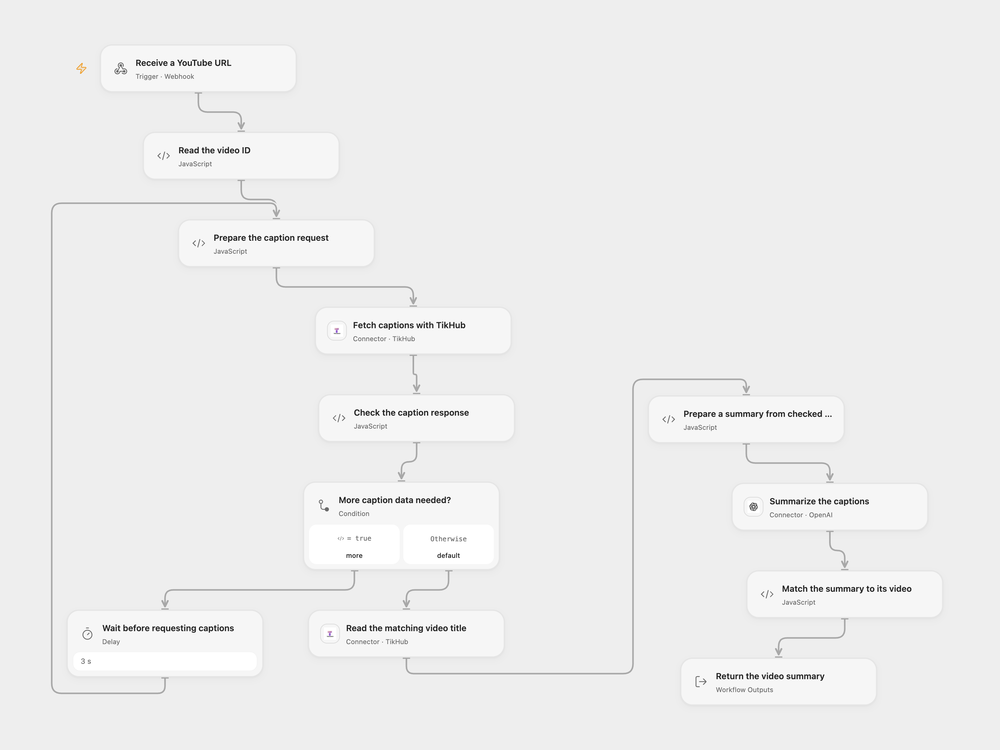

# Summarize YouTube Videos from Public Captions

Submit a YouTube video URL and get a summary and key points based on its public captions.

<!-- template-actions:start -->
 
<!-- template-actions:end -->

<picture>
  <source media="(prefers-color-scheme: dark)" srcset="preview-dark.png">
  
</picture>

## Setup

1. Use the same TikHub connection in **Fetch captions with TikHub** and **Read the matching video title**. For your own token, allow the YouTube Web V2 caption, caption job result and video details paths. [TikHub caption endpoint](https://docs.tikhub.io/431829301e0)
2. Connect OpenAI in **Summarize the captions** and publish. Open the hosted form in **Receive a YouTube URL** and submit a full YouTube watch, short, or live video URL.

## Behavior

The form immediately acknowledges the link. When the run finishes, open its workflow output to see the video title and URL, caption language, summary, and key points.

When English captions are available, the workflow chooses English, an English variant, or auto-generated English in that order. Otherwise, it uses the first available language. A caption job is checked every three seconds, up to twelve times. Videos without available public captions, transcripts over 60,000 characters, mismatched video data, and failed provider calls end the run without a summary. The workflow sends the matched caption text and title to OpenAI.

In n8n

Attach the same TikHub **Header Auth** credential to **Fetch captions with TikHub** and **Read the matching video title**. Set the header name to `Authorization` and its value to `Bearer YOUR_TIKHUB_TOKEN`. Bind an OpenAI API credential in **Summarize the captions**. Activate and open the production form URL. View the result in **Match the summary to its video** in the execution after the form acknowledges receipt.

Inspiration &amp; credits

Adapted from [Summarize YouTube Videos from Transcript](https://github.com/enescingoz/awesome-n8n-templates/blob/827110332c21cbe000ab13f6d292d5adb1f1f8db/OpenAI_and_LLMs/Summarize%20YouTube%20Videos%20from%20Transcript.json) in [enescingoz/awesome-n8n-templates](https://github.com/enescingoz/awesome-n8n-templates).

Source collection notice: © 2024–2026 Enes Cingoz, [CC BY 4.0](https://github.com/enescingoz/awesome-n8n-templates/blob/827110332c21cbe000ab13f6d292d5adb1f1f8db/LICENSE). The [original n8n template](https://n8n.io/workflows/2736-summarize-youtube-videos-from-transcript/) credits Ahmed Alnaqa. See [repository licensing](../../README.md#licensing) for the scope of OOMOL contributions and third-party material.

## Changes to the source

TikHub replaces the unconfigured Apify actor. The workflow matches the captions and title by video ID and returns a structured summary in the execution.

