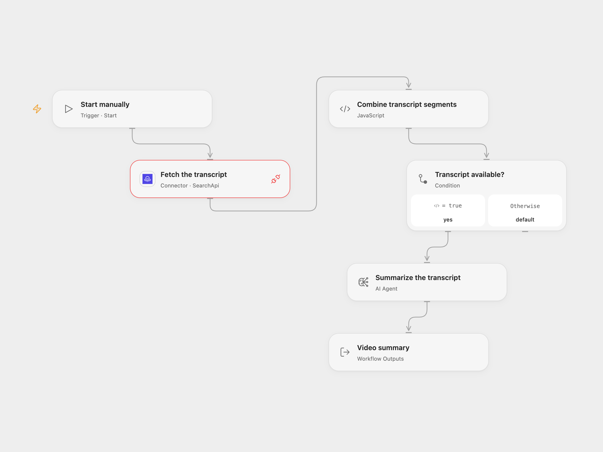

# Summarize YouTube Transcripts

Fetch a YouTube transcript and generate a concise summary.

<picture>
  <source media="(prefers-color-scheme: dark)" srcset="preview-dark.png">
  
</picture>

[Open Flow JSON](templates/summarize-youtube-transcripts.openflow.json) · [n8n JSON](templates/summarize-youtube-transcripts.n8n.json)

## Setup

Connect SearchApi in **Fetch the transcript** and replace YOUR_YOUTUBE_VIDEO_ID with a video ID. Select an available model in **Summarize the transcript**. In n8n, set the video ID in **Fetch the transcript**, configure Query Auth with name api_key and your SearchApi key as its value, and connect an OpenAI model in **OpenAI Chat Model**. Run either format manually.

## Behavior

The workflow requests the video's transcript, joins the returned text segments in order, and summarizes the text. If no transcript is available, it produces no summary. API errors or invalid transcript data stop the run. SearchApi defaults to English; available captions depend on the video and service. The model receives the transcript and may make mistakes, so review the result. Long transcripts can exceed execution or model context limits. Query credentials can appear in service or network logs; keep keys and execution data private.

Inspiration &amp; credits

## Changes to the source

- Explicitly request the youtube_transcripts engine. The source omitted the community node's resource selection, which defaults to Google search in the checked node version. n8n uses HTTP Query Auth instead of requiring the community node; both formats check the response before summarization.
- Open Flow uses an AI Agent on the combined text; n8n keeps its 6,000-character splitter and summarization chain. Their summaries can differ.

Adapted from [YouTube transcript summarization](https://github.com/Zie619/n8n-workflows/blob/ae8cf6dc5b873cbb4f74587aa9180ed3a9f70682/workflows/Manual/1552_Manual_Summarize_Automation_Triggered.json) in [Zie619/n8n-workflows](https://github.com/Zie619/n8n-workflows). The matching [n8n listing](https://n8n.io/workflows/3828-generate-youtube-video-summaries-with-searchapi-transcripts-and-llm/) credits Pedro Santos. No separate original template license was found.

The collection’s [MIT notice](https://github.com/Zie619/n8n-workflows/blob/94007c1445d9258a7da116646b79473e7c7c3282/LICENSE) is pinned at a later revision. This is the collection notice at that revision; it does not establish a separate original template author's license. Our changes are listed above; see [repository licensing](../../README.md#licensing).

> MIT License
>
> Copyright (c) 2025 Zie619
>
> Permission is hereby granted, free of charge, to any person obtaining a copy
> of this software and associated documentation files (the "Software"), to deal
> in the Software without restriction, including without limitation the rights
> to use, copy, modify, merge, publish, distribute, sublicense, and/or sell
> copies of the Software, and to permit persons to whom the Software is
> furnished to do so, subject to the following conditions:
>
> The above copyright notice and this permission notice shall be included in all
> copies or substantial portions of the Software.
>
> THE SOFTWARE IS PROVIDED "AS IS", WITHOUT WARRANTY OF ANY KIND, EXPRESS OR
> IMPLIED, INCLUDING BUT NOT LIMITED TO THE WARRANTIES OF MERCHANTABILITY,
> FITNESS FOR A PARTICULAR PURPOSE AND NONINFRINGEMENT. IN NO EVENT SHALL THE
> AUTHORS OR COPYRIGHT HOLDERS BE LIABLE FOR ANY CLAIM, DAMAGES OR OTHER
> LIABILITY, WHETHER IN AN ACTION OF CONTRACT, TORT OR OTHERWISE, ARISING FROM,
> OUT OF OR IN CONNECTION WITH THE SOFTWARE OR THE USE OR OTHER DEALINGS IN THE
> SOFTWARE.

