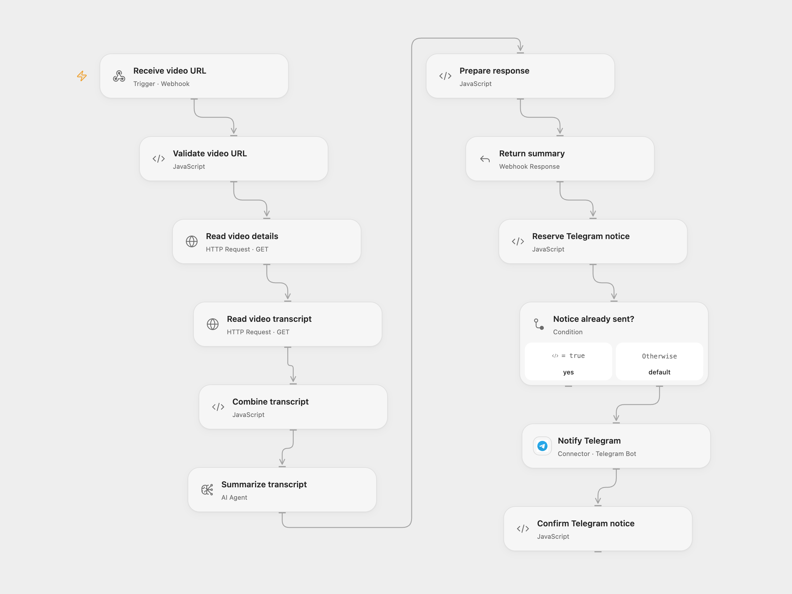

# Summarize YouTube Video and Notify

Summarize a YouTube transcript, return video details and notify Telegram.

<!-- template-actions:start -->
[](https://openflow.run/templates/summarize-youtube-video-and-notify/) [](templates/summarize-youtube-video-and-notify.n8n.json)
<!-- template-actions:end -->

<picture>
  <source media="(prefers-color-scheme: dark)" srcset="preview-dark.png">
  
</picture>

## Setup and use

Configure a [YTAPI](https://docs.ytapi.dev/transcripts/get/) key as the YTAPI_KEY Secret Variable, an AI model, a Telegram connection and chat ID, and persistent State. POST JSON containing youtubeUrl to the webhook. The HTTP response waits up to 60 seconds and contains id, youtubeUrl, title, description, summary and topics. Configure YTAPI HTTP Header Auth credentials with Authorization set to Bearer followed by the API key, OpenAI, Telegram.

## Behavior

The workflow fetches the video details and available transcript, summarizes its complete text, returns the result, then sends the title and URL to Telegram. Only videos with accessible captions can be processed; transcript availability, external service access and model context limits apply. Review model output for accuracy. Telegram notification is checkpointed per video; inspect Telegram before clearing a pending checkpoint, and clear a completed checkpoint to deliberately notify again. Avoid overlapping runs. Video information and transcript text are sent to the configured services.

<details>
<summary>In n8n</summary>

Import the n8n workflow and configure YTAPI HTTP Header Auth credentials with Authorization set to Bearer followed by the API key, OpenAI, Telegram and a Data Table with item_key and status text columns.

</details>

<details>
<summary>Inspiration &amp; credits</summary>

Adapted from [⚡AI-Powered YouTube Video Summarization & Analysis](https://github.com/enescingoz/awesome-n8n-templates/blob/827110332c21cbe000ab13f6d292d5adb1f1f8db/OpenAI_and_LLMs/%E2%9A%A1AI-Powered%20YouTube%20Video%20Summarization%20%26%20Analysis.json) in [enescingoz/awesome-n8n-templates](https://github.com/enescingoz/awesome-n8n-templates).

Source collection notice: © 2024–2026 Enes Cingoz, [CC BY 4.0](https://github.com/enescingoz/awesome-n8n-templates/blob/827110332c21cbe000ab13f6d292d5adb1f1f8db/LICENSE). The source export does not identify a separate template author or license. See [repository licensing](../../README.md#licensing) for the scope of OOMOL contributions and third-party material.

Changes from source: Connect the disconnected metadata and transcript path, use the documented YTAPI transcript and video endpoints, update the model, return topic names, and add Telegram notification checkpoints.

Collection license notice:

```text
Creative Commons Attribution 4.0 International License

Copyright (c) 2024-2026 Enes Cingoz

You are free to:

  Share - copy and redistribute the material in any medium or format
  Adapt - remix, transform, and build upon the material for any purpose,
  even commercially.

Under the following terms:

  Attribution - You must give appropriate credit, provide a link to the
  license, and indicate if changes were made. You may do so in any
  reasonable manner, but not in any way that suggests the licensor
  endorses you or your use.

  No additional restrictions - You may not apply legal terms or
  technological measures that legally restrict others from doing
  anything the license permits.

Notices:

  You do not have to comply with the license for elements of the
  material in the public domain or where your use is permitted by an
  applicable exception or limitation.

  No warranties are given. The license may not give you all of the
  permissions necessary for your intended use. For example, other rights
  such as publicity, privacy, or moral rights may limit how you use the
  material.

For the full license text, see:
https://creativecommons.org/licenses/by/4.0/legalcode

```

</details>
