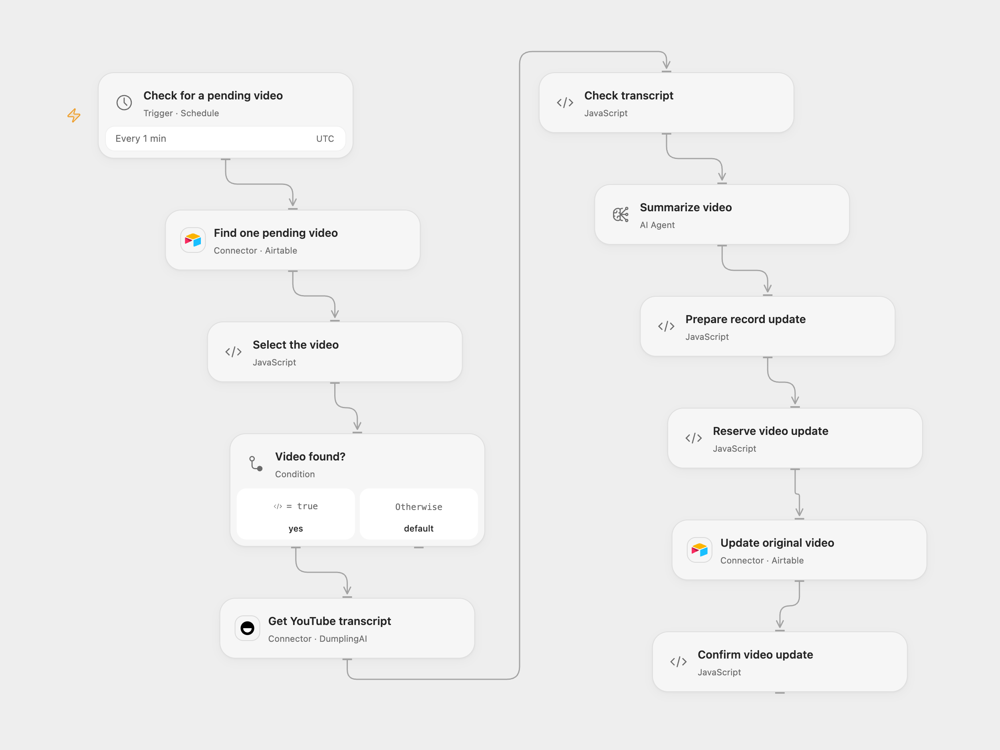

# Summarize YouTube Videos in Airtable

Summarize a pending YouTube video and update its Airtable record with the main idea and takeaways.

<picture>
  <source media="(prefers-color-scheme: dark)" srcset="preview-dark.png">
  
</picture>

[Open Flow JSON](templates/summarize-youtube-videos-in-airtable.openflow.json) · [n8n JSON](templates/summarize-youtube-videos-in-airtable.n8n.json)

## Setup

Connect Airtable to both nodes and select the same base and table. Create a Source URL field, a Type single-select field with Youtube Video, a Status checkbox, and Main Idea and Takeaways text fields. Connect DumplingAI, grant Provider API Request permission, and select an AI model. In n8n configure Airtable, DumplingAI header authentication and the model. Use one format at a time.

## Behavior

Every minute in UTC, the workflow selects at most one unchecked Youtube Video record. It requests its transcript, summarizes it and updates that same record with the main idea, newline-separated takeaways and checked Status. No match causes no update. Videos need an available transcript; errors stop processing and leave the record unchecked. Check the record before retrying an uncertain update. A pending update checkpoint blocks a later attempt for the same record. Check Airtable after an uncertain update, then clear its checkpoint only after deciding whether to retry. Create an n8n Data Table with item_key and status text fields, and configure it on the checkpoint nodes. Avoid overlapping runs. Transcripts must fit model and execution limits, and are sent to the model provider.

Inspiration &amp; credits

## Changes to the source

- Use DumplingAI’s documented transcript endpoint and validate its response and the summary.
- Use an explicit UTC schedule, write takeaways as text, and remove example Airtable identifiers.

Adapted from [YouTube to Airtable](https://github.com/Zie619/n8n-workflows/blob/ae8cf6dc5b873cbb4f74587aa9180ed3a9f70682/workflows/Code/1109_Code_Schedule_Automation_Scheduled.json) in [Zie619/n8n-workflows](https://github.com/Zie619/n8n-workflows). The [n8n listing](https://n8n.io/workflows/3609-summarize-youtube-videos-into-structured-content-ideas-with-ai-and-airtable/) credits Batu Öztürk. Attribution: Batu Öztürk (original workflow); Zie619 (collection).

The collection’s [MIT notice](https://github.com/Zie619/n8n-workflows/blob/94007c1445d9258a7da116646b79473e7c7c3282/LICENSE) is pinned at a later revision. This is the collection notice at that revision; it does not establish a separate original template author's license. Our changes are listed above; see [repository licensing](../../README.md#licensing).

> MIT License
>
> Copyright (c) 2025 Zie619
>
> Permission is hereby granted, free of charge, to any person obtaining a copy
> of this software and associated documentation files (the "Software"), to deal
> in the Software without restriction, including without limitation the rights
> to use, copy, modify, merge, publish, distribute, sublicense, and/or sell
> copies of the Software, and to permit persons to whom the Software is
> furnished to do so, subject to the following conditions:
>
> The above copyright notice and this permission notice shall be included in all
> copies or substantial portions of the Software.
>
> THE SOFTWARE IS PROVIDED "AS IS", WITHOUT WARRANTY OF ANY KIND, EXPRESS OR
> IMPLIED, INCLUDING BUT NOT LIMITED TO THE WARRANTIES OF MERCHANTABILITY,
> FITNESS FOR A PARTICULAR PURPOSE AND NONINFRINGEMENT. IN NO EVENT SHALL THE
> AUTHORS OR COPYRIGHT HOLDERS BE LIABLE FOR ANY CLAIM, DAMAGES OR OTHER
> LIABILITY, WHETHER IN AN ACTION OF CONTRACT, TORT OR OTHERWISE, ARISING FROM,
> OUT OF OR IN CONNECTION WITH THE SOFTWARE OR THE USE OR OTHER DEALINGS IN THE
> SOFTWARE.

