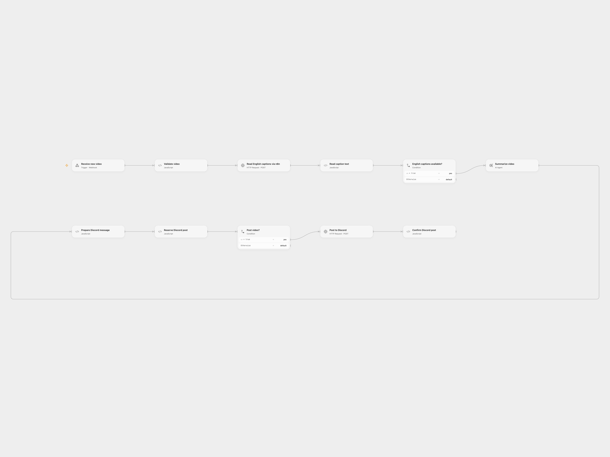

# Summarize YouTube Videos on Discord

Summarize a channel’s new video captions and post the video to Discord.

<picture>
  <source media="(prefers-color-scheme: dark)" srcset="preview-dark.png">
  
</picture>

[Open Flow JSON](templates/summarize-youtube-videos-on-discord.openflow.json) · [n8n JSON](templates/summarize-youtube-videos-on-discord.n8n.json)

## Setup

Import n8n and set the RSS feed channel ID. Configure YouTube OAuth with the owner of that channel; caption download requires appropriate access. For Open Flow, enable the alternate RSS frontend and authenticated caption relay, set their URLs and matching N8N_CAPTION_RELAY_TOKEN, configure the model and persistent State, and bind the Post to Discord URL input to a secret variable DISCORD_WEBHOOK_URL including ?wait=true so Discord returns a message ID. In direct n8n mode configure the original RSS, YouTube OAuth, model, Discord webhook and a Data Table with item_key and status text columns. Use one mode and avoid overlapping runs.

## Behavior

Every minute, the RSS feed checks for new channel videos. The first English caption track is downloaded and converted to text, summarized in three bullets and posted with that video’s title and link. Videos without an English track produce no post. Transcripts are sent to the model. Verify generated summaries.

If a Discord post has an unknown result, inspect Discord and resolve the pending State or Data Table record before retrying.

Inspiration &amp; credits

Adapted from [Share YouTube Videos with AI Summaries on Discord](https://github.com/enescingoz/awesome-n8n-templates/blob/827110332c21cbe000ab13f6d292d5adb1f1f8db/Discord/Share%20YouTube%20Videos%20with%20AI%20Summaries%20on%20Discord.json) in [enescingoz/awesome-n8n-templates](https://github.com/enescingoz/awesome-n8n-templates).

Source collection notice: © 2024–2026 Enes Cingoz, [CC BY 4.0](https://github.com/enescingoz/awesome-n8n-templates/blob/827110332c21cbe000ab13f6d292d5adb1f1f8db/LICENSE). The source export does not identify a separate template author or license. See [repository licensing](../../README.md#licensing) for the scope of OOMOL contributions and third-party material.

