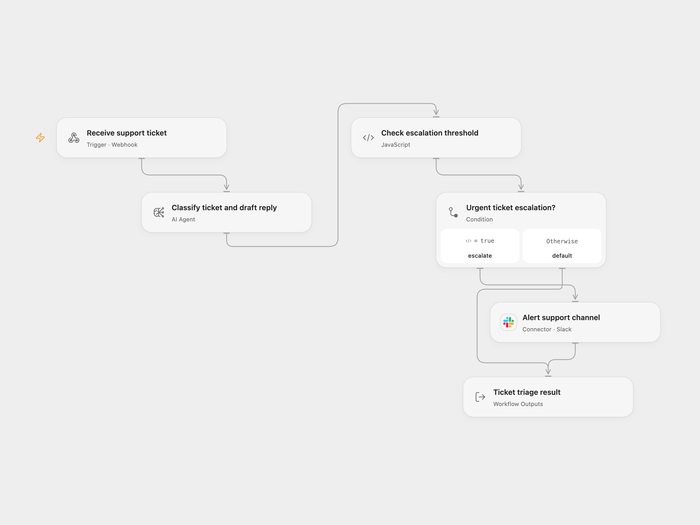

# Support Ticket Triage & Draft Reply

Classify incoming support tickets by category and urgency, draft a customer reply, and escalate urgent cases to Slack.

<picture>
  <source media="(prefers-color-scheme: dark)" srcset="preview-dark.png">
  
</picture>

## Requirements

- Slack connection with chat:write permission for urgent escalation alerts
- Configured AI model on the Open Flow AI Agent node
- Helpdesk or form webhook posting ticketId, customerEmail, subject, body, and planTier

## Setup

1. Import `templates/support-ticket-triage-draft.openflow.json` into Open Flow.
2. Replace any placeholder values (such as `YOUR_SLACK_CHANNEL_ID` or `YOUR_GATEWAY_MODEL_ID`) with your own configuration.
3. Connect your required integrations (for example, Slack) and run or activate the workflow trigger.
