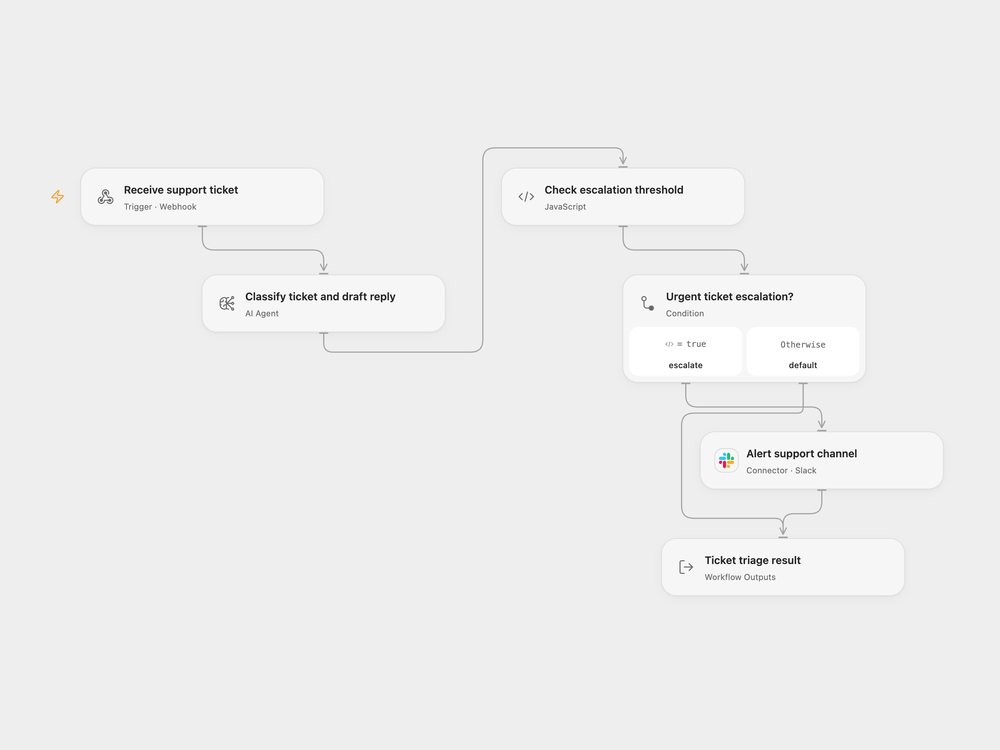

# サポートチケットのトリアージと返信下書き

受信したサポートチケットをカテゴリと緊急度で分類し、顧客への返信を下書きして、緊急案件を Slack にエスカレーションします。

<picture>
  <source media="(prefers-color-scheme: dark)" srcset="../../preview-dark.png">
  
</picture>

## 前提条件

- 緊急エスカレーション通知用に chat:write 権限を持つ Slack 接続
- Open Flow AI Agent ノードに設定済みの AI モデル
- ticketId、customerEmail、subject、body、planTier を送信するヘルプデスクまたはフォームの Webhook

## セットアップ

1. `templates/support-ticket-triage-draft.openflow.json` を Open Flow にインポートします。
2. プレースホルダー値（`YOUR_SLACK_CHANNEL_ID` や `YOUR_GATEWAY_MODEL_ID` など）をご自身の設定に置き換えます。
3. 必要な連携（Slack など）を接続し、ワークフローのトリガーを実行または有効化します。
