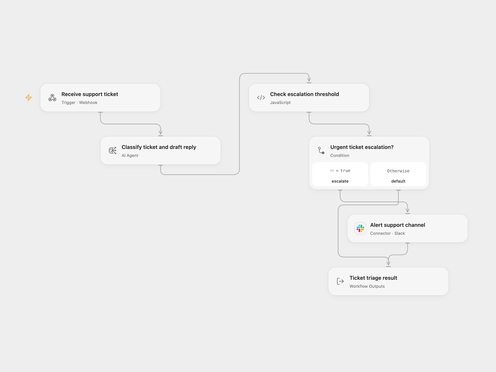

# 支持工单分诊与回复草稿

按类别和紧急程度对收到的支持工单分类，起草客户回复，并将紧急工单升级到 Slack。

<picture>
  <source media="(prefers-color-scheme: dark)" srcset="../../preview-dark.png">
  
</picture>

## 前提条件

- 具有 chat:write 权限、用于发送紧急升级提醒的 Slack 连接
- 已在 Open Flow AI Agent 节点上配置 AI 模型
- 由帮助台或表单 Webhook 发送 ticketId、customerEmail、subject、body 和 planTier

## 配置步骤

1. 将 `templates/support-ticket-triage-draft.openflow.json` 导入 Open Flow。
2. 将占位值（如 `YOUR_SLACK_CHANNEL_ID` 或 `YOUR_GATEWAY_MODEL_ID`）替换为你自己的配置。
3. 连接所需的集成（例如 Slack），然后运行或启用工作流触发器。
