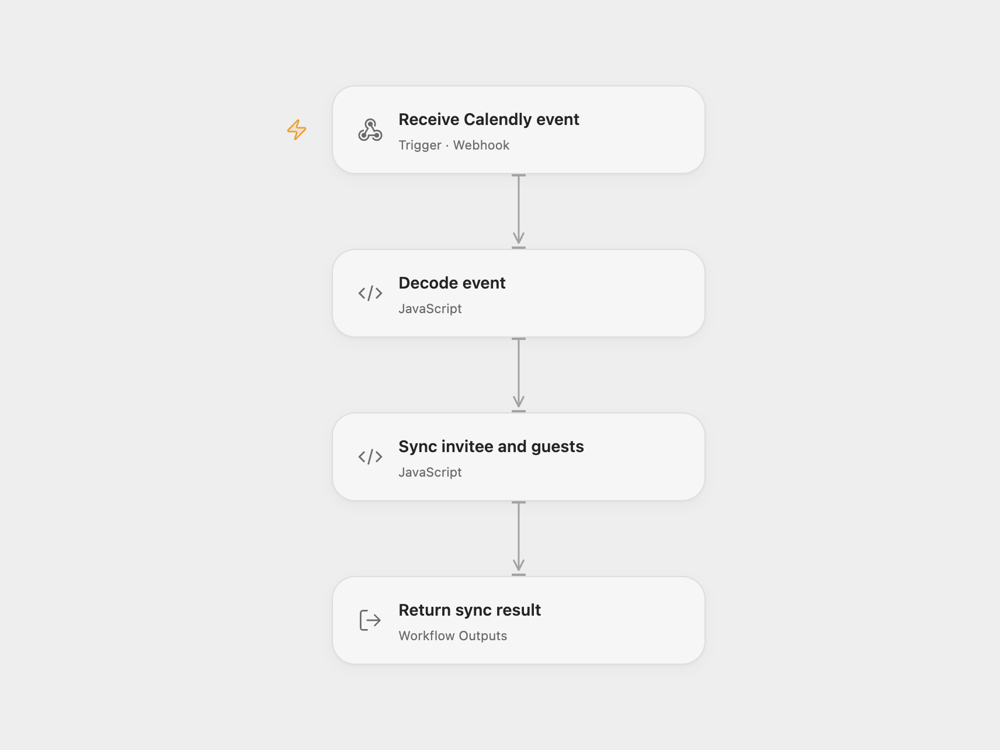

# Sync Calendly Bookings to KlickTipp

Sync invitees and guests to KlickTipp when a Calendly event is booked or canceled.

<picture>
  <source media="(prefers-color-scheme: dark)" srcset="preview-dark.png">
  
</picture>

[Open Flow JSON](templates/sync-calendly-bookings-to-klicktipp.openflow.json) · [n8n JSON](templates/sync-calendly-bookings-to-klicktipp.n8n.json)

## Setup and use

Configure the Calendly Trigger and KlickTipp community node in n8n. Set the opt-in process, booking and cancellation tags, and custom fields on each KlickTipp node. Activate the workflow to register Calendly booking and cancellation webhooks. For Open Flow, bind the secret Variables KLICKTIPP_USERNAME and KLICKTIPP_PASSWORD, configure the IDs and field names in **Sync invitee and guests**, and enable **Forward to Open Flow** in n8n. Disconnect **New Calendly event** from **Convert data for KlickTipp** when using the relay; reconnect it and disable the relay when using n8n directly. Replace YOUR_FIELD214142_ID in the cancellation expressions with the configured guest field ID. Configure matching custom field types in KlickTipp; the guests field stores a JSON array.

## Behavior

On booking, the workflow writes the invitee's appointment fields and guest addresses, then updates each guest. On cancellation it reads the saved addresses, applies the cancellation tag to the invitee and guests, and clears the guest list unless the booking was rescheduled. The Calendly trigger does not verify webhook signatures; restrict endpoint access. Each Open Flow HTTP request must receive its complete response within 30 seconds. Event and contact details may appear in execution history. A failed or unknown write may have already changed contacts; inspect KlickTipp before retrying.

Inspiration &amp; credits

## Changes to the source

- Add an optional n8n relay and replace account-specific identifiers with placeholders. Store guest addresses as JSON, handle missing guests and reminder numbers, map guest rescheduling to the reschedule URL, and use the local date fields for the invitee.

Adapted from [Calendly bookings to KlickTipp](https://github.com/Zie619/n8n-workflows/blob/ae8cf6dc5b873cbb4f74587aa9180ed3a9f70682/workflows/Calendly/0660_Calendly_Noop_Create_Triggered.json) in [Zie619/n8n-workflows](https://github.com/Zie619/n8n-workflows). The [original n8n template](https://n8n.io/workflows/2620-calendly-to-klicktipp-integration/) credits KlickTipp as its author. The source export does not identify a separate template license.

The collection’s [MIT notice](https://github.com/Zie619/n8n-workflows/blob/94007c1445d9258a7da116646b79473e7c7c3282/LICENSE) is pinned at a later revision. This is the collection notice at that revision; it does not establish a separate original template author's license. Our changes are listed above; see [repository licensing](../../README.md#licensing).

> MIT License
>
> Copyright (c) 2025 Zie619
>
> Permission is hereby granted, free of charge, to any person obtaining a copy
> of this software and associated documentation files (the "Software"), to deal
> in the Software without restriction, including without limitation the rights
> to use, copy, modify, merge, publish, distribute, sublicense, and/or sell
> copies of the Software, and to permit persons to whom the Software is
> furnished to do so, subject to the following conditions:
>
> The above copyright notice and this permission notice shall be included in all
> copies or substantial portions of the Software.
>
> THE SOFTWARE IS PROVIDED "AS IS", WITHOUT WARRANTY OF ANY KIND, EXPRESS OR
> IMPLIED, INCLUDING BUT NOT LIMITED TO THE WARRANTIES OF MERCHANTABILITY,
> FITNESS FOR A PARTICULAR PURPOSE AND NONINFRINGEMENT. IN NO EVENT SHALL THE
> AUTHORS OR COPYRIGHT HOLDERS BE LIABLE FOR ANY CLAIM, DAMAGES OR OTHER
> LIABILITY, WHETHER IN AN ACTION OF CONTRACT, TORT OR OTHERWISE, ARISING FROM,
> OUT OF OR IN CONNECTION WITH THE SOFTWARE OR THE USE OR OTHER DEALINGS IN THE
> SOFTWARE.

