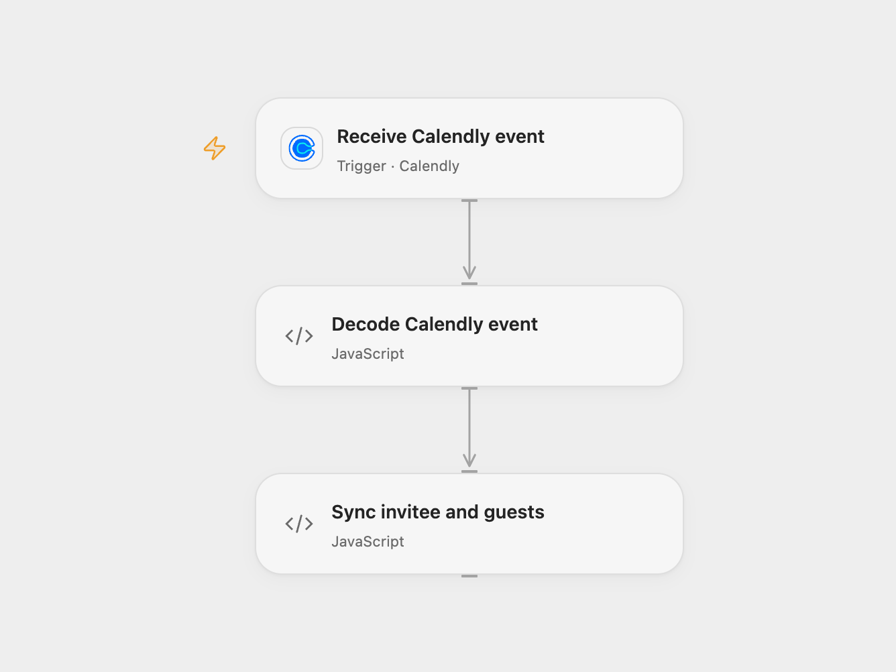

# Sync Calendly Guests with KlickTipp

Synchronize Calendly invitees and guests with KlickTipp on bookings and cancellations.

<!-- template-actions:start -->
 
<!-- template-actions:end -->

<picture>
  <source media="(prefers-color-scheme: dark)" srcset="preview-dark.png">
  
</picture>

## Setup

Create the KlickTipp list, booking and cancellation tags and custom fields. Set their IDs in **Sync invitee and guests**, then bind secret Variables KLICKTIPP_USERNAME and KLICKTIPP_PASSWORD. Enable persistent State and prevent overlapping executions. In n8n connect Calendly and KlickTipp, configure each list, tag and field, and select the same Data Table on checkpoint nodes with text columns item_key and status. For Open Flow enable **Forward to Open Flow**, set its URL, and disconnect **Event not processed** from the Calendly trigger. Use one format.

## Behavior

A booking updates the invitee and each guest, saving the guest addresses on the invitee. A cancellation reads those saved addresses, updates the invitee and guests, and clears the guest field unless the meeting was rescheduled. Protect webhook access and execution history containing contact details.

For an unknown write, inspect the matching subscriber before replay. In **Sync invitee and guests** enter the pending key and set resolution to confirmed or absent. When confirming a cancellation invitee write, enter the saved guest addresses as a JSON array. Re-send the same event after resolving it and clear those fields. In n8n inspect all affected subscribers and the pending Data Table row; complete any remaining writes manually and mark the row done, or delete the row only when no write occurred.

Inspiration &amp; credits

Added a Calendly relay and checkpoints for writes.

Adapted from [Calendly booking and cancellation to KlickTipp](https://github.com/Zie619/n8n-workflows/blob/ae8cf6dc5b873cbb4f74587aa9180ed3a9f70682/workflows/Calendly/0661_Calendly_Noop_Create_Triggered.json) in [Zie619/n8n-workflows](https://github.com/Zie619/n8n-workflows). The source export does not identify a separate template author or license.

The collection’s [MIT notice](https://github.com/Zie619/n8n-workflows/blob/94007c1445d9258a7da116646b79473e7c7c3282/LICENSE) is pinned at a later revision. This is the collection notice at that revision; it does not establish a separate original template author's license. Our changes are listed above; see [repository licensing](../../README.md#licensing).

> MIT License
>
> Copyright (c) 2025 Zie619
>
> Permission is hereby granted, free of charge, to any person obtaining a copy
> of this software and associated documentation files (the "Software"), to deal
> in the Software without restriction, including without limitation the rights
> to use, copy, modify, merge, publish, distribute, sublicense, and/or sell
> copies of the Software, and to permit persons to whom the Software is
> furnished to do so, subject to the following conditions:
>
> The above copyright notice and this permission notice shall be included in all
> copies or substantial portions of the Software.
>
> THE SOFTWARE IS PROVIDED "AS IS", WITHOUT WARRANTY OF ANY KIND, EXPRESS OR
> IMPLIED, INCLUDING BUT NOT LIMITED TO THE WARRANTIES OF MERCHANTABILITY,
> FITNESS FOR A PARTICULAR PURPOSE AND NONINFRINGEMENT. IN NO EVENT SHALL THE
> AUTHORS OR COPYRIGHT HOLDERS BE LIABLE FOR ANY CLAIM, DAMAGES OR OTHER
> LIABILITY, WHETHER IN AN ACTION OF CONTRACT, TORT OR OTHERWISE, ARISING FROM,
> OUT OF OR IN CONNECTION WITH THE SOFTWARE OR THE USE OR OTHER DEALINGS IN THE
> SOFTWARE.

