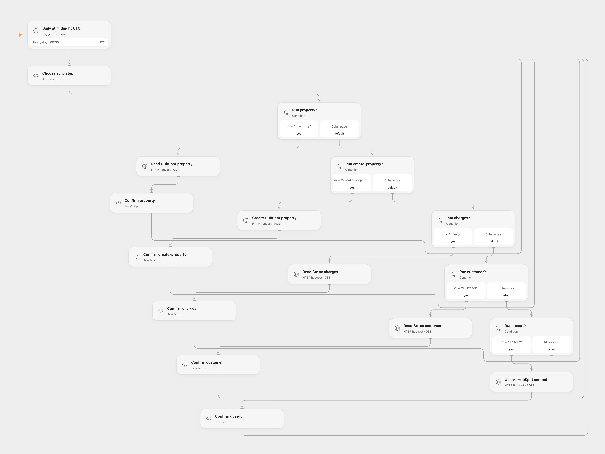

# Sync Captured Stripe Spend to HubSpot

Sum captured Stripe charges by customer email and update a HubSpot contact property.

<picture>
  <source media="(prefers-color-scheme: dark)" srcset="preview-dark.png">
  
</picture>

[Open Flow JSON](templates/sync-captured-stripe-spend-to-hubspot.openflow.json) · [n8n JSON](templates/sync-captured-stripe-spend-to-hubspot.n8n.json)

## Setup

Store a Stripe secret key as Secret Variable `STRIPE_SECRET_KEY` and a HubSpot access token as `HUBSPOT_TOKEN`. Grant charge and customer read access in Stripe and contact and property access in HubSpot. Configure the HubSpot property ID and label in **Choose sync step**. The workflow creates the numeric property if missing; set **checkProperty** to false if you maintain it separately. Enable persistent State and prevent overlapping runs.

In n8n, connect Stripe and HubSpot and configure the property in **Configure**. Run one format. The schedule uses UTC.

## Behavior

Each day, read all charges, ignore those without a customer, fetch each distinct customer, sum `amount_captured` by email, divide by 100, and create or update the matching HubSpot contact. As in the source, amounts are added without currency conversion and divided by 100; use this only when that calculation matches your Stripe currencies. Customers without an email cannot be matched.

If a HubSpot write has an unknown result, inspect HubSpot before entering its pending key in **Choose sync step**. Acknowledgement treats the write as completed.

Inspiration &amp; credits

## Changes to the source

- Use explicit UTC and pause on uncertain Open Flow writes.
- Stop the n8n run when the property lookup fails for a reason other than a missing property.

Adapted from [Sync Stripe charges to HubSpot contacts](https://github.com/Zie619/n8n-workflows/blob/ae8cf6dc5b873cbb4f74587aa9180ed3a9f70682/workflows/Code/0288_Code_Schedule_Create_Webhook.json) in [Zie619/n8n-workflows](https://github.com/Zie619/n8n-workflows). The source export does not identify a separate template author or license.

The collection’s [MIT notice](https://github.com/Zie619/n8n-workflows/blob/94007c1445d9258a7da116646b79473e7c7c3282/LICENSE) is pinned at a later revision. This is the collection notice at that revision; it does not establish a separate original template author's license. Our changes are listed above; see [repository licensing](../../README.md#licensing).

> MIT License
>
> Copyright (c) 2025 Zie619
>
> Permission is hereby granted, free of charge, to any person obtaining a copy
> of this software and associated documentation files (the "Software"), to deal
> in the Software without restriction, including without limitation the rights
> to use, copy, modify, merge, publish, distribute, sublicense, and/or sell
> copies of the Software, and to permit persons to whom the Software is
> furnished to do so, subject to the following conditions:
>
> The above copyright notice and this permission notice shall be included in all
> copies or substantial portions of the Software.
>
> THE SOFTWARE IS PROVIDED "AS IS", WITHOUT WARRANTY OF ANY KIND, EXPRESS OR
> IMPLIED, INCLUDING BUT NOT LIMITED TO THE WARRANTIES OF MERCHANTABILITY,
> FITNESS FOR A PARTICULAR PURPOSE AND NONINFRINGEMENT. IN NO EVENT SHALL THE
> AUTHORS OR COPYRIGHT HOLDERS BE LIABLE FOR ANY CLAIM, DAMAGES OR OTHER
> LIABILITY, WHETHER IN AN ACTION OF CONTRACT, TORT OR OTHERWISE, ARISING FROM,
> OUT OF OR IN CONNECTION WITH THE SOFTWARE OR THE USE OR OTHER DEALINGS IN THE
> SOFTWARE.

